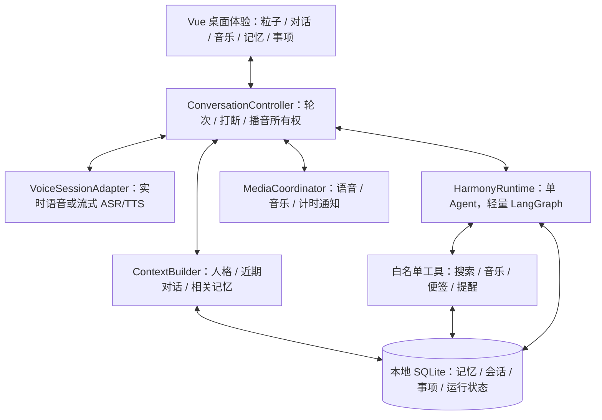

#  Seamo-AI 语音助手：harness 陪伴型 Agent 产品方案

- 版本：v2 产品方案 / 讨论稿 v0.1
- 日期：2026-10-10
- 状态：供产品评审，尚未进入产品代码实施。
- 适用范围：macOS、中文优先、单用户内部使用；现有工程名 `lingli/lingmo` 暂不改名。
- 名称约定：本文将 Harmony 作为陪伴型 Agent 的方案代号，不指代某个同名第三方框架。
- 证据范围：现有仓库只读检查、用户历史反馈、官方仓库与文档调研。尚未安装或运行外部开源项目，尚未验证新增云服务账号权限。

## 1. 产品主张

**一个能自然交谈、记得你的生活背景，并把日常小事认真办好的桌面 AI 伙伴。**

陪伴是主体验，工作与生活协助是陪伴中自然发生的行动。用户可以倾诉、随口问事、一起听歌，也可以让它记下想法、安排提醒、查资料、把混乱的事情理清楚。

用户应该逐渐产生的判断是：“和它交流不费劲，它记得重要的事，答应做的小事靠得住。”

### 1.1 用户与价值假设

首批用户是项目使用者本人及少量受邀内部体验者，主要在个人 Mac 上工作和生活。暂不推导大众市场规模，也不假设已验证商业需求。

| 用户情境 | 实际需求 | 应交付的价值 |
| --- | --- | --- |
| 工作结束，有情绪想说 | 被认真听到，不立刻收到一套建议 | 自然对话、适度追问、允许沉默 |
| 隔天继续聊之前的事 | 不想重新解释自己 | 有来源的跨会话记忆 |
| 想知道最近的信息 | 不想自己打开一串网页 | 查证后的简明答案和可查看的来源 |
| 一边做事一边想到小事 | 不想切换应用记录 | 便签、待办、提醒，保存结果明确 |
| 想工作、休息或听歌 | 需要适合当下的陪伴节奏 | 可调整的播放队列、专注计时、低打扰 |
| 对一个工作问题没思路 | 需要有人帮着梳理 | 几个清楚的要点、下一步或一份短草稿 |

### 1.2 首版目标

1. 对话的自然度与可靠性优先于功能数量，尤其解决等待过长、播音断续、不能插话的问题。
2. 实现一次真正的“记住、再想起、可更正、可忘记”。
3. 完成联网问答、提醒、便签、音乐这几类高频小事，形成工具调用的完整闭环。
4. 统一人格、声音、视觉和行为；不同能力背后仍然是同一个伙伴。
5. 保留可扩展模块，但首版只运行一个面向用户的 Agent。

### 1.3 本轮不纳入首版

通用电脑自动操作、终端执行、编程 Agent、自动发邮件、自动购买、多 Agent 团队、插件市场、云端全天候代办、多用户账号、跨设备同步，以及被动持续读取屏幕。

工作辅助限定为讨论、整理用户提供的文字、联网查证、生成短文本，不追求自动完成复杂职业工作。情感陪伴不承诺心理治疗或诊断。

## 2. 现有版本与重构理由

以下为本次在仓库中确认的事实，不是对运行中应用的完整测试结论。

| 现状证据 | 对产品的影响 | 本次处理方向 |
| --- | --- | --- |
| `electron/main/ipc/chatHandlers.ts` 用内存数组保留最多 40 条消息 | 重启后无法延续长期背景；消息列表不等于记忆 | 分离会话历史、长期记忆、提醒与便签 |
| `electron/main/providers/llmProvider.ts` 的纯文本解析会提取 `《...》` 为点歌意图 | 提到书名等内容也可能触发不应有的动作 | 自然文本与结构化工具调用分开 |
| `src/App.vue` 中 `finishVoiceCapture` 等完整 LLM 结果后才调用整段播音 | 文本生成、合成、播放存在串行等待 | 重新验证实时语音路线，保留可控的流式备选 |
| `getAutoListenBlockers` 将助手说话、音乐视图作为阻塞条件 | 听歌时交流、说话时打断难以自然成立 | 独立管理音频、对话轮次和视图状态 |
| `App.vue` 承担大量跨模块时序协调 | 改语音容易影响音乐、UI 和状态 | 将会话控制与服务编排移入独立模块 |
| 已有 GD Studio provider、音乐收藏和搜索历史 | 播放能力已有可复用基础 | 验证后复用，不从头重写播放器 |

用户此前的一次历史日志显示停说到出声约 8.36 秒，其中请求 LLM 到首个原始文本约 5.23 秒，整段 TTS 返回约 2.58 秒。这只能说明当时样本中的瓶颈，不能当作当前模型或新架构的性能结论。引入框架本身不会消除模型推理和网络耗时。

## 3. 开源调研与方案选择

这里的“通用 Agent”指能保持状态、调用工具并完成一定范围任务的软件。公开源码、演示丰富或自称 AGI，均不等于经过验证的通用人工智能。

### 3.1 值得参考的项目

| 项目 | 官方资料确认的方向 | 对本项目的价值与取舍 |
| --- | --- | --- |
| [AIRI](https://github.com/moeru-ai/airi) | 桌面/网页陪伴、实时语音、角色表现；采用 Vue/TypeScript 等技术；README 仍将部分记忆能力列为进行中 | 最接近体验方向，优先研究对话、音频、角色模块的边界；保留我们的粒子主体，不整体迁入角色、游戏和插件系统 |
| [Open-LLM-VTuber](https://github.com/Open-LLM-VTuber/Open-LLM-VTuber) | 免按键语音、打断、Live2D；仓库公告正在讨论与规划 v2 重写 | 借鉴打断和会话机制；不依赖尚未发布的重构。其[发布说明](https://github.com/Open-LLM-VTuber/Open-LLM-VTuber/releases)说明了前后端许可差异，直接复用前须核对具体版本 |
| [Letta](https://github.com/letta-ai/letta) | 有状态 Agent 与长期记忆；当前入口将活跃实现指向 `letta-code` | 借鉴身份、记忆、会话的分层；首版不引入另一套完整 Agent 服务。旧 V1 教程与当前实现不能混用 |
| [LangChain JS](https://docs.langchain.com/oss/javascript/langchain/overview) / [LangGraph](https://docs.langchain.com/oss/javascript/langgraph/overview) | 工具调用 Agent；持久状态、流式输出和可恢复执行 | 推荐作为轻量工具编排基础，与现有 TypeScript 工程相容；选用一个有边界的流程，不为每句话建立复杂计划 |
| [Deep Agents](https://docs.langchain.com/oss/javascript/deepagents/overview) | 包含上下文、文件系统和子任务等 Harness 能力 | 可作后续参考；首版没有需要它解决的长任务与文件执行规模 |
| [LiveKit Agents](https://docs.livekit.io/agents/) | Python/Node.js 实时语音框架，媒体管线、会话与中断相关能力 | 若需要 WebRTC、多端和独立语音服务，是候选；单机内部版暂不引入房间与媒体服务部署 |
| [Pipecat](https://github.com/pipecat-ai/pipecat) | Python 实时语音/多模态框架，可组合语音处理管线 | 适合语音服务化；当前单机 TypeScript 应用引入 Python 常驻服务需要额外打包与维护，首版先借鉴而非并列集成 |

以上是资料层面的适配判断，不是对这些项目的性能排名。没有以 stars 或宣传中的时延作为选型依据；也没有实际验证它们对当前火山账号和音色的即插即用兼容性。

### 3.2 三种重构路径

| 路径 | 优点 | 代价 | 建议 |
| --- | --- | --- | --- |
| 整体 Fork 陪伴项目 | 现成语音与角色示例较丰富 | 要迁移 UI、音乐、配置，承接大量无关模块 | 适合作实验样机，不作默认主路线 |
| **保留桌面体验，重建陪伴内核** | 能复用已有投入，功能边界由我们的产品决定 | 需认真完成语音适配、记忆和工具契约 | **推荐** |
| 部署通用 Agent/多 Agent 平台，再加语音壳 | 扩展面大 | 执行、服务部署和运维超出内部陪伴需求 | 暂不采用 |

推荐组合：Electron + Vue + 原粒子球；本地会话控制、SQLite 记忆、白名单工具；轻量 LangGraph TypeScript 执行流程。实时语音优先做火山端到端验证，传统流式管线作替代路线。无需同时引入 Letta、Deep Agents、LiveKit 和 Pipecat。

## 4. 六个核心使用场景

### 场景 A：回到桌前聊一会儿

用户：“今天开会真的很烦。”

助手先回应这一件具体的事，例如：“听起来那场会挺消耗你的。是讨论没结果，还是有人让你不舒服？”若用户只是想说，不继续列建议；若说“帮我想想怎么处理”，再一起梳理。它不通过语音或表情直接下心理诊断，也不机械地每轮追问。

### 场景 B：隔天接着聊

用户：“昨天那个方案，我还是拿不准。”

助手检索相关事件，例如：“你说的是昨天聊到的首页改版，还是音乐推荐的方案？”唯一匹配时直接接续；没有记录时明确没有找到，不编造共同经历。更正为“不是那个”后修正当前检索，不让旧答案主导后续对话。

### 场景 C：生活中的联网问答

用户：“这个周末杭州有什么适合一个人逛的展？”

根据用户明确给出的城市与日期联网，核对开放时间，口头给两三个选择，界面保留来源与查询时间。预约、购买不在首版范围；信息不完整时说明未确认。搜索失败保留已输入的问题，提供重试。

### 场景 D：随口记事

用户：“明天晚上八点提醒我给妈妈打电话。”

保存带时区和实际日期的提醒后，再说“记好了，明天晚上八点提醒你”。界面有可编辑的提醒条目。接着说“改成九点”修改同一条；“算了，取消”删除对应提醒，不新建重复项。

### 场景 E：一起专注和听歌

用户：“陪我专注二十五分钟，放点没有人声的音乐。”

创建专注计时与音乐请求，选出可播放队列；不能确认无人声时不保证筛选绝对准确。用户可以说“这首太吵”“音量小一点”。开口时音乐降低音量，结束后恢复；用户主动暂停的音乐不会被自动恢复。

### 场景 F：把工作想法理清楚

用户：“我现在不知道先做哪个功能。”

助手结合用户提供的目标讨论取舍，必要时只问一个关键问题；形成三项优先事项。用户说“记下来”，才保存为便签或待办。需要事实支持时查资料；它不会声称已经替用户修改产品、发布内容或完成无法执行的工作。

## 5. 完整功能清单与版本边界

R1 是首个内部可用版本，所有列入 R1 的功能必须有真实服务和验收结果。R2 是扩展方向，不能在 R1 界面假装可用。开发顺序不等于删减验收范围。

| ID / 阶段 | 功能 | 首版范围与实现方式 | 验收证据 |
| --- | --- | --- | --- |
| F01 / R1 | 自然语音与文字 | 开始/结束语音会话、免按键交流、Space 兜底、文字输入、实时字幕；统一轮次状态 | 连续 20 轮可说、可停、可恢复，文字与声音对应同一轮 |
| F02 / R1 | 人格与自然回应 | 名称、称呼、语气、长短偏好、当前音色；人格配置独立于工具规则 | 改为 Alex 后新会话与开场白一致；不再自称默认项目名 |
| F03 / R1 | 打断与纠正 | 停止当前语音、取消旧输出、接收补充；按实际播放量记录助手已说部分 | 连续插话测试没有双重播音、旧回复复活或丢失新问题 |
| F04 / R1 | 长期记忆 | 个人偏好、显式记住事项、近期事件；本地保存，检索、更正、删除、暂停记忆 | 重启后正确回忆；删改后下一轮与重启后都生效 |
| F05 / R1 | 联网问答 | 搜索、读取有限网页、保留来源与日期、围绕结果追问 | 每项时效性事实能追溯；无结果/超时不编造来源 |
| F06 / R1 | 便签与待办 | 新建、查询、编辑、删除、完成；内容可导出为文本/Markdown | 工具回执与持久化数据一致，取消后不误保存 |
| F07 / R1 | 提醒与专注计时 | 一次性提醒、修改、取消、到期通知、应用恢复后的过期处理 | 重复事件不重复通知；系统休眠与应用退出行为符合第 10 节 |
| F08 / R1 | 音乐陪伴 | 搜索、音源、队列、播放控制、收藏、反馈、封面、同步歌词与原粒子形象 | 切歌后所有资源属于同一 trackKey；空 URL/无歌词可恢复 |
| F09 / R1 | 轻工作协助 | 讨论思路、整理粘贴文本、改写短文、生成简短计划并存为便签 | 产物可编辑；没有未经要求的外部操作 |
| F10 / R1 | 有边界的主动性 | 到期提醒、用户明确约定的回访、恢复未完成对话的轻提示 | 勿扰生效；“先别问了”后不反复主动追问 |
| F11 / R1 | 全界面与设置 | 陪伴首页、音乐、记忆、事项、设置；麦克风/网络/服务状态可理解 | 无假开关、死按钮；错误后能恢复，键盘可操作 |
| F12 / R2 | 更多上下文 | 用户主动选取的文档、截图、日历只读接入 | 单独确定资料范围与权限后验收 |
| F13 / R2 | 更主动的生活协助 | 周期提醒、定期简报、用户委托的持续关注 | 有持久调度、停止机制与适当通知频率 |
| F14 / R2 | 更多设备与工具 | 可选云同步、经审核的连接器、其他模型与音色 | 每一项单独评估，不默认常驻多个服务 |

## 6. “像真人交流”的可执行规范

目标是自然、体贴、有连续性的交互；产品身份始终是 AI。人格可以温暖、有幽默感和自己的表达偏好，但不能假装有真实人类经历或要求用户建立排他关系。

| 维度 | 设计规则 | 反例 / 测试 |
| --- | --- | --- |
| 倾听 | 先回应用户刚说的具体内容，再判断是否需要建议 | 倾诉后立刻输出“第一、第二、第三”须减分 |
| 长短 | 普通回应通常 1–3 句，复杂内容先给要点，用户可要求展开 | 不固定凑字数，不将长网页全文播给用户 |
| 追问 | 只问影响理解或执行的关键缺项；一轮通常一个问题 | 不每轮结尾强行提问，不重复已知条件 |
| 情绪 | 允许“听起来有些累”这种可修正理解；不作确定诊断 | 不把用户一次难过永久记录成性格 |
| 沉默 | 用户停顿时留出续说空间，不不断填充“嗯、我在” | 噪声和短暂思考不连续触发回复 |
| 记忆 | 只在相关时自然提起，不反复展示“我知道你的一切” | 不把检索不到的内容说成共同回忆 |
| 观点 | 有理由时提出不同看法，语气温和，允许用户纠正 | 不一味附和，也不指挥用户生活 |
| 行动 | 进行中可以说明正在处理；成功表述必须依据回执 | 搜索失败不能说查到了；存储失败不能说记好了 |
| 主动 | 由已授权的时间、事项或明确上下文触发 | 不因用户很久没打开而责备、催促或制造依赖 |
| 音色 | 稳定、一致、可试听；情感表达以所选服务真实能力为限 | 不依赖固定笑声、哭腔、降速营造“真人感” |

系统提示词拆成稳定身份、对话风格、记忆引用规则、工具行为规则四部分。用户编辑角色提示词不能覆盖工具权限、完成条件和数据处理规则。关键规则在程序中校验，不仅写进 prompt。

## 7. 页面与交互重构

### 7.1 信息架构

首页以粒子球与对话为主，音乐有独立沉浸视图；“记忆”“事项”“设置”从稳定的辅助入口打开。没有默认展开的任务指挥面板，也不在首页同时展示所有功能。

| 界面 | 主要内容 | 交互与视觉原则 |
| --- | --- | --- |
| 陪伴首页 | 原粒子球、当前回应、语音/文字入口、可展开历史 | 保留视觉主体；文本可读，麦克风状态明确；长答案进入阅读区域 |
| 音乐视图 | 球体、动态歌词、小封面、曲名/歌手、播放控制、搜索 | 歌词无信息卡外框；上下文渐隐；搜索结果仅搜索后展开；歌手在歌名下方 |
| 记忆页 | 关于你、重要的事、偏好、来源与时间 | 直接编辑、删除；暂停记忆和临时对话易找到；不用亲密度数值 |
| 事项页 | 提醒、待办、便签和专注计时 | 轻量列表；状态真实；一键更改或取消，不做复杂项目管理 |
| 设置页 | 名称/人设、音色试听、输入输出设备、自动倾听、勿扰、服务与数据 | 个人化与服务配置分组；未配置能力明确显示，不留假可用状态 |
| 首次启动 | 简短自我介绍、称呼、麦克风授权、记忆偏好 | 非阻塞默认值；拒绝麦克风仍能文字聊天；先说明云端语音处理 |

语音、媒体和任务分别显示真实状态：听、等待回应、说；音乐播放/暂停；事项处理中/完成/失败。不能仅凭播放动画让用户误以为麦克风已打开或任务已完成。

### 7.2 粒子与感知

沿用现有球体主体。待机保持低运动量；聆听响应用户音量；回应响应实际音频；音乐用平滑频段能量与节拍包络驱动内部层次。保留空间稳定性，避免球体来回摇摆和高频抖动。

动画只能表达产品状态与音频能量，不能把“猜测用户情绪”伪装成准确检测。提供减少动态效果与清晰字幕选项；窄窗口、长歌名、长回复均需专项检查。

原型阶段先覆盖：首页待机/说话/打断、音乐搜索/播放、记忆编辑、提醒确认、服务不可用。静态图只验构图，必须用交互原型验时序；原型中的模拟数据明确标注，不能作为功能验收。

## 8. 陪伴型 Harness 架构

### 8.1 总体结构

Electron 主进程承载云服务连接、Agent、工具与本地数据；渲染进程负责交互、音频采集/输出与可视化。IPC 传类型化事件，不让页面直接访问密钥。首版不额外部署服务端、向量数据库或消息队列。

### 8.2 两种会话驱动，共用同一套状态与工具

**端到端语音模式：** 实时模型负责自然对话。它发出原生工具请求时，由本地运行时校验并执行，结果按相同调用 ID 送回会话。简单暂停音乐直接走确定的工具处理；需要数步搜索整理的请求才进入轻量 Agent 子流程。不得让另一个 LLM 同时为同一句闲聊生成另一份回复。

**流式管线模式：** ASR 确认用户输入后，HarmonyRuntime 使用统一上下文执行“理解 → 必要工具 → 结果 → 回复”，文本通过连续 TTS 会话播出。键入文字也复用这一套工具和记忆；语音与文字不能各养一份人格和历史。

两种模式是可替换的会话适配器，首版只启用一条经过验收的默认路径，不每轮双模型竞跑。默认路径由第 9 节的验证决定；切换仅发生在会话边界，避免半句话换音色或重复执行。

### 8.3 运行机制

普通聊天没有强制规划节点；用户提出多个行动时保存简短步骤。内部运行状态包含 `sessionId`、`turnId`、`runId`、工具调用 ID、预算、结果、取消标记，不展示内部思维链。

建议初始执行限制：一个前台交互轮次；单个轻任务最多 4 次模型决策、6 次工具调用、30 秒前台执行预算。都是可调整的产品初值，最终以测试校准。提醒存入调度器后退出本轮，不靠 Agent 挂起等待。

只读请求允许有限重试；写入提醒、便签必须带幂等键。中断或重启后先核对已持久化副作用，再恢复或告知中断，不能重放一次完整对话制造重复提醒。

### 8.4 工具契约

| 工具组 | 主要动作 | 结果要求 |
| --- | --- | --- |
| `memory` | recall / remember / update / forget | 返回记忆 ID、来源和生效版本；显式更正优先 |
| `web` | search / readPage | 标题、URL、时间、片段/正文、是否读取成功；结果为外部资料，不作执行指令 |
| `notes` | create / list / update / complete / delete | 持久化 ID 和版本；找不到目标先澄清 |
| `reminders` | create / list / reschedule / cancel | 绝对时间、时区、状态、真实调度范围 |
| `music` | search / play / pause / resume / next / queue / favorite / feedback | 曲目身份、实际播放状态、失败原因 |
| `focus` | start / pause / resume / stop | 计时状态；可独立于音乐运行 |

工具结果统一包含 `status`、`data`、`errorCode`、`retryable` 和相关实体 ID。模型产出的是候选动作；程序负责 schema 校验、运行权限、取消检测和结果确认。MCP 可作为 R2 的接入协议，首版内置工具无需先部署 MCP 服务。

## 9. 语音方案与选型门槛

### 9.1 主选：火山端到端实时语音验证

火山官方资料已介绍端到端实时语音、会话事件及模型版本差异；新的接入说明也出现了全双工模型与标准化会话字段。该方向适合陪伴，但文档能力不等于本项目账号已经可用。[端到端接口](https://docs.volcengine.com/docs/DoubaoVoice/End-to-endreal-timespeechlargemodelAPIaccessdocument?lang=zh)、[接入必读](https://docs.volcengine.com/docs/DoubaoVoice/access-mustread?lang=zh)

G0 必须实际验证：中文自然度、用户现有音色是否可用、可配置人格、字幕与已播音频对齐、打断/取消、原生工具往返、记忆注入与删除后的会话刷新、延迟与费用。不同代际接口、RTC 混合编排与直接 WebSocket 不能混用参数。

现有 ASR/TTS 开通不代表已开通实时语音。当前 `ICL_` 音色不能仅凭命名认定兼容所有实时模型；原音色兼容是优先条件，不会静默替换为默认声音。

通过上述能力测试，端到端方案才能成为默认。如果工具调用、记忆控制或声音不能满足要求，选择下面的可控管线；不会上线一个只会闲聊却声称支持完整 Agent 的半成品。

### 9.2 备选：连续的 ASR → Agent → TTS 管线

火山双向流式 TTS 支持持续文本输入和音频输出，文档建议流式场景使用 PCM。[双向流式 TTS](https://docs.volcengine.com/docs/DoubaoVoice/WebSocketBidirectionalStreaming-V3?lang=zh)

实现采用单轮持续合成会话、自然短句或语义边界输入、连续 PCM 缓冲和 AudioWorklet 输出。不同音频分片只是同一音流的数据，不是不同播放文件。原始 PCM 不走 MP3 分片解码；按声明的采样率重采样到输出设备，处理采样帧边界。

初始缓冲建议从 120–250ms 范围实测，按到达抖动有界调整。不能用固定 1 秒以上预缓冲或持续降速掩盖供给不足；记录缓冲耗尽、分句等待与服务端音频到达间隔，分别修正。

首个自然短句尽早合成，但不按固定十五个字截断整段话。工具调用未完成之前不合成成功声明。已播内容进入会话记录，取消后清空后续音频及未播文本，避免记忆误以为用户听过完整答案。

### 9.3 插话、轮次与播放协调

用户开口时先抑制当前播音，再确认是否是真实插话；确认为语音后取消旧生成，并让后到数据因旧 `turnId` 失效。噪声导致的短暂抑制可恢复，不能把每一次音量尖峰都当作新问题。

区分“停止说话”和“取消事项”：前者默认停当前回答；明确“别查了”“取消刚才的提醒”才取消相应任务。已经提交的写操作先核对结果，无法撤回时明确告知。

输出统一由 MediaCoordinator 管理：一条助手语音、一路音乐、短通知。语音会话启用回声消除；内置扬声器、耳机和蓝牙分别测试。硬件条件下打断不稳定时保留可见的按键输入模式，不以关闭全部检测伪装全双工。

## 10. 记忆、提醒与数据

### 10.1 四类记忆

| 类别 | 示例 | 写入与有效期 |
| --- | --- | --- |
| 身份和稳定偏好 | 用户希望被怎样称呼，喜欢少一些建议 | 首次设置或明确事实；用户可更正 |
| 近期事件 | 今天准备面试，昨天讨论过某个方案 | 带日期和来源，按事件相关性逐渐降低优先级 |
| 共同讨论与结论 | 决定先验证语音，再做新 UI | 保留结论与出处，不保存模型推测为事实 |
| 当前互动状态 | 用户现在只想倾诉、这轮正在解释什么 | 主要留在当前会话，不自动上升为长期人格标签 |

会话历史、记忆和提醒是不同实体。说“最近比较忙”不自动创建提醒；说“明天提醒我”需要真实调度，不能仅写进 prompt。

首次设置提供“记住重要的事”的清楚选择；用户开启后，明确表达的普通偏好、近期事件和共同结论可自动记忆，无须每句话确认。推测不保存成事实，敏感内容先征询。未开启自动记忆时，仍支持用户明确要求的“记住这件事”。新记忆在记忆页可见，日常对话不逐条播报保存提示。

自动候选提取在对话后异步完成，不增加首响等待，也不对每句闲聊额外调用一个模型。用户可关闭自动记忆，或开启临时对话；临时对话不落长期历史、不提取记忆。授权状态与“记住/忘记”的明确指令由程序处理，不交给模型自行推断。

每条长期记忆记录 `id / category / content / sourceTurnId / createdAt / updatedAt / confidence / status / version`，需要时有过期时间。更正使旧版本失效；删除同时清理检索索引、摘要和缓存引用，并阻止后台任务从旧消息重新生成该记忆。实时云会话已注入的内容无法仅靠本地删除撤回，需要刷新上下文或重建会话后再继续引用。

### 10.2 最小存储与检索

SQLite 存储会话、记忆、事项、运行日志和音乐偏好；先用身份字段、实体、时间、关键词匹配与小规模候选排序。中文关键词检索需明确分词/字符匹配方案，不能假设默认英文全文分词器足够。首版无需独立向量服务；只有改述检索测试不达标时再引入本地 embedding 索引。

每轮注入稳定身份、最近相关对话摘要和少量相关记忆，不把全部历史塞进 system prompt。候选检索超时时继续对话并承认暂未找到记录，不阻塞数秒。

本地持久化不等于全程离线：语音、必要对话与检索出的上下文会发送到已配置的云服务。原始音频默认不持久保存；调试日志不记录密钥，全文记录需用户启用。清除本地数据的界面准确说明不会代替云厂商删除其服务端记录。

最小数据归属如下，避免把所有状态都装进聊天历史：

| 数据 | 最小关键字段 | 所有者 |
| --- | --- | --- |
| 会话与消息 | sessionId、turnId、角色、内容、已播放范围、创建时间、取消状态 | 会话控制器；临时会话仅内存 |
| 长期记忆 | 类别、内容、来源、有效期、状态、版本 | 记忆服务 |
| 便签与待办 | 内容、类型、完成状态、创建/更新时间、版本 | 事项服务 |
| 提醒 | 事项 ID、dueAt、timezone、调度状态、投递记录、幂等键 | 本地调度器 |
| Agent 运行 | runId、当前步骤、工具调用、结果、取消状态、预算 | 运行时 |
| 音乐偏好 | trackKey、反馈类型、场景、时间 | 音乐服务 |

修改助手名称或表达风格只更新人格版本，不删除用户记忆。数据删除与备份恢复均有版本规则；已有备份不会被“从当前记忆删除”自动改写，界面提供独立的本地备份清理入口。

### 10.3 提醒的真实运行范围

R1 使用本地持久化调度；应用运行且 Mac 清醒时到期通知。关闭窗口可选择保持后台运行；彻底退出、关机或睡眠期间，不承诺准时出声。事项页明确这一范围。

启动、唤醒时核对到期记录：近期错过的提醒集中展示一次，更早的进入“已错过”列表，不连播全部历史提醒。默认近期窗口为 24 小时，可在后续调整。通知被系统权限或勿扰阻止时记录“应用内已到期、系统通知未确认”，不虚报已送达。

所有提醒存绝对时间与 IANA 时区，保留原始表达；夏令时或跨时区歧义需要澄清。首版只做一次性提醒，周期规则放 R2。自然语言执行前只澄清缺失条件，已明确授权的普通提醒不反复要求确认。

## 11. 联网与音乐的可用性方案

### 11.1 联网

SearchProvider 优先评估火山豆包搜索 Custom 版，复用供应商体系；它提供搜索结果供应用组织答案，不能假设现有 LLM Key 已包含权限。官方说明旧“搜索总结版”已停止新增开通，所以不把它作为新接入依赖。[豆包搜索 Custom 文档](https://docs.volcengine.com/docs/87772/2272953)

首轮最多两个查询、最多读取三个相关页面，复杂追问再追加。搜索、正文抽取与回答引用分开记录；只得到摘要时不得声称读过全文。时效信息记录查询日期与原文日期；找不到可信数据就说明未确认。天气等精确数据后续可加专用 provider，首版不把普通网页片段当作保证准确的实时观测。

网页文本作为外部资料处理，不允许其要求修改人设、泄露配置或调用工具。正文读取限制公开 HTTP(S)、重定向目标、响应大小和超时；不让模型指定任意本机/内网地址。

### 11.2 音乐

继续使用现有 GD Studio provider 和默认源顺序 `netease → kuwo → joox`。此轮未重新压测其服务，不承诺持续可用；provider 继续可替换，不能将它与 Agent 强耦合。

曲目身份以 `source:id` 为主键，播放 URL、封面、歌词都是该身份下的资源。异步切歌用请求版本拦截旧结果，防止出现新音频配旧歌名。临时播放链接不当作永久收藏数据。

空 URL 或资源失败时，明确点名的歌曲优先尝试跨源同曲，不能悄悄换成无关曲目；泛化推荐可按既有规则尝试下一源/下一首。尝试耗尽显示失败和重试入口，不重复播“正在为你播放”。

歌词由真实音频时钟驱动，seek 后立即重新定位；暂停冻结，恢复继续。有 LRC 时显示前后有限上下文，无歌词显示歌曲信息与简短推荐理由，不生成假歌词。封面失败给稳定占位，不影响播放控制。

推荐从收藏、明确喜欢/不喜欢和场景出发；跳过一次只是弱信号。对没有人声、节奏等属性，来源未提供可靠标签时按已验证歌单/曲目筛选并允许用户修正，不虚构音频分析结果。

## 12. 模块交接与兼容要求

下列是实施边界建议，不是已创建的模块，也不是要求一次性移动全部代码。

| 所有者 | 拟负责内容 | 当前入口与处理 |
| --- | --- | --- |
| `agent` | HarmonyRuntime、上下文、工具循环、预算、执行日志 | 将 `chatHandlers.ts` 缩为协议适配，迁出内存与业务循环 |
| `voice` | 会话适配、取消、采样、PCM 播放、会话诊断 | 梳理现有 ASR/TTS providers 和 recorder，不复活未验收的 MP3 分片播放 |
| `memory` / `storage` | SQLite、迁移、来源、检索、删除传播 | 与 `configStore.ts` 的人设配置分离 |
| `tools` | 搜索、便签、提醒、音乐领域动作 | 包装已验证 provider；禁止用书名号等文本标记触发动作 |
| `media` | 音乐和语音优先级、ducking、恢复 | 从 `App.vue` 与 `useMusic` 中提取跨音源协调 |
| `ui` | 页面、可访问性、渲染状态 | `App.vue` 组合视图，不拥有 Agent 工作流程 |

事件统一携带 session、turn、run 和 sequence，订阅能够注销。类型至少覆盖输入转录、回复文本、音频、工具进度、事项变更、错误、取消和完成。新 IPC 仍同步 preload 白名单、类型声明和契约测试。

配置保存需有 schema version；导入现有人格、音色、收藏和搜索历史。密钥放主进程可访问的系统安全存储或仅本机配置，不随分发安装包复制；不在文档、日志、云端 prompt 中混入密钥。

服务能力有显式配置状态：未配置、可用、配额不足、连接失败。内部版仍调用付费云服务，成本按会话语音用量、模型 token、搜索次数记录；方案阶段不承诺具体单价或免费。

## 13. 验收与测量

### 13.1 体验门槛

以下是提议的验收目标，均不是当前已达到的结果。测试记录机型、macOS、网络、模型版本、音色、上下文长度和冷热启动；P50/P95 同时报告失败次数，不能只保留成功样本。

| 指标 | R1 建议门槛 | 测量方式 |
| --- | --- | --- |
| 闲聊首个有意义音频 | 正常网络 P50 ≤ 1.5s，P95 ≤ 3s | 从 Space 松开或参考音频真实停说点到有效回答首次播放；包含自动断句等待；“嗯/我查一下”不算有效回答 |
| 自动断句等待 | 独立报告分布，不以提前截句换低延迟 | 同时记录实际停说与系统提交轮次时间，测试句中停顿 |
| 插话停声 | P95 ≤ 300ms | 从确认真实插话到当前音频停止；另报语音检测耗时与误打断率 |
| 播音连续性 | 30 分钟混合会话，无可复现的逐字卡顿与重复音频 | 主观听测加缓冲耗尽事件；自然停顿与网络断供分开标注 |
| 音乐控制 | 本地暂停/音量动作 P95 ≤ 300ms | 从确认动作到媒体状态生效，不含 ASR 听清所需时间 |
| 本地提醒 | 应用清醒运行时到期偏差 ≤ 5s，零重复 | 调整时钟、重启、睡眠恢复、取消竞态的测试记录 |
| 记忆正确性 | 固定用例显式事实命中 ≥ 90%；更正/删除用例全部通过 | 同一数据集重复测试；杜撰回忆单独记录为失败 |
| 核心工具完成 | 固定测试集端到端成功 ≥ 95% | 必须有真实回执与产物，外部故障另外报告但不当作完成 |
| 情感自然度 | 内部盲评平均 ≥ 4/5，且不低于旧版 | 评分维度为倾听、贴切、口语、不过度建议；不是满意度保证 |

建议首轮至少 100 次正常网络交互，覆盖短问答、倾诉、插话、工具与听歌；另加 30 次故障注入和至少 20 个跨会话记忆案例。外部依赖可用率、正常条件下完成率和失败恢复率分别统计。

### 13.2 埋点口径

沿用历史 trace 的思路但升级成逐轮事件：用户停说、检测结束、识别确认、上下文完成、模型请求、首内容、首合成文本、首音频收到、首实际播放、工具开始/结束、取消、结束。

端到端模式没有可观测的内部 ASR/LLM/TTS阶段时就记录未知，只测公开事件；不能人为补出时间戳。不同进程的单调时钟不直接相减，统一接收侧端到端时间，内部各自报告 span duration，并保留 trace ID。成本与超时也进入同一报告。

### 13.3 必须覆盖的验收用例

1. 未授权麦克风、无设备、静音、拔掉设备后仍可恢复或文字交流。
2. 快速连按 Space、窗体失焦、自动倾听切换后状态不锁死。
3. 助手说话时插话、噪声误触、快速第二次插话，旧数据不复活。
4. 网络断开、云端超时、配额不足，错误不被当作助手事实写入记忆。
5. 角色名称更改、音色切换、冷启动后依旧正确。
6. 记忆跨会话检索、更正、删除；删除发生在后台提取任务完成之前。
7. 提到一本书不会点歌；“改到九点”只修改正确提醒。
8. 搜索部分结果失败、来源互相矛盾、恶意网页指令，输出可追溯。
9. 提醒到期、取消与重试同时发生，不重复写入、不虚报通知成功。
10. 播放过程中搜索切歌，标题/封面/歌词一致，语音 ducking 后恢复正确。
11. 用户主动暂停音乐后结束对话，音乐维持暂停。
12. 窗口缩放、长名称、键盘导航、减少动态效果、屏幕阅读器标签可用。

### 13.4 完成定义

每个 R1 功能具有：真实实现、可见运行状态、失败与恢复路径、相关自动化测试、实际服务验证、用户验收记录。未取得服务权限的功能标记未验收，不用 mock 演示替代。云服务不可用时可以清晰降级，但不能宣称所有功能始终可用。

## 14. 分阶段交付

阶段按退出条件推进，以下不承诺未经评估的工期。整体拆成语音、陪伴内核、生活工具与 UI 四个可独立验收的子项目，分别制定实施计划。

| 阶段 | 产物 | 退出条件 |
| --- | --- | --- |
| G0 能力与基线验证 | 旧版可回退快照；端到端/流式语音对比；模型工具调用验证；搜索连通结果 | 默认语音路线与音色明确，关键能力有证据；不可用项目有替代决定 |
| G1 体验原型 | 全界面信息架构、关键状态交互原型、中文对话样例 | 用户认可陪伴首页、音乐、记忆、事项的操作与视觉；原型不冒充真实服务 |
| G2 陪伴内核 | 自然会话、打断、人格、记忆、统一轮次/媒体协调 | F01–F04 及相应延迟、自然度、删除测试通过 |
| G3 日常行动 | 搜索、便签、提醒、音乐工具、轻工作讨论 | F05–F10 的真实任务闭环通过，工具错误可恢复 |
| G4 界面整合与内测 | 完整 UI、设置、安装包、诊断报告与回退说明 | R1 全清单验收，真实使用日记与问题分级完成 |

G0/G1 可以独立并行探索，产品功能开发以已确认的原型和接口为依据。迁移采用可切换的新内核，现有数据先备份，数据库升级可恢复，保留旧版可运行包；验证通过后再移除旧实现。

## 15. 评审重点与待验证项

| 事项 | 本稿建议 | 尚缺的证据 |
| --- | --- | --- |
| 产品重心 | 情感陪伴优先，生活小事和轻工作自然融合 | 内部连续使用反馈，不能仅靠一次演示 |
| 开源复用 | AIRI 等作参考，LangGraph 作有限编排基础 | 锁定依赖版本、许可与当前工程打包验证 |
| 语音路线 | 优先验证火山实时语音；不合格则连续流式管线 | 账号开通、原音色、工具、记忆控制和实测时延 |
| 记忆模式 | 显式记住可用；首次开启后自动保存明确的普通事实，敏感内容征询 | 内部用户对频率、隐私与误记的反馈 |
| 联网服务 | 豆包搜索 Custom 候选，统一可替换接口 | 实际 Key 权限、国内可达性、来源质量和费用 |
| 音乐 | 复用 GD Studio，真实状态与故障回退补齐 | 当前可用率、资源一致性与长时间播放测试 |
| 提醒 | R1 本地运行范围清晰，退出后不承诺准时 | 是否需要之后增加系统级或云端调度 |

本轮交付的是可以评审的产品与实现方向。进入开发前，把通过评审的 R1 范围拆成模块任务、接口与验收用例；不继续沿用“先堆功能，再靠体验反馈补时序”的交付方式。
