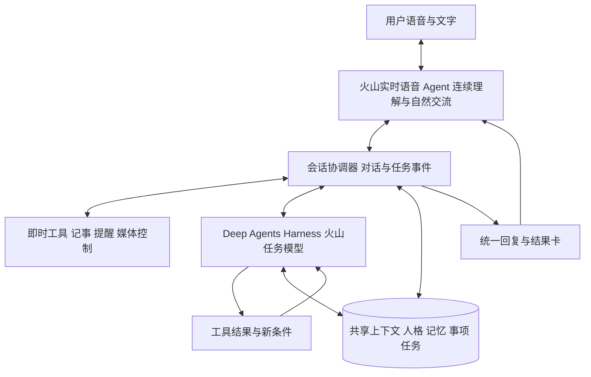
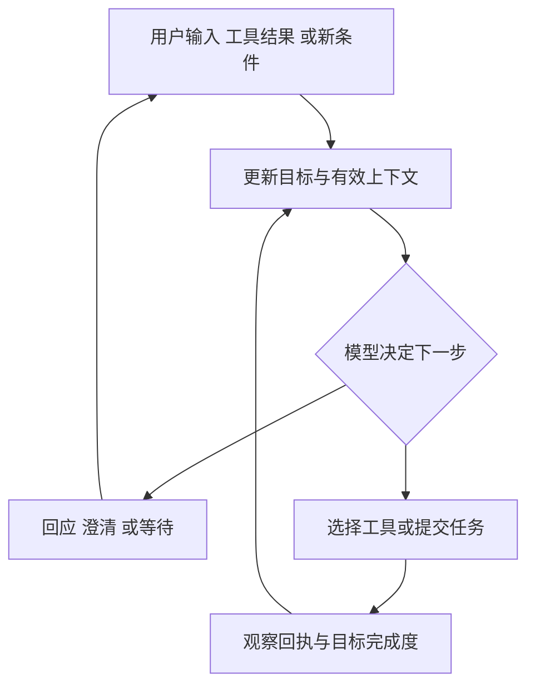
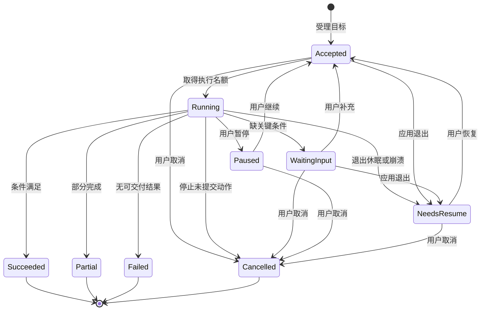
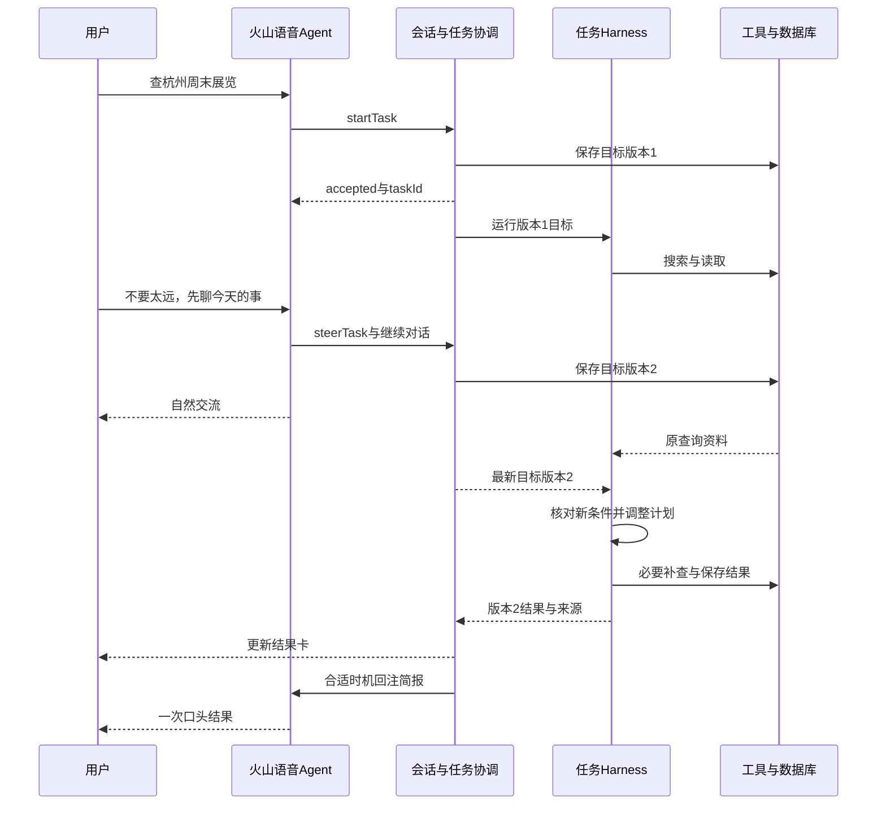

# Seamo AI 语音助手 R1 产品需求文档（PRD）

版本 v0.5.1｜AI开发实施基线　日期 2026年10月11日　适用 产品、设计、客户端与Agent研发、测试

本次修订 v0.5.1：按用户确认统一正式名称、默认助手名与开发资产引用为 Seamo AI；架构、功能范围、工具与字段合同沿用 v0.5。

本期将现有 Seamo AI 语音助手升级为一个能自然交流、延续个人背景，并可靠完成日常小事的桌面陪伴型 Agent。首版面向 macOS、中文、单用户内部使用，沿用 Electron、Vue 与现有粒子球。正式产品名称为 Seamo AI 语音助手，默认助手名为 Seamo AI；工程中的 lingli 或 lingmo 名称不作为用户面前的人格名称。

本文明确六类用户能力、五个主体页面与六类辅助界面、41项功能的逐项规格、六个Skill与33个子技能、完整Agent链路、十个完整Prompt、38个领域/任务工具与三个内部工具、完整字段Schema及60个验收场景。R1指本次重构后的首个内部可用版本；性能值是建议验收门槛，产品行为与默认值用于本版评审。所有模型以火山引擎为主，账号、模型ID、协议与音色通过G0验证后固化。

本版承接v0.4的“原生实时语音Agent＋任务Harness＋共享个人上下文”，补齐模型指令、标准Skill文件、字段合同、程序校验、资产版本及AI coding执行约束。第21至第28节与配套开发资产包共同构成实施基线，Prompt/Skill正文在本PRD完整列出。本文定义待实施版本，现有源码状态仍待仓库核对；云端服务连通与全量产品交付分开验收。

术语约定：Task表示助手后台执行任务；Todo表示用户待办Item；Reminder表示一次性提醒；Skill表示模型可组合的能力规范；Tool表示实际执行函数；Artifact表示可编辑结果。这些对象的状态与取消不能混用。

## 1 产品定义与版本目标

### 1.1 产品介绍

用户打开应用后，与一个有稳定名称、声音和交流风格的 AI 伙伴交谈。它可以倾听烦恼，接着之前的话题聊，查询近期信息，记下想法，安排提醒，陪用户听歌和专注，也能帮助讨论工作问题、整理短文本。

陪伴是主体验。工作与生活协助从对话中自然发生：当用户说出行动要求时，助手调用真实工具；当用户只是倾诉时，它先回应具体内容，不急着创建待办或提出方案。六类能力共享同一人格、会话和记忆，用户不需要在多个机器人之间切换。

### 1.2 本期应交付的六类能力

| 能力 | 用户可以怎样使用 | 完成的具体含义 |
| --- | --- | --- |
| 自然交流 | 免按键聊天、插话、纠正、文字输入、切换倾诉与建议 | 音频连续，能接住新问题，名称与设置一致 |
| 长期记忆 | 记住偏好和近况、隔天接续、更正、忘记 | 数据跨重启存在，检索有来源，删改立即影响下一轮 |
| 联网问答 | 问近期信息、读公开网页、比较几个选择、追问 | 事实对应真实来源，查询失败清楚呈现 |
| 生活小事 | 便签、待办、一次性提醒、专注计时 | 真实保存，可修改和取消，到期行为符合本地运行范围 |
| 音乐陪伴 | 按场景选歌、点歌、队列、收藏、边听边聊 | 找到可播放音源，歌词与曲目一致，语音与音乐协调 |
| 轻工作协助 | 讨论取舍、梳理粘贴文字、改写短文、形成下一步 | 得到可编辑的短结果，可按指令保存或导出 |

### 1.3 原版本问题与本期对应改变

| 原方案及历史反馈记录的问题 | 本期应改变的行为 |
| --- | --- |
| 主要区分聊天与点歌，行为能力有限 | 使用结构化工具调用，支持上述六类能力的完整闭环 |
| 内存中保留近期消息，重启不能延续背景 | 将消息历史、长期记忆、事项和运行状态分别持久化 |
| 调整 system prompt 后仍自称默认项目名 | 名称与人格采用统一配置版本，开场白和每轮响应读同一版本 |
| 停说后等待长，TTS 曾出现逐字卡顿 | 验证实时语音路线，统一连续播放、断句、打断及测量口径 |
| 助手说话和音乐页会阻塞倾听 | 视图、语音状态、音乐状态分别管理，播放时可以交流 |
| 文本书名号可能被当作点歌信号 | 动作只由结构化工具或确定的媒体控制指令触发 |
| App.vue 承担跨模块时序 | 独立会话控制器、Agent 运行时、媒体协调与领域服务 |

历史日志中有一次停说至出声约 8.36 秒的记录。这是单次旧样本，用于提出问题；R1 的性能结论必须来自统一环境下的新测试。框架重构不等于云模型首响应自动变快。

### 1.4 版本边界

R1包含F01至F11，展开为第4至第12节的41个功能点，并在第12.4节逐项追溯。所有列入 R1 的功能都要连接真实服务并完成验收。开发顺序允许分阶段，最终内部版本按完整范围检查。

R2 保留用户主动选择的文件或截图、日历只读接入、周期提醒、定期简报、持续关注、更多设备和连接器。通用电脑操作、终端执行、编程 Agent、自动发送消息、购买、多 Agent 团队、插件市场、跨设备同步不进入 R1。R1 不持续读取屏幕，也不提供应用彻底退出后的云端代办。


### 1.5 文档使用与需求追溯

本文是R1功能版本PRD。研发按功能ID和工具契约拆解，设计按页面ID和组件状态出图，测试按第17节A01至A50与第28节A51至A60执行。功能、页面、Skill、能力、工具和验收使用不同编号，避免把“能聊天”当作一个没有边界的大功能。

| 对象 | 编号或名称 | 含义与所在位置 |
| --- | --- | --- |
| 用户能力 | C01至C06 | 六类产品能力及实现边界，第1.6节 |
| 主体页面 | P01至P05 | 首页、音乐、记忆、事项、设置，第12节 |
| 辅助界面 | O01至O06 | 引导、历史、长结果、来源、任务进度、编辑与设备提示，第12节 |
| 功能需求 | F01a至F11d，共41项 | 第4至第12节，含逐项规格 |
| 内置Skill | SK01至SK06 | companion_chat等六个能力规范，第3.5节 |
| 公共运行能力 | 记忆、指代、授权、媒体、任务协调 | 跨Skill复用，不能作为隐式业务动作 |
| 验收场景 | A01至A60 | 第17/28节；性能口径见第16节 |
| 参数与限制 | L01至L24 | 第14.5/25.1节及Schema，统一取值，不由各页面另设一套 |

本文中的行为规则和默认范围是本版产品决定；模型ID、账号权限、接口配置和性能数据是G0待验证项。以下涉及服务的能力均指设计和官方文档支持范围，不代表现有代码已经接通。对软件实现的评审以真实调用、数据库回执和安装包测试为准。

### 1.6 六类能力的实现目标与边界

| 能力ID | 本版要实现的具体能力 | 必要支撑 | 本版明确边界 |
| --- | --- | --- | --- |
| C01 自然交流 | 持续倾听、语音语义判停、连续播音、插话接续、文字混输、倾诉与建议切换、统一人格 | 火山实时语音；会话协调；SK01；F01至F03 | 中文普通话优先；只有用户启动的会话采集；不承诺读心、诊断情绪或离线生成回答；全双工须实测 |
| C02 个人记忆 | 明确记住、授权后自动提取、跨会话召回、更正、遗忘、临时对话 | 火山文本模型提取；SQLite；MemoryService；F04 | 保存有来源的明确事实与共同结论；不保存推测人格；备份是独立数据副本，不把本地删除描述为删除供应商所有记录 |
| C03 联网问答 | 理解时间地点、搜索与读公开页、对比候选、引用、候选追问、失败后调整 | 火山搜索候选；公开页读取；SK02；F05 | 不登录、不付费、不购买预约；无证据不保证客流或库存；读取范围和查询时间可见 |
| C04 生活小事 | 便签、待办状态、一次性提醒、改期取消、专注计时、约定回访 | 领域数据库；本地调度；SK03、SK04；F06、F07、F10 | 待办不自动通知；提醒需应用运行且Mac清醒；不支持周期或跨设备调度 |
| C05 音乐陪伴 | 场景选歌、点歌、播放器与队列、收藏反馈、歌词粒子、边听边聊 | 现有音乐provider；本地播放器；SK05；F08 | 仅受支持音乐来源；推荐不等于播放；不生成音乐、不下载完整歌曲、不做音色演唱 |
| C06 轻工作协助 | 讨论取舍、整理粘贴文字、改写、局部续改、转便签待办、导出 | 火山任务文本模型；结果版本；SK06；F09 | 文本上限见L01；不解析文件截图，不代操作办公软件，不自动发送发布，不做代码执行 |

### 1.7 典型用户任务与整个产品链路

| 任务 | 用户入口与目标 | 完整业务链路 | 最终可见完成物 |
| --- | --- | --- | --- |
| 下班后交流 | P01开始交流；聊今天遇到的事 | 建立会话→注入人格与有效背景→持续理解→倾听或建议→插话修正→本地保存有效历史；记忆提取按授权 | 连贯对话；没有隐式生成的待办和情绪标签 |
| 隔天接续方案 | P01语音“接着昨天那个方案” | 解析话题→召回有效记忆及相关产物→唯一对象接续或澄清→讨论→明确委托后保存 | 对应旧主题的新结果或新版便签，来源可追溯 |
| 查询与记事 | P01要求查展览，再保存第二个 | 建立目标→后台搜索查证→用户可继续聊天并改条件→候选结果与来源→定位candidateId→保存便签→需要时另建提醒 | 来源卡、便签itemId、提醒reminderId及实际日期 |
| 听歌专注 | P01语音或P02/P04按钮 | 解析时长与偏好→计时与选歌独立执行→实际播放→聊天时降音→计时结束轻提示 | 专注状态、真实曲目与队列；失败分项说明 |
| 更正与忘记 | P03编辑删除或P01语音 | 定位记忆→版本更新或失效→抑制旧来源→刷新召回摘要与实时上下文→下一轮验证 | 最新内容或已删除状态；关联便签和提醒保留，除非另有明确委托 |
| 异常恢复 | 故障提示或下次启动 | 保存已提交结果→标记失败或待恢复→读取回执→用户选择继续→采用最新条件接续 | 结果不丢、不重复创建，旧语音不重播 |


## 2 统一的交流与行动规则

### 2.1 如何体现陪伴

普通回应通常为 1 至 3 句，先接住用户刚说的事，再判断是否需要追问、建议或执行。复杂结果先口头说要点，细节放入可展开的阅读区。用户明确说“只想聊聊”“不要建议”时，本会话保持倾听；用户说“帮我想办法”时转入讨论。语气可以温暖、有观点，但 AI 身份保持清楚。

情绪是当前交流线索。助手可以说“听起来这件事让你有些累”，用户可纠正；不能把一次情绪变成长期性格标签。每轮不强制提问，不用固定安慰话或反复播放填充语掩盖等待。

### 2.2 三类典型请求的行为

| 请求类型 | 示例 | 系统处理 |
| --- | --- | --- |
| 交流 | 今天很累，陪我聊聊 | 使用人格、当前话题与相关记忆直接回应，无必经规划步骤 |
| 单一行动 | 暂停音乐、记下这个想法 | 校验必要参数，调用对应工具，按真实结果回复 |
| 组合行动 | 放点安静的音乐，明晚提醒我接着这个方案 | 拆成两个有独立状态的动作，缺项只问一次，分别给回执 |

这三类用于解释体验，不是独立的固定路由。一个请求可以同时包含交流与多个行动，执行中可以被用户修订。所有新输入和工具结果都进入同一语义决策闭环。

只有影响理解或执行的关键条件缺失时才追问。“杭州这个周末有什么展”已含城市与时间，不重复问城市；“明晚提醒我”没有具体时间且未设晚间默认时间时，询问几点。普通记事与点歌已经由用户提出，无须再增加一次机械确认。

### 2.3 行动结果的用语

进行中只能表达过程，如“我在查开放时间”。只有数据库提交成功，才能说“已记好”；播放器实际开始播放，才能说“正在播放”；完成真实查询后，才能说“查到”。组合任务一项失败时说明已完成与未完成的部分，保留成功结果，不虚报整体完成。

长答案的文字可以提前展示，但未播出的后半段不得被记为用户已听到。执行成功发生在打断期间时，结果仍写入事项或音乐状态，并通过卡片呈现；已经取消的旧语音不重新播放回执。

## 3 Agent 逻辑架构与运行方案

### 3.1 明确的Agent架构与设计职责

本版采用“原生实时语音 Agent＋任务 Harness＋共享个人上下文”的架构。语音模型负责连续理解与自然表达；模型驱动的工具循环负责行动；Harness负责上下文、工具执行、计划状态、运行预算、取消和恢复。用户面对同一个Seamo AI，内部有实时交流与后台任务两种运行节奏。这里明确的是待实施方案，不能据此宣称当前代码已经实现。[6][7][8]

本版的行为决策由模型依据目标和工具观察持续完成。LangGraph提供状态运行能力，Deep Agents提供任务Harness；应用负责领域工具与会话、媒体、记忆协调。模型可选择并调整下一步，工程代码校验执行边界与完成条件。[1][8]

本版的智能性具体表现为：听懂省略和指代，按情境决定回应、澄清或行动；简单请求立即处理，复杂目标按需形成短计划；工具返回后检查是否满足目标，再决定继续、调整或结束；用户插话可以补充条件、变更目标、停止播音或取消任务。每句话都参与语义判断，但普通闲聊不必额外调用一个规划模型。

原生Speech-to-Speech描述模型直接理解与生成语音；全双工描述听与说能够同时进行，两者分别验证。字节2026年4月9日公开Seeduplex的边听边说、抗干扰与动态判停能力，并表示已在豆包App上线；公开材料没有披露整个豆包App的规划、长期记忆和工具Harness，不能将下图称为豆包内部架构。[6]



Electron主进程拥有实时协议连接、任务运行时、工具、数据库与调度；渲染进程负责录音、连续音频输出、页面与粒子可视化。preload暴露类型化白名单IPC。长任务在独立异步运行中执行，CPU密集操作移出主进程事件循环；关闭窗口后的任务遵循应用后台运行设置，彻底退出后不继续云端办事。

### 3.2 Harness具体包含什么

实时交流模型M01来自火山豆包语音，任务推理模型M02来自火山方舟；Deep Agents与LangGraph在客户端运行，SQLite与领域服务本地执行。模型决定要做什么、依据观察选择下一步；程序决定动作是否允许、何时提交、是否成功及结果如何呈现。模型配置分工见第15节。

Harness是让模型持续可靠办事的运行支撑，不是一个新模型，也没有必须遵循的单一产品标准。本期由Deep Agents TypeScript提供通用模型工具循环并利用LangGraph运行能力；Seamo AI应用用注册write_todos、Skill与PR06摘要实现可控计划和上下文管理，补齐火山协议、实时会话协调、个人记忆、领域服务、任务持久化和媒体控制。[8][12][13]

| 模块 | 输入与输出 | 本期必须负责的逻辑 |
| --- | --- | --- |
| 实时语音Agent | 持续音频、文字、必要上下文；回复、工具请求、交互事件 | 理解语音语义和表达线索；决定回应、等待、澄清、即时行动或提交任务；原生模式不等待独立ASR final再理解 |
| 会话协调器 | turn、response、task和工具事件 | 会话与播音所有权、实际已播范围、任务事件队列、插话和新条件路由；同一时刻仅一条助手语音 |
| Task Harness | 目标、约束、上下文快照；计划、进度、结果 | 模型驱动工具循环；观察后调整计划；预算、检查点、未知结果核查；只产出结构化结果，不自行开第二路语音 |
| 上下文服务 | 人格版本、近期有效消息、相关记忆、活动任务 | 本轮明确指令和最新更正优先；按需注入；摘要仍保留来源与删除版本；不能用压缩重新引入已忘记内容 |
| 能力与Skill注册表 | 能力说明、成功条件、工具schema | 提供模型可组合的能力规范；按需加载详情；不给每类请求写死完整执行路线 |
| 工具执行器 | 模型结构化调用 | 参数与权限校验、goalVersion检查、幂等、超时、取消、回执；运行时只允许注册动作 |
| 领域服务 | 记忆、便签、提醒、专注、音乐对象 | SQLite事务、实体版本、播放器状态、本地到期调度；真实结果是任务成功依据 |
| 媒体协调器 | 助手音频、音乐、通知、真实语音活动 | 用户讲话优先；音乐降音与恢复；通知和任务完成不抢话；晚到旧音频失效 |

“由模型规划”不表示模型可以任意调用电脑能力。它在本期能力内自主决定顺序与组合；新增能力通过注册工具与能力说明接入，不要求重写一个总路由流程。R1仍保持六类能力范围。

### 3.3 模型驱动的决策闭环



图中闭环表达行为决策：模型依据新证据选择下一步。工程代码负责会话状态、工具边界和预算，不先把用户划到一个不可变的“聊天线路”或“行动线路”。例如一句“我有点烦，帮我把明天的事整理一下”可以先接住情绪，再查已有待办并整理；用户说“先别整理，陪我聊两句”则更新当前目标。

| 可选择的下一步 | 适用条件 | 完成与接续逻辑 |
| --- | --- | --- |
| 自然回应 | 闲聊、倾诉、讨论或已有充分信息 | 直接口语回复；有新问题继续理解，不必生成任务计划 |
| 澄清关键条件 | 指代、时间或对象缺失会影响执行 | 只问关键缺项，保存待补目标；回答后从已有状态继续 |
| 调用即时工具 | 一步可完成的明确动作 | 工具返回后再判断是否成功；需要时继续组合其他动作 |
| 提交后台任务 | 多步查询、比较、整理或跨能力组合 | startTask迅速返回taskId与accepted；受理不等于完成；语音会话继续 |
| 更新或取消活动任务 | 用户修改原任务条件或明确取消 | 定位taskId，提高goalVersion或取消；保留已提交实体的真实状态 |
| 继续与修订计划 | 来源不足、工具失败或新增条件 | 调整查询或步骤，沿用有效结果；预算不足时给部分结果或请求用户继续 |
| 完成与汇总 | 成功条件均已满足，或明确部分失败 | 输出有来源的结果和分项回执；不以模型声称“做完”作为证据 |

结构化计划用于需要多步协调的目标，记录步骤、依赖、状态与完成条件；只保存可审核的行动摘要，不保存或展示模型隐藏推理。简单“暂停音乐”和普通聊天直接完成。

### 3.4 后台办事与持续对话

长任务不在实时工具回调中一直await到整个查询完成。火山实时语音3.0提供工具声明与call_id回传；应用用快速受理的工具回执结束本次交接，再让后台任务事件回传最终结果。实际并发对话和播报控制必须G0验证，不能仅因支持Function Calling就认为已实现边办事边交流。[12] 本期实现独立TaskSupervisor：

1. 实时Agent调用startTask，普通会话持久化目标与必要上下文；临时会话仅保存内存任务状态。随后返回taskId和accepted。
2. Task Harness在独立异步运行中调用工具、更新计划，发出task.progress、task.needs_input和task.completed等事件。
3. 会话协调器把必要进度放到卡片，将与当前交流有关的变化注入语音上下文。任务完成时，用户正在讲话则先静默呈现；在合适交流空隙再提供一次结果。
4. 用户继续闲聊不取消任务；涉及该任务的“预算改成五百”“第二个不要”“别查了”分别触发steerTask或cancelTask。
5. steerTask更新goalVersion。当前只读调用可以结束，但下一次模型决策、写操作提交和结果发布都必须采用最新版本；旧结果可保留作资料，不能当作最新结论发布。
6. 取消当前播音只失效responseId；取消任务作用于taskId。晚到任务回执仍保存，旧播音永不复活。

R1允许一条实时语音会话与一个活动的复杂后台任务同时存在。新复杂目标由模型判断是修改原目标还是独立任务；独立任务进入可见队列，可由用户要求暂停当前任务后优先处理。暂停、音量和其他即时动作可穿插，不排在长查询后面。记忆提取和提醒调度使用各自服务，不占用该任务名额。

### 3.5 六个内置能力规范

Skill是模型可按需读取的能力说明与完成标准，同一任务可以组合多个Skill。triggers描述语义适用范围，不能被实现成唯一关键词分发规则；guidance提供建议而不是强制固定步骤。Skill采用标准SKILL.md的name/description与正文，版本、权限与资源由独立注册表管理；完整正文、别名和实现合同见第23节与配套资产。

| Skill | 适用范围与必要信息 | 允许调用的工具 | 成功条件 |
| --- | --- | --- | --- |
| companion_chat | 闲聊、倾诉、接着之前聊 | memory.recall | 回应当前话题，有依据地延续背景，不杜撰经历 |
| web_qa | 最新信息、用户要求查询或读网页；必要地点和时间 | web.search、web.readPage | 关键事实有来源；结果不足标记未确认；可按观察调整查询 |
| capture_item | 记下来、列待办、改刚才记录；内容与明确目标 | notes相关动作 | 返回itemId和版本，记录与意图一致 |
| reminder_focus | 提醒、回访约定、专注；事项及时间或时长 | reminders、focus相关动作 | 已真实保存或启动，运行范围可见 |
| music_companion | 点歌、场景放歌、控制、反馈 | music相关动作、memory.recall | 实际播放状态与明确偏好一致 |
| work_discussion | 讨论取舍、整理或改写；材料及目标 | memory.recall、web、notes | 产物可编辑；需要查证时联网；按指令保存 |

所有任务均可在授权范围调用memory.remember、update、forget。能力工具集合是组合后的允许集合；内容来自网页时仍受统一工具边界约束。“记住我不喜欢人声”和“为我放无歌词音乐”分别需要记忆与播放回执。


#### 3.5.1 Skill的统一结构与调用规则

每个Skill是版本化能力规范，下面的子技能是实现与评测范围，不是新的Agent。运行时保持六个Skill；记忆、对象解析、授权、任务协调和媒体控制是公共服务。页面按钮直接调用领域服务也必须遵守相同规则，不必为了点一个“暂停”按钮经过模型。

| 契约字段 | 本版定义 |
| --- | --- |
| 身份 | skillId、name、version、description；固定版本随R1发布 |
| 使用条件 | 语义适用范围、必要条件、排除范围；描述用于模型选择，不做唯一关键词路由 |
| 输入 | goal、constraints、sourceRefs、selectedEntity、currentTime、timezone、contextVersion、goalVersion及必要业务字段 |
| 操作范围 | allowedTools、readScopes、writeScopes；由运行时求有效授权交集 |
| 行动指导 | 可用子技能、依赖关系、澄清规则、失败处理；模型可以根据观察改顺序 |
| 输出 | replyBrief、artifact、sourceRefs、candidateRefs、entityReceipts、unresolvedFields、completionStatus；无结果的字段可省略 |
| 完成依据 | 对应实体或资源回执；查询对应来源；讨论对应产物；不能用“我完成了”作为证据 |
| 生命周期 | 选择→装入必要指导→决策与工具循环→检查完成条件→回传；新条件可重新选择或组合 |
| 更新边界 | R1不开放用户自定义Skill安装与自动修改Skill；人格编辑不改变工具权限 |

常驻上下文保存六个Skill的短描述。实时语音会话暴露经过注册的即时工具和任务控制工具；详细查询与工作指导按需装入任务Harness。需要全部更新语音工具声明时，由适配器提交有效工具集合，不能漏掉已注册即时动作。框架Skill加载不会自动实现火山实时语音协议。

#### 3.5.2 SK01 companion_chat：自然交流与陪伴

**负责目标：**理解当下话题和交流期待，保持稳定人格，以自然回应支持持续对话。主要在实时语音Agent执行，普通闲聊不进入后台计划。

| 子技能 | 实现逻辑与输入 | 输出与边界 |
| --- | --- | --- |
| SK01.1 话题接续 | 根据最近有效轮次、当前实体和相关记忆理解“那个”“接着说” | 唯一对象直接接续，多对象问一项；不能编造共同经历 |
| SK01.2 倾听回应 | 使用用户明确事件与当轮表达线索；识别“只想聊” | 先回应具体内容，通常1至3句；不自动写情绪记忆、待办或提醒 |
| SK01.3 建议讨论 | 用户主动求建议或明确允许后，结合目标和限制 | 给少量具体建议；关键条件不足可追问；不机械要求每轮选一个模式 |
| SK01.4 风格遵循 | 读取personaVersion与当前短长、语气要求 | 聊天、查证摘要、工具回执称呼一致；不能改工具边界 |
| SK01.5 混合需求协作 | 一句话同时含倾诉、查询或行动 | 回应交流部分并组合其他Skill；动作仍以明确委托为依据 |

必要输入为有效用户交互和人格；历史、相关记忆是可选补充。可用memory.recall与任务控制；显式记忆指令进入公共记忆服务，行动进入对应Skill。无相关记忆不阻塞普通闲聊；记忆服务失败只说明相关记录暂时不可用，不说所有记忆不存在。输出为自然回复及需要组合的目标摘要。完成目标是回应贴切、被打断后能接住新输入，验证A02、A06、A07、A31。

#### 3.5.3 SK02 web_qa：查询、查证与比较

**负责目标：**获取真实公开资料，形成带来源和不确定项的答案。复杂查询在任务Harness执行，期间前台保持对话。

| 子技能 | 实现逻辑与输入 | 输出与边界 |
| --- | --- | --- |
| SK02.1 查询构建 | 问题、明确城市、currentTime、timezone；把本周末等转为具体范围 | query仅含查证所需条件；不默认读取精确定位，不附整段个人聊天 |
| SK02.2 公开页读取 | 搜索候选或用户提供HTTP(S)链接 | 抽取关键字段、来源标题与时间；登录墙、动态页仅标记实际读取范围 |
| SK02.3 事实核对 | 核对名称、时间、地点、开放信息或用户关心字段 | 关键结论对应sourceRef；矛盾项保留差异，缺字段标未确认 |
| SK02.4 候选比较 | criteria与候选记录，按用户条件比较 | 产生稳定candidateId与可说明的排序；未知距离、客流等不猜测 |
| SK02.5 追问与改条件 | selectedCandidate或taskId、goalVersion | “第二个”接续同一对象；过时字段再查询，新条件更新已有目标 |
| SK02.6 失败调整 | 无结果、临时错误、证据不足及剩余预算 | 可换query或候选；技术重试次数见第3.6节，耗尽后部分汇总 |

必填是明确问题；城市、时间或比较标准仅在影响结果时要求。工具为web.search、web.readPage及必要memory.recall；保存与提醒通过组合SK03/SK04执行。输出含answerBrief、来源、候选、未确认字段与查询时间。至少存在真实有效来源，才能说“查到”；只得摘要只能声称基于摘要。完成目标及失败验收A13、A14、A32、A33、A41。

#### 3.5.4 SK03 capture_item：便签、待办与导出

**负责目标：**把明确内容保存为正确的本地对象，并支持查询、编辑、完成与删除。

| 子技能 | 实现逻辑与输入 | 输出与边界 |
| --- | --- | --- |
| SK03.1 引用与取材 | 当前选中内容、最近产物或明确原话；定位sourceRef | 只取明确范围；多个“这个”先澄清，不能保存整段无关对话 |
| SK03.2 原文与整理 | 保存模式original或organized，标题与正文 | 原文保留文字；整理不新增事实；标题上限L02、正文L01 |
| SK03.3 待办拆分 | 明确“列待办”或选中清单 | 每项有独立itemId及完成状态；普通待办不自带到期通知 |
| SK03.4 对象维护 | itemId、expectedVersion、patch或完成状态 | 修改同一对象；并发冲突先读取，不能覆盖页面新编辑 |
| SK03.5 保存与导出 | artifactId、artifactVersion或具体itemIds | 转为本地便签/待办，或导出TXT/MD；用户取消文件选择即取消 |

工具为notes.create、list、update、complete、delete、export；提醒不由该Skill偷偷推断。创建按actionId幂等；相同文字的两次独立明确请求可生成两条，不能用文本相同永久去重。创建多个待办返回每项回执，部分失败不补写已成功项。输出为实体ID、实际内容与保存版本或真实导出路径。完成目标验收A15至A17、A25、A29、A39。

#### 3.5.5 SK04 reminder_focus：一次性提醒、回访与专注

**负责目标：**将时间委托变成可修改、有范围说明的真实调度或计时。

| 子技能 | 实现逻辑与输入 | 输出与边界 |
| --- | --- | --- |
| SK04.1 时间解析 | 原话、currentTime、系统timezone、可选晚间默认时间 | 形成dueAt并显示具体日期；“晚上”无设置则问几点，过去时间澄清 |
| SK04.2 创建与关联 | 内容、dueAt、可选itemId、kind | kind为普通提醒或一次性回访；有itemId则关联，不复制原便签 |
| SK04.3 改期与取消 | reminderId、expectedVersion、目标时间或取消指令 | 更新原ID与scheduleVersion；并发到期按真实投递状态处理 |
| SK04.4 专注控制 | 时长或focusId、expectedVersion；可选结束音乐规则 | start/pause/resume/stop；同时只一段活动专注，睡眠或退出恢复暂停 |
| SK04.5 到期表达 | 调度已触发事件、交谈与勿扰状态 | 静默卡片或合适空隙语音；调度器确定到期，模型只组织表达 |

工具为reminders.create、list、reschedule、cancel与focus.start、getState、pause、resume、stop。到期由本地Scheduler运行，不让模型长期挂起等待。缺时刻时维持待补请求，不能先保存一个猜测时间。专注与音乐是独立子目标；音乐调用需组合SK05。输出为具体时间、运行范围、调度或计时回执。完成目标验收A18至A20、A26、A40、A44。

#### 3.5.6 SK05 music_companion：选歌、播放与音乐协作

**负责目标：**根据明确需求找到并实际播放可用曲目，在交流时保持媒体状态一致。

| 子技能 | 实现逻辑与输入 | 输出与边界 |
| --- | --- | --- |
| SK05.1 场景理解 | 工作、放松、无人声等条件及有效音乐偏好 | 少量候选及理由；“今天烦”本身不能自动播放 |
| SK05.2 点歌与匹配 | 曲名、歌手或搜索关键词 | 唯一匹配播放，多同名提供选择；提到书名不触发点歌 |
| SK05.3 音源与开播 | trackKey、playbackRequestId、当前状态 | 验证资源并实际开播；失败按同曲/合适候选调整，不虚报成功 |
| SK05.4 播放与队列 | 暂停、继续、下一首、seek、音量、队列动作 | 本地控制实时生效；队列末尾停止；新请求使旧资源失效 |
| SK05.5 收藏与反馈 | 当前trackKey、like/dislike等明确反馈 | 收藏与反馈有来源；一次跳过不永久拉黑风格 |
| SK05.6 对话协作 | 用户讲话、助手实际播音与播放器状态 | 媒体协调器降音恢复；Skill不通过再次play来恢复音量 |

工具为music.search、getState、play、pause、resume、next、seek、setVolume、queue、favorite、feedback及memory.recall。音源、封面、歌词读取是MusicService内部资源操作；可对模型返回状态，不要求模型自己解析歌词时钟。输出为候选或真实播放、队列、收藏回执。点名曲目资源尝试次数L06；未知无人声标签不能保证无歌词。完成目标验收A21至A24、A33、A45。

#### 3.5.7 SK06 work_discussion：讨论、整理与结果迭代

**负责目标：**把用户当前问题或粘贴文字变成可编辑、可继续修改的短结果。

| 子技能 | 实现逻辑与输入 | 输出与边界 |
| --- | --- | --- |
| SK06.1 澄清目标 | 当前问题、限制、必要背景 | 缺关键取舍条件时问一项；有充分背景直接开始，不重复索取 |
| SK06.2 方案与优先级 | 用户目标、已知事实、可比较选项 | 2至3个优先项、理由与下一步；没有依据不虚构业务指标 |
| SK06.3 文本加工 | 原文、整理/改写目标、语气与长度 | 产生Artifact和版本；不得在超限时静默截断原文 |
| SK06.4 局部迭代 | artifactId、expectedVersion、段落或条目引用 | 只修改目标部分，显示新版本；当前编辑内容优先于旧生成结果 |
| SK06.5 保存与接续 | 用户明确“保存”“列待办”“导出” | 组合SK03/SK04；后续引用以实际保存版本为准 |
| SK06.6 查证补充 | 需要当前竞品、日期等外部事实 | 组合SK02；用户提供事实与外部证据分别标明 |

主要使用火山任务文本模型，允许memory.recall；联网、保存和提醒经对应能力组合。输出为replyBrief、artifactId、version、正文、结构化条目与未确认项。默认短结果，用户可展开；R1仅处理文字，不读取剪贴板外的内容或本机文件。完成目标验收A25、A39、A46。

#### 3.5.8 Skill组合与公共服务的明确边界

| 用户表达 | 选用能力 | 顺序与依赖 | 需要用户看到的结果 |
| --- | --- | --- | --- |
| 只想聊聊今天的事 | SK01 | 持续理解与回应；无必经行动 | 自然对话，不生成任务清单 |
| 查展览并把第二个记下来 | SK02＋SK03 | 得到稳定候选后才保存；候选不足先说明 | 来源与候选卡，之后便签回执 |
| 明晚问我方案想好了没 | SK04，可接SK01 | 先确定时间与主题并保存；到期只询问一次 | 具体回访时间与范围 |
| 专注25分钟并放纯音乐 | SK04＋SK05 | 无相互依赖的子动作独立执行；分别判断成功 | 计时与播放独立状态 |
| 整理这段话再列三个待办 | SK06＋SK03 | 先生成结果，再按委托保存任务项 | 可编辑原产物与三项实体回执 |
| 记住我更喜欢没有人声的音乐 | 公共MemoryService | 明确事实、版本与来源写入；不需要播放Skill | 记忆已保存，音乐不自动启动 |

Skill组合不等于扩大工具权限。有效动作必须同时满足已注册工具、本期功能范围和用户委托。来源网页中的文字、模型自己的建议和后台任务猜测不能代替用户委托。

### 3.6 任务状态、预算与取消

任务生命周期包括accepted、running、waiting_input、paused、succeeded、partially_succeeded、failed、cancelled和needs_resume。任务目标、计划、实体回执和用户更正分别保存，不能只保存最后一句模型回答。

建议初值：即时工具不占用复杂任务槽，通常只做一次操作及结果判断；普通轻任务最多4次模型决策、6次工具调用。复杂后台任务最多8次模型决策、12次工具调用、120秒活动执行预算；等待用户补充与队列时间不计入活动预算。计划更新不算对外副作用，但仍计入模型决策成本。

简单首次联网最多2个查询、读取3页；组合比较可在任务总预算内扩展至4个查询、6页。达到预算后汇总已取得资料，明确尚缺条件，允许用户继续；不因框架支持长运行就自动无限查询。默认不执行复杂多Agent分工。

只读调用的临时网络故障可重试1次；参数缺失、无结果、未授权不盲目重试。写入失败先查幂等回执，同一明确动作复用actionId和idempotencyKey。用户改变动作内容则形成新的修订动作，更新原实体，不能重复创建。

“停一下”默认停止当前回答；“别查了”取消活动查询；“取消明晚提醒”执行对应领域反向操作。写工具在提交前核对取消状态与goalVersion：取消先于提交则不写入；事务先提交则保留成功回执，按明确取消目标执行反向动作。不能从一句“停”推断已经保存的数据被撤销。

### 3.7 重启恢复与个人记忆

普通会话每次关键动作提交后保存任务检查点；启动或睡眠恢复后将未结束任务标为needs_resume，先检查回执，防止便签或提醒重复创建。未完成的查询与讨论展示继续入口，用户选择后以最新目标和工具状态恢复，不自动重播旧音频或启动云查询。临时会话的任务状态仅存内存，不保存可重启恢复的检查点；明确保存的便签、提醒等对象按各自领域规则保留。[2]

SQLite负责个人记忆、领域数据、任务事件与持久化适配器。Deep Agents的memory参数所指的AGENTS.md式指导文件不直接等于本产品个人记忆；偏好、近况、更正删除仍由第5节MemoryService管理。[8] 检查点要通过真实跨重启测试，内存MemorySaver不满足此要求。

### 3.8 完整运行示例

用户在2026年10月10日上海时间说：“今天有点累，陪我专注二十五分钟，放点没有人声的音乐，明晚八点提醒我继续那个语音助手方案。”日期仅作验收样例。

| 发生的情况 | 模型与Harness如何处理 | 用户体验与真实状态 |
| --- | --- | --- |
| 初始请求 | 接住疲惫表达，检索方案背景；按需形成专注、音乐、提醒三个子目标 | 简短自然回应，三项分别有状态；情绪不固化为长期标签 |
| 参数充分 | 调用focus.start、音乐选播和reminders.create；互不依赖的动作可独立完成 | 实际开播才说正在播放；提醒显示10月11日20点 |
| 音源不可用 | 观察真实失败，优先换同曲音源或下一符合条件候选 | 专注与提醒保留，不重复创建；音乐最终失败则单独说明 |
| 用户说“提醒改成九点，音乐别换了” | 更新对应目标与goalVersion，修改同一reminderId，取消尚未提交的换歌 | 提醒改至21点；未提交的新播放不发生；已实际切歌时按真实状态说明 |
| 用户说“先聊两句，今天这会开得烦” | 实时Agent转入交流；后台既定任务继续，除非用户明确取消 | 能立即聊会议，不用等整个任务跑完 |
| 任务完成 | 检查最新目标与分项回执；通过协调器一次性回传 | 若用户正在说话先显示卡片，交流空隙简短汇总 |

另一个必须通过的例子：“帮我查杭州周末适合放松的展览，选两个。”搜索中用户说“不要人太多的，先跟我聊聊今天的事”。实时Agent继续当前交流；后台任务将新条件纳入比较，有证据的内容才纳入判断，缺少客流信息明确未确认；任务完成不抢话。用户说“第二个帮我记下来，明早九点提醒我看”时，使用候选ID接续保存和提醒。执行顺序由目标、证据与工具结果共同决定。


### 3.9 从启动到结束的完整运行链路

下表固定运行责任和数据交接，模型在这些边界内自主选择下一步。它是完整业务链路，不是把每个用户意图写成一条固定业务流程。

| 阶段 | 触发与输入 | 负责模块与处理 | 输出与可见行为 |
| --- | --- | --- | --- |
| R01 启动恢复 | 启动应用、配置与SQLite | 加载persona/settings版本，迁移检查；恢复事项与音乐队列；未结束Task标needs_resume | P01显示待机与一次恢复提示；不自动开麦，不自动云查询 |
| R02 开始会话 | 点击开始或发送文字；设备和服务状态 | 权限校验，建立火山实时Session；注入有效背景、时间、工具集合 | 显示连接中→可交流；失败保留文字/重试入口，未配置不假装可用 |
| R03 持续接收 | 音频流、文字、selectedEntity与当前话题 | 原生模式持续传音频；按语义判停确定回应；转录只更新对应消息 | 实时字幕与输入状态；输入可与输出、后台任务并行 |
| R04 构建有效上下文 | personaVersion、近期有效消息、记忆、Task摘要 | ContextService按预算过滤已删事实；时间用本轮系统时区；对象解析使用稳定ID | 模型知道当前交流与任务，不注入无关全部历史 |
| R05 决策下一步 | 当前输入、目标、观察与能力说明 | 实时Agent决定回应、澄清、即时动作或startTask；复杂任务按需加载Skill | 口语回应、关键问题、工具调用或任务受理卡 |
| R06 执行即时动作 | 完整结构化参数与用户委托 | ToolExecutor校验范围、对象、取消、版本；领域服务执行 | 成功回执后确认；参数错误以可澄清错误返回，不先写后问 |
| R07 受理复杂任务 | goal、constraints、sourceRefs、requestKey | TaskSupervisor创建Task；普通会话事务落库，临时会话只存内存；返回taskId/accepted，后台启用Harness | 受理不等于完成；实时会话继续，新任务最多排队L15条 |
| R08 后台工具循环 | 最新goalVersion、计划与工具结果 | 火山文本模型选工具；执行器返回Observation；模型判断继续、改计划、问用户或结束 | 进度卡更新；不展示隐藏推理，不生成第二路独立语音 |
| R09 新条件与控制 | 闲聊、纠正、暂停、取消、领域修改 | 判定与活动任务关系；steer提高版本；stopResponse只停播；cancelTask取消未提交任务动作 | 即时回应最新输入；已提交副作用保留并显示 |
| R10 汇总和呈现 | 最新版本的TaskResult、实体回执、来源 | 协调器复核目标版本，记录resultId；先更新卡片；合适时机口头简报 | 每个结果最多一次主动播报；部分成功说明已做与未做 |
| R11 会后处理 | 已完成的有效会话片段及授权 | 保存普通历史；授权下用火山文本模型提取记忆；提交前核对删除和版本 | 不阻塞首响；临时会话不产生长期历史与自动记忆 |
| R12 结束与断开 | 结束会话、关窗口、退出、休眠 | 结束会话关闭采集与输出；是否取消后台任务另有控制；彻底退出持久化并停止运行 | 麦克风明确关闭；提醒、专注与任务按本地运行范围恢复 |

结束普通语音会话不等于清空历史、取消提醒或停止音乐。普通会话的任务可在应用继续运行时完成，结果留卡片，关闭会话后不主动重开麦或播语音。结束临时会话则取消该会话尚未提交的Task动作，并销毁临时上下文；已经明确保存的对象和已完成的真实动作保留。关窗口默认结束采集并保留后台服务；用户主动结束应用时不继续任务执行。该行为可在设置更改，不能只由路由决定。

### 3.10 会话、输入、输出和任务的状态

| 状态维度 | 枚举与关键状态转换 | 不变量 |
| --- | --- | --- |
| Session | idle→connecting→active；active→reconnecting或ending→ended；错误进入error | 一条活动语音会话；重连有sessionGeneration，旧连接事件不可改新状态 |
| Input | off、ready、receiving、turn_pending、muted、device_error | muted不采集真实音频；保持连接按火山实际静音协议；结束即关闭采集 |
| Output | idle、generating、buffering、speaking、cancelled、error | responseId拥有音频；一条助手语音；取消后清掉对应缓冲 |
| Task | accepted、running、waiting_input、paused、needs_resume与四个结束态 | 一个活动复杂Task；多个queued子状态共享accepted；结束态不被晚到进度改回running |
| 领域实体 | 提醒、专注、便签、音乐各自状态 | 独立于Session与Task；Task cancelled不能自动抹掉已提交实体 |



queued使用Task.status=accepted与queuePosition表示，不新增相似生命周期枚举。waiting_input和paused释放复杂任务执行名额；用户补充后重新排队。暂停在安全检查点生效；已发出的只读调用可结束并保存，写入未知时先查回执。四个结束态分别为succeeded、partially_succeeded、failed、cancelled。

### 3.11 工具调用、成功判定与版本控制

1. **形成调用：**模型给出完整toolName与参数；适配器仅在参数完成事件后接收，不执行流式半截JSON。
2. **补充执行信息：**程序生成或读取actionId、runId、用户委托范围和幂等键；模型提供的实体ID必须能在当前候选、选中对象或数据库中核验。
3. **校验：**校验schema、时间、对象版本和最新goalVersion。缺条件返回NEEDS_INPUT；越界返回OUT_OF_SCOPE；冲突返回VERSION_CONFLICT，均不得先产生副作用。
4. **执行：**同一实体的写操作串行，独立只读可有界并行。组合目标只有存在数据依赖时等待；创建提醒依赖内容与时间，歌词读取不阻塞专注启动。
5. **记录：**提交前检查取消与版本；本地数据库写入原子保存实体和Receipt；音乐等状态以真实播放器回执为准，无法同事务确认的结果不明时标unknown，用原幂等键查询，不立即重试创建。
6. **观察：**回执作为工具结果交给模型；模型依据真实成功、缺字段、可重试性和剩余预算重新选择。
7. **呈现：**协调器按最新版本和输出所有权呈现。SDK返回响应结束仅代表模型这次生成结束，不能替代业务目标完成。

火山语音侧call_id负责云端调用与结果配对，actionId负责本地幂等，二者不得混用。startTask在原call_id上只回复一次accepted；任务最终结果用新事件更新上下文与结果卡，不把原调用再次回传成另一个“完成”结果。只有最新goalVersion才可发布结论。

### 3.12 长任务中修改目标的时序



图是可验收行为时序。供应商返回的协议事件由VolcRealtimeAdapter归一化；不能照抄其他供应商事件，或假定“名称相似”就可以直接接入其SDK。

## 4 自然语音与情感交流

本节展开 F01、F02、F03，共 8 个功能点。

| ID与功能 | 触发 | 正常逻辑和可见结果 | 异常与验收重点 |
| --- | --- | --- | --- |
| F01a 免按键会话 | 点击开始交流，自动倾听已开启 | 原生模式持续传音频，由语音语义判停决定回应；听与说可并行，点击结束关闭采集 | 首次拒绝授权转文字；后台监听必须处于用户开启的会话，不能随启动隐式常开 |
| F01b 按键说话 | 自动模式关闭时按住 Space 或录音按钮 | 按下录音，松开提交；同一轮不重复提交 | 文本框聚焦时 Space 为输入空格；失焦或释放丢失时安全收尾；无有效语音不发起模型 |
| F01c 文字与字幕 | 输入文字，或接收到转录和回复 | 文字与语音共用上下文；临时字幕标为未确认，转录完成后固定；原生模式字幕不等于模型唯一理解；长答案可展开 | 文字发送会终止当前播音后创建新轮；转录更正不制造两条用户消息 |
| F01d 设备与权限 | 首次授权、切换设备、拔插设备 | 显示所选麦克风和输出设备；系统默认是明确选项；测试后保存 | 麦克风失效停采集，保留文字入口；所选设备消失时提示恢复方式，不悄悄持续监听另一设备 |
| F02a 人格与开场白 | 启动，或保存名称、人设、称呼、音色 | 使用统一personaVersion；开场白简短，同一会话只一次；后台重连不重复问候 | 改为Alex后下一有效轮生效；实时服务若需重建则清楚提示；失败不退回lingmo自称 |
| F02b 倾听与建议 | 倾诉，或说只想聊、帮我想办法 | 当轮识别交流意图，先回应具体事件；只需倾听时不输出行动清单 | 情绪理解允许被纠正；不长期保存推测；普通回复保持口语，用户要求后展开 |
| F03a 插话打断 | 用户在助手说话时开口，或点停止 | 依据真实交互与语义中断事件停播放、清缓冲、取消旧生成，接入新turnId；保留持续倾听 | 未经确认的噪声可只临时降音后恢复；已确认取消的旧音频和文本不得复活；一时刻仅一条助手语音 |
| F03b 纠正与停止任务 | 不是那个、我说的是、别查了 | 纠正更新本轮目标，动作取消按run或实体定位；已提交的副作用保留可见回执 | 停播不等于删除事项；指代有多项候选时问一个问题；未知执行结果先核查 |

### 4.1 语音状态与轮次

下表描述界面主状态，不是互斥的全系统状态机。底层inputState、outputState和taskState分别保存；原生实时模式在输出时仍可接收输入，后台任务执行时也可继续交流。

| 会话状态 | 进入条件 | 应显示和允许的操作 | 退出条件 |
| --- | --- | --- | --- |
| 未开始 | 启动或用户结束会话 | 粒子待机、开始交流、文字输入；麦克风关闭 | 开始语音或发送文字 |
| 正在听 | 用户开始讲话或按下录音 | 显示采集状态和临时字幕，粒子响应真实输入；原生模式持续传音频 | 松开按键或语义判停；输出时仍保持输入能力 |
| 确认输入 | 语义判停或管线模式等待ASR final | 保留临时字幕，允许续说和取消；原生模式不以独立ASR final作为全部动作门槛 | 确认有效交互或判断无交互 |
| 等待回答 | 已提交并构建上下文 | 显示等待，允许插话、停止或文字发送 | 回复音频可播，或需要工具 |
| 正在办事 | 活动任务尚未结束 | 结果卡显示进度，允许持续对话、修改目标与取消 | 完成、等待补充、暂停、失败或取消；不阻塞语音主状态 |
| 正在回应 | 助手音频实际播放 | 粒子响应真实输出，可插话和停止 | 播放结束或确认打断 |
| 可恢复错误 | 断网、配额或设备问题 | 简明错误、重试、文字入口 | 用户恢复或退出会话 |

音乐播放、页面路由和事项状态不属于上述语音状态。进入音乐页不关闭语音会话；返回首页不自动停止音乐。自动会话中播完回复回到待听；按键模式回到未采集状态。

### 4.2 自动断句与真实插话

原生模式优先使用模型提供的语音语义判停与交互意图事件，结合回声消除和设备音频处理验证续说、犹豫、无关对话与音乐干扰。不能用一个固定静音阈值代替全部交流判断。回退管线采用语义断句；约700毫秒静音等待仅作校准起点。按键录音建议初始上限60秒，不将原生实时会话机械切成60秒一段。[6][7]

疑似噪声只可临时降音；确认真正插话才取消当前输出。误触且未取消时恢复原进度；已经取消的旧输出不能重新播放。转录更正对应原turn。写动作必须来自确定的结构化参数、明确授权目标与本地校验，临时字幕不能触发写入；日期或指代含糊时澄清，原生模式不要求额外独立ASR final再理解动作。

### 4.3 人格配置优先级

系统工具与数据规则由程序固定；助手名称、用户称呼、语气和音色读设置；本轮明确风格要求优先于历史偏好。用户编辑人设文本不能改变工具白名单和成功条件。首次普通话问候、联网结果、记事回执、音乐口播使用同一人格配置。修改名称不删除用户记忆。

### 4.4 自然语音与交流的逐项规格

#### F01a 免按键会话

- **入口与前提：**P01主按钮；P02至P04保留全局语音栏。须已配置火山实时服务且获得麦克风授权。
- **输入与正常逻辑：**点击开始后显示连接中，成功才打开有效会话并显示正在倾听。持续上行音频，按语义判停回应；回复时仍接收输入。点击结束立即关闭采集、停止该会话播音并正常断连。
- **边界与异常：**启动应用不自动监听。权限拒绝显示文字入口；连接失败不保持不明确的录音状态。结束会话不取消已保存提醒和后台任务；后台结果只留卡片。
- **功能完成目标：**P01麦克风状态与真实采集一致，连续20轮不重复提交；页面切换保持会话。
- **验收关联：**A01、A02、A27、A36。

#### F01b 按键说话

- **入口与前提：**P01按住录音按钮，或无文本焦点时按住Space；须自动倾听关闭。
- **输入与正常逻辑：**按下开始采集，松开提交同一段输入；超L03上限自动收尾并提示。页面失焦按已采集内容安全结束；用户明确取消则不提交。发送中显示当前输入状态，允许停止回答。
- **边界与异常：**文本框、编辑器和弹窗输入焦点内Space只输入空格；音色试听不与录音并行。短暂误按无有效语音不请求模型。模式切换先结束当前采集，再启用下一种模式。
- **功能完成目标：**每次录音最多形成一条用户消息；丢失keyup、快速点击与切页不会长期卡在采集状态。
- **验收关联：**A03、A04、A36。

#### F01c 文字、字幕与混合输入

- **入口与前提：**P01文字框和全局语音栏；O02历史与O03长结果。
- **输入与正常逻辑：**文字非空且不超L01可发送；发送先停止旧播音，再形成新turn。临时转录更新同一消息，完成后固定；助手文字可先展示，并记录实际已播范围。文字与语音使用当前同一Session和上下文。
- **边界与异常：**原生语音转录不是模型理解的唯一依据。文字发送不默认取消后台任务；输入法组词时Enter不发送，Shift+Enter换行。被打断的未播内容不能被记为用户已经听到。
- **功能完成目标：**空输入不发送，超限不截断，临时转录不新增重复消息；有效输入创建新轮且旧音频不复活。
- **验收关联：**A01、A03、A07、A31。

#### F01d 设备与权限

- **入口与前提：**P05设备分组、全局设备状态、O06设备失效提示。
- **输入与正常逻辑：**列出系统默认及明确设备，保存deviceId；提供短录音与输出试听。切换麦克风先停止原采集，再打开新设备；切换输出取消或安全结束当前播音，音乐按播放器实际状态迁移。
- **边界与异常：**设备拔出后停采集并提示重新选择；不能悄悄启用另一麦克风。首次拒绝后显示系统权限入口；应用无法替用户修改系统权限。设备名不可写进模型提示。
- **功能完成目标：**拔插、蓝牙切换、拒绝权限均可恢复；系统默认选项明确，页面选项与实际设备一致。
- **验收关联：**A04、A36。

#### F02a 人格与开场白

- **入口与前提：**O01首次引导、P05人格音色、P01会话建立。
- **输入与正常逻辑：**人格保存name、userAddress、style、voiceId与personaVersion；全部模式读同一版本。有效新会话播放一次简短问候；后台重连不重播。名称人设下一轮生效；音色待当前播音结束或手动停止后重建必要配置。
- **边界与异常：**名称默认Seamo AI，可改；工程lingli/lingmo不作自称。设置保存与云端应用分别有状态，应用失败标待生效，不回退默认名字冒充成功。音色只能选择已验证的火山可用配置。
- **功能完成目标：**改名Alex后问候、聊天、工具回执全部一致，重启仍保留；不在半句话换声。
- **验收关联：**A05、A37、A49。

#### F02b 倾听、建议与交流切换

- **入口与前提：**P01对话；用户语音说只想聊、帮我想办法或纠正理解。
- **输入与正常逻辑：**模型以当前事件为中心，识别只倾听、求建议或混合行动；本会话明确风格优先。回应通常1至3句，复杂内容先简报可展开。用户改变期待后立即调整，不要求手动切机器人。
- **边界与异常：**一次情绪不形成长期性格结论；不因倾诉自动放歌、建待办或提醒。每轮不强制反问。交流中提出的方案需用户明确委托后才成为写动作。
- **功能完成目标：**只想聊时保持倾听，明确求建议后给具体建议；情绪判断被纠正后采用新理解。
- **验收关联：**A06、A31。

#### F03a 插话与停止回答

- **入口与前提：**所有页面全局停止回答按钮；用户在助手播音时真实插话。
- **输入与正常逻辑：**确认有效中断后取消response，清相应音频与待播缓冲，接入新输入；界面旧回答标被打断，已播与未播范围区分。用户继续当前话题时可自然接续，但不自动重播后半段。
- **边界与异常：**疑似噪声可临时降音，未经确认取消时才允许原位恢复。停止回答只作用播音/回复生成，任务与实体状态另行控制；同一时刻不能两路助手语音。
- **功能完成目标：**确认插话后停声达第16节门槛；重复插话、噪声、慢到音频无双播或复活。
- **验收关联：**A07、A08、A34。

#### F03b 纠正、修改目标与取消任务

- **入口与前提：**P01语音；O05任务卡的修改、暂停、继续、取消。
- **输入与正常逻辑：**先解析指代与控制对象。不是那个更新当前理解；不要太远修改活动task目标版本；别查了取消Task未提交动作；取消明晚提醒执行领域取消。若已有写入结果，使用实体ID更正或撤销。
- **边界与异常：**有多个活动或相似对象先问一个问题。stopResponse、cancelTask和实体取消互不代替；未知写入结果先核查。普通闲聊不隐式取消查询；明确暂停Task在安全检查点生效。
- **功能完成目标：**修订影响下一决策和最终结果，旧版本不发布；已成功便签提醒不因停播丢失。
- **验收关联：**A08、A29、A32、A34、A43。


## 5 长期记忆

本节展开 F04，共 5 个功能点。会话历史是对话记录；记忆是有来源的可复用事实；提醒和便签是可执行或可编辑的事项。

| ID与功能 | 触发 | 正常逻辑和可见结果 | 异常与验收重点 |
| --- | --- | --- | --- |
| F04a 明确记住 | 记住我喜欢安静的音乐 | 提取明确内容与类别，调用memory.remember；保存成功后给简短回执，记忆页可见 | 内容含糊先问；写入失败不说记住了；同一事实不重复新增 |
| F04b 自动记忆 | 首次开启记住重要的事 | 会话后异步提取普通明确偏好、近况和共同结论；保留来源，不逐条口播 | 推测不固化；敏感内容先询问；关闭后停止新提取，保留既有数据 |
| F04c 回忆与接续 | 昨天那个方案、你记得我喜欢什么 | 按话题、实体、时间检索少量有效记忆；唯一匹配直接接续，多候选澄清 | 无匹配明确没找到；不得把检索失败当作不存在所有记忆，更不得编造共同经历 |
| F04d 更正与忘记 | 改成、忘掉，或记忆页编辑删除 | 修改生成新版本，旧版本失效；删除写入失效标记并刷新检索、摘要、缓存和云会话上下文 | 后台提取不能从旧来源重新生成；下一轮和重启后不能再引用删除事实 |
| F04e 临时对话 | 开启临时对话 | 不读取长期记忆，不落长期历史，不提取新记忆；仅保留本次内存上下文 | 明确记住指令需先确认退出临时模式；明确保存便签或提醒仍可执行，须有可见回执 |

### 5.1 记忆类别与有效期

| 类别 | 保存内容 | 失效与使用规则 |
| --- | --- | --- |
| 稳定偏好 | 喜欢怎样称呼、音乐口味、回复长短 | 无默认过期；最新明确更正优先 |
| 近期事件 | 正在准备某次会议、这周处理某件事 | 保存发生时间；临时事件建议30天后降低召回权重，到期事项不当作当前状态 |
| 共同结论 | 决定先验证语音，之后改界面 | 记录主题、结论、来源和状态；新结论替代旧结论 |
| 当前交流状态 | 现在只想倾诉，这轮说到哪 | 会话内使用，不自动变为长期人格标签 |

30天是候选排序初值，不代表自动删除历史；有明确结束日期的事件保存 validUntil，到期后标为历史，避免说“你明天要面试”却引用很久前的信息。可以删除，不能由模型自行把过去事实改写成当前事实。

### 5.2 读取与写入逻辑

普通会话每轮装入稳定人格、近期有效消息与最多 5 条相关记忆；临时会话使用隔离上下文，不检索长期记忆。建议本地检索预算 200 毫秒；无相关记忆不强行填满。SQLite先采用实体、日期和中文字符或分词匹配；以改述测试验证效果。若需向量化，使用经验证的火山模型生成并在本地保存索引，同时复验时延与删除传播；不默认新增外部向量数据库。

自动记忆提取以完成轮次或会话片段为单位，避免每句闲聊增加一次模型调用。写入前核对 memoryVersion、授权状态和来源的删除标记；重复候选合并。模型推测“用户很孤独”等不作为事实写入。

### 5.3 删除如何真正生效

删除在同一事务中使目标失效并记录来源抑制信息；重建相关摘要和检索索引，清掉待提取候选。后续上下文屏蔽受影响的旧事实，必要时不再注入对应原消息；界面原聊天记录可以继续存在，用户另有删除历史的入口。

已经注入实时云会话的记忆需刷新或重建云上下文，完成后才进入下一有效轮。用户以后明确重新要求记住可以创建新来源版本，后台任务不可借旧消息复活。恢复本地备份时也应用删除标记；当前删除不自动改写既有备份，数据设置提供单独清理。

### 5.4 记忆的逐项规格

#### F04a 明确记住

- **入口与前提：**P01明确记住指令；P03新增记忆O06表单。
- **输入与正常逻辑：**提取明确事实、类别和来源，内容可在卡片查看；同一事实更新或合并，保存后返回memoryId和版本。页面填写明确内容可直接本地保存，不要求云模型再解释。
- **边界与异常：**含糊或相互冲突的事实先澄清；敏感内容用户明确要求保存时按其指定范围，不顺带扩展。临时对话中先处理退出临时模式选择；保存失败不说记住了。
- **功能完成目标：**明确事实跨重启可召回；回执中的内容与用户委托一致，有来源而无额外推测。
- **验收关联：**A09、A12、A38。

#### F04b 授权后自动记忆

- **入口与前提：**O01或P03/P05记住重要的事开关。
- **输入与正常逻辑：**默认关闭，用户选择后启用。以完整有效轮次或片段异步提取普通偏好、近期明确事件和共同结论，保存来源及发生时间；重复候选合并。写前再核对开关、临时模式、memoryVersion和删除记录。
- **边界与异常：**普通聊天不逐句开提取请求；猜测、讽刺未澄清内容、网页事实不当作用户记忆。敏感自动候选仅在当前会话询问，未同意不落内容到长期候选库。关开关不删除已有记忆。
- **功能完成目标：**启用后真实普通事实保存；关闭与提取并发时新写入被阻止，失败可重试但不打断对话。
- **验收关联：**A10、A11、A38。

#### F04c 回忆与跨会话接续

- **入口与前提：**P01自然追问，P03分类、搜索和来源查看。
- **输入与正常逻辑：**按主题、实体、时间及有效性检索，最多注入L04条；独一匹配直接接续，多候选给简短选择。点击来源打开相关历史或产物；相关消息已删除则显示来源记录已删除，保留有效记忆自身来源元信息。
- **边界与异常：**真实无匹配说明没找到，服务超时说明暂时无法读取；两者不同。暂时不确定不能编造过去对话；过期事件当历史背景。长期记忆不自动把全部便签全文装入模型。
- **功能完成目标：**改述能召回，旧日期不说成当前日程；来源可查、错误可恢复。
- **验收关联：**A09、A13、A35、A38。

#### F04d 更正、删除与忘记

- **入口与前提：**P03单条编辑删除；P01明确忘掉/改成。
- **输入与正常逻辑：**先定位memoryId；编辑提交expectedVersion生成有效新版本，删除生成抑制记录。同步阻止旧来源自动提取，刷新索引摘要和活动任务上下文；云会话必要时用新sessionGeneration重建，完成后下一轮继续。
- **边界与异常：**单条明确删除直接执行，批量清理见F11d。忘记不自动删便签或取消提醒。内容不能在UI宣称完成后仍注入；网络失败时显示本地已删除、会话刷新中并阻止旧上下文继续响应。
- **功能完成目标：**下一轮、摘要压缩、任务接续与重启后不引用旧事实；旧提取和备份不复活已抑制来源。
- **验收关联：**A11、A35、A38、A48。

#### F04e 临时对话

- **入口与前提：**P01状态栏、P03或P05临时对话开关。
- **输入与正常逻辑：**切换前结束当前回复与采集，建立隔离上下文；不读长期记忆，不存聊天，不自动提取。期间明确创建便签或提醒仍可执行并提示保存范围；结束时取消临时会话尚未提交的Task动作，销毁临时任务状态、文本与音频缓存，保留已明确保存的对象。
- **边界与异常：**已有持久化任务保留，但在临时会话中静默呈现，不注入其私人背景；该会话新任务只在内存运行，必要事项回执可持久化。临时任务退出后不恢复。明确记住时先让用户选择退出临时模式再保存。
- **功能完成目标：**临时聊天与Task正文不进入备份历史，长期记忆未被使用；用户明确保存的事项仍存在且范围清楚。
- **验收关联：**A12、A47。


## 6 联网问答

本节展开 F05，共 4 个功能点。首版使用可替换的 SearchProvider 与公开网页读取器，原方案的豆包搜索 Custom 为待验证候选，现有LLM密钥是否具有权限需单独确认。

| ID与功能 | 触发 | 正常逻辑和可见结果 | 异常与验收重点 |
| --- | --- | --- | --- |
| F05a 判断与搜索 | 用户说查一下，或涉及最新、现在、这个周末 | 解析地点和实际日期，简单首次最多2个查询；组合任务按第3.6节总预算扩展；不要求手动联网开关 | 地点缺失且影响结果时询问；未配置或配额不足明确失败，不以旧知识冒充已查 |
| F05b 网页与引用 | 需要核对候选或用户给公开URL | 简单首次最多读取3页，复杂比较按任务预算扩展；保存标题、URL、访问时间、页面日期和读取状态；界面来源可打开 | 只获得摘要标为摘要；无日期标为未知；动态页、登录墙、读取失败不声称读过全文 |
| F05c 结果追问 | 哪个更近、第二个周日开吗 | 保存本轮候选与来源，按候选ID接续；动态事实需要重新核对时再查 | 候选不唯一先澄清；来源矛盾时展示差异和未确认项，不拼凑确定结论 |
| F05d 失败和重试 | 网络失败、超时、零结果 | 保留原问题与已成功来源；允许一次技术重试，之后给用户重试入口 | 零结果不等于网络故障；部分成功可回答已证实内容，失败部分单独标明 |

### 6.1 查证要求与自主查询

理解问题与时间地点后，由模型依据现有资料决定搜索、读页、改查询或直接汇总；来源不足可调整检索顺序，已得到的有效资料可复用。最终核对关键事实，形成2至3个口头要点，界面呈现来源卡和查询时间。对于推荐展览，至少核对名称、地点、日期和开放信息；缺字段用“尚未确认”，不补写。

用户信息不自动全部发送给搜索服务：搜索 query只含必要问题条件，不附整段情绪聊天、个人背景或密钥。网页作为外部资料，不能改变人设、要求读取本机文件或触发其他工具。读取只允许公开HTTP(S)，检查每次重定向、禁止回环和内网地址，限制响应大小与超时。

### 6.2 口头与界面的分工

口头说明结论与不确定点，不朗读完整URL和整篇网页。界面展示简洁结果、来源编号、页面标题、日期和已读取范围。用户点击来源打开系统浏览器，不在R1中承诺自动登录或预约购买。

### 6.3 联网的逐项规格

#### F05a 理解问题与自主搜索

- **入口与前提：**P01查询请求或SK06需要核对事实；O05进度卡。
- **输入与正常逻辑：**提取问题、时间地点和条件。简单首次在L07预算内查询；复杂比较启动Task，在L08总预算内根据观察改query。搜索通过SearchProvider执行，默认验证火山豆包搜索Custom；用户给足条件直接查。
- **边界与异常：**本版不取精确定位；缺城市且影响结果才问。不开通或鉴权失败显示搜索不可用，不伪造来源；不要求用户每轮点联网开关。查询关键词不附个人情绪聊天与密钥。
- **功能完成目标：**实际发起查询，显示查询时间与必要条件；执行中修改条件沿用taskId并更新版本。
- **验收关联：**A13、A14、A32、A41。

#### F05b 公开页读取与引用

- **入口与前提：**搜索来源、用户公开URL；O04来源详情。
- **输入与正常逻辑：**读取器校验HTTP(S)、重定向与响应大小，获取必要文本；保存来源ID、标题、URL、访问时间、页面日期、读取类型和状态。正文与摘要分别标记；口头讲结论，界面按结论映射来源编号。
- **边界与异常：**登录墙、付费页、无法读取的动态页不声称全文已读。禁止回环、私网及重定向越界。外部页面命令不能触发本地动作。读取失败可保留可靠摘要，但降级范围明确。
- **功能完成目标：**每个关键事实有来源引用；来源可打开，页面类型与读取范围正确。
- **验收关联：**A14、A41。

#### F05c 候选追问与比较

- **入口与前提：**P01哪个更近/第二个；O03候选卡选择。
- **输入与正常逻辑：**候选有candidateId、displayIndex、criteriaVersion和sourceRefs。指代优先当前用户选中的候选与可见列表；追加条件更新比较，旧结果显示已更新。动态字段过时或来源不足时再查；保存或提醒接续对应ID。
- **边界与异常：**列表重排后“第二个”以用户实际看到的版本解析，不能按后台新排序猜。多个列表问清是哪次。距离缺少出发点时询问或仅比场地位置；不以缺数据断言客流少。
- **功能完成目标：**候选身份、追问事实和保存内容一致，改条件不把另一对象冒充同一个。
- **验收关联：**A13、A32、A41。

#### F05d 失败、部分结果与重试

- **入口与前提：**Task失败卡、搜索工具错误、无候选。
- **输入与正常逻辑：**区分鉴权、网络、超时、零结果、页面失败与资料矛盾。临时技术故障一次重试；证据不足可在预算内换查询。返回已确认内容、缺项和重试入口，重试保留原问题与最新条件。
- **边界与异常：**零结果不标网络失败；一个页面失败不撤销其他证据。达到预算不偷偷扩展。重试创建新run，已有保存动作不重复执行；没有有效资料时不说查到。
- **功能完成目标：**失败可解释、已成功来源保留，技术重试与调整查询可区分，无无限循环。
- **验收关联：**A14、A29、A33、A41。


## 7 便签与待办

本节展开 F06，共 4 个功能点。

| ID与功能 | 触发 | 正常逻辑和可见结果 | 异常与验收重点 |
| --- | --- | --- | --- |
| F06a 新建便签 | 把这个想法记下来 | 内容来自当前明确文本或被选中的输出；生成可编辑标题和正文，返回itemId | 找不到指代先问；不能把本轮所有聊天混入便签；成功后才说已保存 |
| F06b 待办与完成 | 列三个待办、把第一项完成 | 保存独立任务项和完成状态，展示数量；完成按明确itemId或唯一匹配目标更新 | 普通待办没有到期通知；需要提醒另建提醒关系；不因聊天谈到完成就自动勾选 |
| F06c 查询编辑删除 | 看看刚才记的、第二项改成、删掉它 | 优先最后操作对象与当前选中项，再查候选；修改携带expectedVersion | 有多项匹配先澄清；版本冲突重新读取，不覆盖新改动；明确删除普通条目直接执行 |
| F06d 导出 | 导出这段便签或当前列表 | 导出TXT或Markdown到用户选择位置，成功后提供打开位置或文件入口 | 取消保存对话框算取消，不算成功；无法写入时保留正文与重试 |

### 7.1 内容处理规则

“记下原话”按原文保存；“整理后记下来”允许结构化整理但保留含义。默认保存简短标题与正文，不需要表单再填一遍。自动生成的标题可编辑，保存内容仍可查看。把讨论结果转便签只执行一次，以runId和actionId形成幂等键。

便签、待办、长期记忆有不同入口。记下一份会议清单不自动将全文写成长期记忆；关闭自动记忆仍可使用便签和待办。

### 7.2 便签待办的逐项规格

#### F06a 新建便签

- **入口与前提：**P01记下来；P04便签新增；O03保存结果。
- **输入与正常逻辑：**定位明确原文/产物/选中候选。原文或整理模式可见，标题L02、正文L01；缺标题自动生成但可编辑。保存事务后返回itemId和内容版本，P04与首页卡同步。
- **边界与异常：**找不到“这个”先澄清。只记用户委托范围，不把全部聊天混入。单次重复请求回执复用；另一次明确新建可建新条。保存不默认创建记忆或提醒。
- **功能完成目标：**数据库中有真实便签，内容与来源一致，重启可查看编辑。
- **验收关联：**A15、A29、A39。

#### F06b 待办拆分与完成

- **入口与前提：**P01列待办/完成第一项；P04待办新增与勾选。
- **输入与正常逻辑：**清单拆成独立task类型Item，各自ID、title、completedAt和version；展示未完成/已完成。完成按明确选中项或可见列表解析，更新同一对象；可撤销完成。
- **边界与异常：**谈到事情完成不自动勾选。待办没有通知，到期委托需组合提醒。多项写入保留分项回执，失败不重建已成功项；列表排序改变按显示版本解析。
- **功能完成目标：**每项可独立完成和恢复，数量正确；未明确要求通知时没有Reminder。
- **验收关联：**A15、A16、A39。

#### F06c 查询、编辑与删除

- **入口与前提：**P04列表搜索及O06编辑；P01修改/删那个。
- **输入与正常逻辑：**列表按更新时间排序，可过滤类型/完成状态，关键词本地查标题正文。编辑保存带expectedVersion；删除准确itemId后列表与引用失效。语音操作先按第13.1节定位对象。
- **边界与异常：**多个相似项澄清，不任意删除。页面有未保存草稿时退出提示保留或放弃；版本冲突显示最新内容和用户草稿。关联提醒仍存在，删除卡明确提示另行取消。
- **功能完成目标：**单条修改不生成副本，冲突不覆盖新内容，删除后搜索不到且历史回执保留删除标记。
- **验收关联：**A16、A39、A48。

#### F06d 导出文字结果

- **入口与前提：**P04选中便签/待办，O03当前产物；TXT或MD。
- **输入与正常逻辑：**先冻结所选对象及版本，展示导出格式，再由用户选择文件位置。序列化标题、正文、状态和必要日期，写入成功后提供打开位置；文件名可改。
- **边界与异常：**取消保存算cancelled，写权限失败保留内容。R1导出TXT/MD，不承诺Word、PDF、云文档。导出不把所有历史与记忆顺带写出；与全库备份独立。
- **功能完成目标：**文件内容对应用户看到的版本，成功有实际文件路径，失败或取消不报完成。
- **验收关联：**A17、A25、A39。


## 8 提醒与专注计时

本节展开 F07，共 4 个功能点。

| ID与功能 | 触发 | 正常逻辑和可见结果 | 异常与验收重点 |
| --- | --- | --- | --- |
| F07a 创建一次性提醒 | 明天20点提醒我给妈妈打电话 | 解析当地绝对时间和事项，保存dueAt、timezone和原始表达；展示实际日期时间 | 缺具体时间先问；已经过去需澄清；默认不建立周期提醒 |
| F07b 修改与取消 | 改成21点、取消明晚那条 | 基于当前操作对象或明确候选修改同一reminderId，更新调度版本 | 不新增第二条；取消与到期并发时核对提交结果；已发送不能声称撤回系统通知 |
| F07c 到期与恢复 | 应用运行到dueAt、启动或系统唤醒 | 持久化调度，去重通知；恢复时24小时内错过项集中提示一次，更早项进已错过列表 | 退出、关机、睡眠不承诺准时；通知被阻止时显示应用内到期，不声称用户已收到 |
| F07d 专注计时 | 专注25分钟、暂停、继续、结束 | 保存计时状态与剩余时长；提醒到期可轻提示；音乐请求另有独立状态 | 音乐失败仍可计时；取消音乐不取消计时；退出或睡眠后恢复为暂停，不虚报完成专注 |

### 8.1 日期解析和范围

使用系统IANA时区作为新提醒默认值；相对日期按执行时用户所在地计算，回执展示实际年月日、时分和时区。表达“晚上”但没给时刻时，如用户已设置默认晚间时间则使用并明确显示，否则询问。跨时区或夏令时冲突先澄清，不能猜。

本期提醒以创建时的绝对到期时间为准。Mac时区变化不静默改变已保存dueAt；界面可换算当前本地显示。用户要求始终按当地时间运行属于后续周期调度，不由R1隐式承担。

### 8.2 到期通知与勿扰

关窗口并保留后台运行时仍调度；选择彻底退出时停止调度。事项页持续说明运行范围。到期只产生一个投递事件，以reminderId和scheduleVersion去重；系统通知回执不能证明用户看到了，只标记已请求系统通知或应用内提示。

用户讲话或助手播音时，普通提醒先出现卡片，语音等当前轮结束再播；勿扰时禁止主动语音，保留静默列表。勿扰结束后近期错过项集中呈现，避免逐条连播。用户取消或改期后，旧调度版本不得再次投递。

### 8.3 专注计时与音乐

应用清醒运行时计时使用单调时钟计算经过时间，并保存可恢复剩余量；Mac休眠或应用退出时暂停。结束后只有本次有效专注时长记为完成。默认计时结束保持音乐，用户明确要求结束时停歌则保存该规则。声音或卡片提醒不能抢占用户说话。

### 8.4 提醒专注的逐项规格

#### F07a 创建一次性提醒

- **入口与前提：**P01语音或P04提醒新增。
- **输入与正常逻辑：**输入事项、绝对dueAt与timezone，保留原始时间表达；按执行时currentTime解析相对日期。内容来自候选或便签时保存itemId/sourceRef。事务提交后建立scheduleVersion并展示具体日期及应用运行范围。
- **边界与异常：**没时刻且没默认晚间时间先问，不保存猜测。过去时间、跨区歧义澄清；不支持周期表达，说明可创建一次性。创建提醒不生成待办副本。
- **功能完成目标：**一条提醒持久化，有精确日期和真实scheduled状态，重复同一动作不新增。
- **验收关联：**A18、A19、A40。

#### F07b 改期与取消提醒

- **入口与前提：**P04提醒卡改期取消；P01改成九点/取消明晚那条。
- **输入与正常逻辑：**定位reminderId，改期更新同一对象与scheduleVersion，取消使当前调度无效；旧定时器投递前校验最新版本。所有入口同步状态。
- **边界与异常：**已投递通知不承诺撤回；到期并发先读取Delivery。修改已到期提醒形成该对象的新调度版本而非复制实体。说停播不取消提醒；多候选必须澄清。
- **功能完成目标：**仅最新时间生效，无重复通知；修改前后ID相同且回执反映真实投递状态。
- **验收关联：**A08、A18、A19、A40。

#### F07c 到期、错过与唤醒恢复

- **入口与前提：**本地Scheduler，到期卡与系统通知；重启/唤醒。
- **输入与正常逻辑：**按dueAt触发并以reminderId+scheduleVersion去重；记录已请求通知/应用内已呈现，不能标已读。错过L09范围内合并提示一次，更早项入错过列表；用户可查看或改期。
- **边界与异常：**应用退出、关机和睡眠期间不保证通知。无系统权限仍显示应用卡。讲话/播音时先卡片，勿扰静默；连续到期聚合，不逐条抢话。过期取消版本不投递。
- **功能完成目标：**清醒运行偏差与无重复达第16节门槛，系统禁通知和时钟变化可恢复。
- **验收关联：**A19、A26、A40、A44。

#### F07d 专注计时

- **入口与前提：**P01专注指令，P04专注模块，全局剩余时间。
- **输入与正常逻辑：**L10范围内启动；同一时刻只一段活动专注。start/pause/resume/stop独立有focusId、状态、剩余量；结束自然completed，中途stop为stopped。睡眠和退出恢复暂停，清醒计时用单调时钟并持久化。
- **边界与异常：**已有专注时新时长需确认替换或修改，不能暗中叠加。音乐单独控制；默认结束保持音乐，明确要求才关联结束停歌。未实际完成不把暂停时长计成完成。
- **功能完成目标：**剩余量、恢复状态准确，暂停/继续不重开新计时，音乐失败不影响专注。
- **验收关联：**A20、A44。


## 9 音乐陪伴

本节展开 F08，共 6 个功能点。继续复用原方案记录的GD Studio provider与默认源顺序netease、kuwo、joox，上线前重新验证当前可用性；播放能力以真实回执为准。

| ID与功能 | 触发 | 正常逻辑和可见结果 | 异常与验收重点 |
| --- | --- | --- | --- |
| F08a 场景推荐 | 放点适合工作、安静、没歌词的音乐 | 结合场景和明确偏好形成少量候选与推荐理由；选择可播放曲目加入队列 | 无可靠标签不保证绝对无人声；允许用户纠正；推荐卡不等于已播放 |
| F08b 搜索点歌 | 播放指定歌曲，或页面搜索 | 按歌名、歌手或关键词搜索；唯一匹配后取音源，实际开播后进入沉浸页 | 同名不同歌手需澄清；空URL优先找同曲跨源，不能悄悄换无关歌 |
| F08c 播放与队列 | 播放暂停恢复、下一首、调音量、加入队列 | 所有入口调用同一音乐服务，队列可见可删除；暂停恢复维持播放位置 | 暂停本地立即生效；队列末尾默认停止；快速切歌以最新playbackRequestId为准 |
| F08d 收藏与反馈 | 喜欢、收藏、不喜欢、这首太吵 | 保存trackKey与反馈、场景和时间；明确不喜欢排除相同曲目再次自动推荐 | 跳过一次仅弱信号，不永久拉黑风格；收藏不保存临时URL为永久音源 |
| F08e 沉浸歌词与粒子 | 实际开播，用户拖动进度或切歌 | 歌名歌手封面歌词共用source:id；按音频时钟同步歌词，粒子内部随平滑频段能量变化 | 无歌词显示曲目信息，不造歌词；封面失败不阻塞播放；seek与暂停同步更新 |
| F08f 边听边聊 | 音乐时用户或助手说话 | 真实语音活动时音乐降音，结束后恢复原基准音量；语音会话保持有效 | 用户主动暂停或静音后不自动恢复；麦克风回声不得把音乐人声当用户输入 |

### 9.1 推荐和播放是两个完成条件

推荐产生候选及理由；播放需要实际音源可用并启动输出。点名歌曲最多尝试原源及候选同曲来源，共不超过3次资源尝试；泛化推荐可继续下一已验证候选。所有尝试纳入工具预算，失败后提示点歌未成功并提供选择。原曲暂停或继续的策略由播放器当前状态决定，失败不能让页面误显示新曲已播放。

### 9.2 曲目一致性与队列

曲目主键trackKey为source:id。切歌创建新playbackRequestId；音源、歌词、封面异步返回时均核对请求版本，过期结果丢弃。跨源同曲匹配需核对歌名和歌手，必要时给用户选择。进入或返回音乐页只改变视图，不改变队列和会话。

队列支持顺序播放，首版默认不自动开启循环。语音说“再加几首”可追加候选；“换一种更安静的”修改后续队列，当前歌曲是否立即切换取决于用户是否明确说换掉这首。队列操作和当前曲目操作分别给出结果。

### 9.3 声音和粒子的具体协调

为语音和音乐保留独立基准音量。检测到真实用户讲话或助手播音，音乐平滑下降，建议初值为基准的20%；所有语音活动结束约300毫秒后恢复，前提是没有用户暂停、静音或更新的音量操作。用户在降音期间调音量改变基准值，恢复使用新值。

粒子保持球体空间稳定，使用实际音频的低、中、高频平滑能量与峰值包络控制内部亮度和局部位移。柔和音乐变化轻，强节奏时内部闪烁增强；不能用曲名、风格标签或固定动画替代真实音频驱动。提供减少动态效果。验收使用至少一首柔和音乐和一首强节奏音乐，确认变化与可听旋律对应。

### 9.4 音乐的逐项规格

#### F08a 按场景推荐与播放

- **入口与前提：**P01放点工作音乐；P02场景入口或搜索。
- **输入与正常逻辑：**识别场景与明确偏好，默认少量候选，使用已验证标签与可播放资源；泛化放歌在授权范围选一个播放，其余候选可加入队列。先推荐卡，实际开播再标播放中。
- **边界与异常：**仅“今天烦”不启动音乐。未知无人声标签只能说明尽量筛选；缺可靠场景数据仍允许关键词候选而不伪装精确分类。明确dislike曲目不再自动推荐。
- **功能完成目标：**推荐理由对应真实条件，播放需要真实资源回执，失败分开显示。
- **验收关联：**A21、A23、A33。

#### F08b 搜索与点名歌曲

- **入口与前提：**P02搜索框/结果行播放，P01点歌。
- **输入与正常逻辑：**按song、artist或keyword查询；结果含trackKey、标题、歌手、来源与可用状态。唯一候选可直接取源播放，多个同名优先要求选歌手/版本。点歌失败优先核对同歌手同曲跨源。
- **边界与异常：**资源尝试上限L06；不能悄悄替换无关歌曲。搜索与点击播放请求版本分开，旧搜索不覆盖新结果。无音源不说播放中；提到书名无动作委托不点歌。
- **功能完成目标：**选择对象与实际声音一致；空源、同名、旧结果均处理正确。
- **验收关联：**A21、A22、A45。

#### F08c 播放器、音量与队列

- **入口与前提：**P02控制条、全局迷你播放器，P01明确媒体动作。
- **输入与正常逻辑：**统一MusicService处理play/pause/resume/next/seek/setVolume；seek按音频时钟，音量0至100。队列支持追加、删除、调整顺序与清空，当前播放不因删除后续项变化。队列末尾停止，R1默认不循环。
- **边界与异常：**快速切歌以最新playbackRequestId为准；unknown曲目时禁用依赖该曲的控件。音量0不等于暂停；用户暂停不被语音结束自动恢复。清空后续队列不自动停当前歌，需明确停止或切换。
- **功能完成目标：**所有入口状态一致，媒体本地控制生效门槛达标，进度拖拽与暂停恢复准确。
- **验收关联：**A22、A24、A45。

#### F08d 收藏与偏好反馈

- **入口与前提：**P02收藏/不喜欢，P01喜欢这首/这首太吵。
- **输入与正常逻辑：**收藏按trackKey增删，保存曲名歌手来源；反馈有类型、时间、场景与来源。明确不喜欢过滤同一曲目的再次自动推荐；这首太吵作为场景偏好候选，不自动推断所有风格禁用。
- **边界与异常：**跳过一次为弱信号。收藏不保存临时URL作永久播放地址，重新播放重新取源。当前没有明确曲目时澄清，不能把助手正在说的话当歌曲反馈。
- **功能完成目标：**跨重启收藏可见，资源失效可重新取源，负反馈作用范围明确。
- **验收关联：**A23、A45。

#### F08e 歌词、封面与粒子

- **入口与前提：**P02音乐沉浸页，实际歌曲启动和seek。
- **输入与正常逻辑：**曲名歌手、封面歌词绑定trackKey+请求版本；歌词按播放器时钟定位当前/前后行，seek后重定位。粒子用实际频段能量平滑驱动，球体空间稳定；提供减少动态。
- **边界与异常：**无歌词显示曲目信息，不生成伪歌词；无封面用默认图形；资源晚到不替换新歌。歌名在前、歌手在下，控件在窄窗口仍可见；不以固定动画代替真实音频变化。
- **功能完成目标：**播放暂停seek均同步，至少柔和和强节奏曲目验证音画关联，资源失败不阻塞播放。
- **验收关联：**A22、A27、A45。

#### F08f 边听边聊与降音恢复

- **入口与前提：**所有页面播放音乐时，同时开始用户或助手语音。
- **输入与正常逻辑：**真实用户讲话或助手实际播音进入ducking；音乐降至基准L11比例，所有语音活动结束L12后恢复。降音期间用户调音量修改基准；暂停/静音/切歌改变当前状态版本。
- **边界与异常：**计划播音和任务加载不能长时间压低音乐。回声不当作用户输入。恢复只调整音量，不调用play复活用户暂停的曲目；设备变化按照最新设备状态输出。
- **功能完成目标：**语音听清且音乐恢复最新基准；主动暂停、音量0、切歌在竞态下不误恢复。
- **验收关联：**A24、A31、A45。


## 10 轻工作协助

本节展开 F09，共 3 个功能点。

| ID与功能 | 触发 | 正常逻辑和可见结果 | 异常与验收重点 |
| --- | --- | --- | --- |
| F09a 讨论与取舍 | 不知道先做哪个功能、帮我理一下 | 使用当前目标和已知背景，缺关键决策条件时只问一项，输出少量优先项及理由 | 没有证据不编造指标；涉及最新竞品等事实按联网流程核对 |
| F09b 整理与改写 | 粘贴文字后说整理要点、改得简短些 | 根据任务展示可编辑短文、要点或小计划，口头只读摘要 | 未提供材料时询问内容；超过首版处理上限提示分段，不悄悄截断全文 |
| F09c 保存与继续修改 | 保存这个、第二点展开、导出 | 当前产物有artifactId与版本，可局部改写，按明确指令转便签、待办或导出MD | 不自动保存全部草稿为记忆；不声称已修改电脑文件、发布或发送内容 |

输入、正文、标题等按第14.5节统一限制，L01按Unicode码点计数，默认结果保持短正文，用户可要求展开。上限同时受实际模型上下文预算约束，超限在提交前可见。R1 不解析PDF、截图或后台窗口，这些通过R2单独扩展。

界面产物和语音回复属于同一轮：用户说“第二点”优先引用当前可见结果的第二项，找不到时说明缺少对象。原文、改写版本和是否已保存分别可见，避免保存旧版本。

### 10.1 轻工作的逐项规格

#### F09a 讨论与优先级取舍

- **入口与前提：**P01对话，O03结果阅读区；用户提出工作问题。
- **输入与正常逻辑：**结合目标和明确材料，缺关键标准时只问一项；输出2至3个优先项、依据与下一步。需要当前竞品等事实时组合SK02，用户提供事实与外部证据分别标明。
- **边界与异常：**不编造业务数据、指标或已完成调研；建议不直接成为待办。复杂讨论可后台Task，但交流不中断；不代替用户做未授权的外部执行。
- **功能完成目标：**可根据新条件继续调整，有清楚的理由和未确认事项，不堆无关清单。
- **验收关联：**A25、A46。

#### F09b 整理与改写粘贴文字

- **入口与前提：**P01输入框粘贴，O03原文/结果视图。
- **输入与正常逻辑：**按L01检查文本；明确整理、摘要、语气或长度目标后生成Artifact。展示原文与当前结果，口头只读摘要；后台生成中可继续聊。用户当前编辑未保存内容先形成工作草稿版本。
- **边界与异常：**没有材料先问；超限在发送前提示分段，不能偷偷截断。R1不读PDF、截图、网页以外文件或剪贴板历史。模型文本不得覆盖用户正在修改的草稿。
- **功能完成目标：**结果覆盖用户要求，长内容可阅读编辑，生成与编辑的版本关系清晰。
- **验收关联：**A25、A39、A46。

#### F09c 局部续改、保存与导出

- **入口与前提：**O03第二点展开/编辑/保存，P01接续指令。
- **输入与正常逻辑：**引用artifactId、version和稳定sectionId/当前可见序号；局部修改形成新版本，不动未指定部分。保存引用当前用户可见草稿快照，可转便签、拆待办、导出TXT/MD；成功记录savedItemId与savedVersion。
- **边界与异常：**修改产物不自动更新已保存便签：界面标未同步，用户要求更新已保存版本时按itemId改写。多产物时澄清；不发布发送或修改本机办公文件；未明确保存不写入长期记忆。
- **功能完成目标：**新版本与保存内容一致，旧版不误存；语音和页面操作得到同一Artifact状态。
- **验收关联：**A25、A39、A46。


## 11 有边界的主动协助

本节展开 F10，共 3 个功能点。主动发声来自明确委托或用户认可的会话恢复，不根据猜测情绪主动打扰。

| ID与功能 | 触发 | 正常逻辑和可见结果 | 异常与验收重点 |
| --- | --- | --- | --- |
| F10a 约定回访 | 明晚问我方案想好了没 | 保存为一次性回访提醒，时间和主题可编辑，到期询问一次 | 没有时刻时澄清；不能仅记入人设而无调度；取消后不再询问 |
| F10b 恢复提示 | 重启存在未完成的讨论或任务 | 首页出现一次轻提示，可继续或忽略；用户选择继续后恢复有效背景 | 不自动播放旧回答或重启搜索；忽略后本次会话不重复弹出 |
| F10c 勿扰与停止主动 | 开启勿扰、今天别主动提醒、先别问了 | 保存勿扰范围，禁止主动语音；静默保留事项，允许用户主动发起聊天 | 不将勿扰等同于取消事项；用户主动提问可正常回答，通知不在后台反复出声 |

“先别问了”默认停止当前话题的主动追问，保持在本会话；“今天别主动提醒”持续到当日结束并显示实际结束时间；“关掉所有主动提醒”进入设置开关，持续到用户重新开启。三种表达不混用。

### 11.1 主动协助的逐项规格

#### F10a 一次性约定回访

- **入口与前提：**P01明晚问我是否想好了；P04提醒类型回访。
- **输入与正常逻辑：**复用Reminder创建，kind=followup并保存时间、主题与可选topicRef；到期合适时机询问一次，回答可继续同话题。回访可改期和取消，列表范围与普通提醒一致。
- **边界与异常：**无具体时刻澄清；只说以后再聊不创建调度。无用户认可不根据情绪自动回访。没有后台运行时错过规则同F07c，不能承诺AI始终在线。
- **功能完成目标：**回访确有调度，取消后无询问，忽略不自动续约下一次。
- **验收关联：**A26、A40。

#### F10b 恢复提示与继续

- **入口与前提：**P01恢复卡；未结束Task/中断话题重启后。
- **输入与正常逻辑：**首屏一次轻提示，显示主题、状态、已有结果与继续/忽略。选择继续检查最新实体回执、记忆与目标版本，建立新run接续；忽略后本次会话隐藏，不取消已有提醒。
- **边界与异常：**不自动播放旧回答或重启云查询。多个可恢复项合并入口；已删除来源不重新注入。临时会话不产生恢复卡。用户结束的话题不无限标未完成。
- **功能完成目标：**继续无重复副作用，忽略后本次启动不重弹，已有实体不丢失。
- **验收关联：**A26、A35、A47。

#### F10c 勿扰与停止主动发声

- **入口与前提：**P05勿扰开关，全局状态；P01今天别主动提醒/先别问了。
- **输入与正常逻辑：**持久开关直到重新启用；今天勿扰结束时间为当前时区当天23:59:59；先别问了仅本会话该话题。用户主动提问仍正常回复，到期事项与Task完成卡静默保留。
- **边界与异常：**勿扰不取消事项、不关闭麦克风、不暂停Task；不擅自更改系统勿扰设置。持久勿扰不在每日自动恢复；临时范围到期状态明确。
- **功能完成目标：**普通主动语音被抑制，用户主动交流可用，退出勿扰后只聚合近期错过事项。
- **验收关联：**A26、A44。


## 12 页面与设置

本节展开 F11，共 4 个功能点。页面围绕陪伴组织，后台执行细节以简洁结果卡呈现。

| ID与功能 | 触发 | 正常逻辑和可见结果 | 异常与验收重点 |
| --- | --- | --- | --- |
| F11a 首页与导航 | 打开应用或切换页面 | 粒子主体、当前回应、开始结束交流、文字入口；稳定入口进入音乐、记忆、事项、设置 | 窗口缩放和长文本不遮挡控制；切页不重置运行状态，长结果可阅读 |
| F11b 首次设置 | 首次启动 | 选择助手名称、用户称呼、记忆开关，说明云端语音处理并申请麦克风；可跳过非必填项 | 拒绝麦克风仍文字可用；自动记忆需要明确选择；服务未配置可进入设置 |
| F11c 配置与服务状态 | 人格、音色、设备、服务设置 | 保存后返回配置版本；音色可试听；服务区显示未配置、可用、配额或连接问题 | 所有开关真实生效；仅云连接成功不等于全部工具可用，各服务独立检测 |
| F11d 数据与诊断 | 查看历史、清理、导出备份、诊断 | 分别清理历史、记忆、事项、缓存及备份；诊断默认只含阶段与错误信息，可由用户导出 | 不记录密钥和默认原始音频；删除历史与删除记忆范围分别说明；恢复失败不破坏当前数据 |


### 12.1 页面结构、入口与辅助界面

五个主体页面通过固定导航进入，当前语音、音乐、专注状态在所有页面保留。阅读长结果、查看来源和编辑事项用辅助界面，R1不再增加独立“研究”“工作”“Agent管理”页面。

| 页面ID与名称 | 布局和主要区块 | 对应功能 | 默认状态、异常与页面边界 |
| --- | --- | --- | --- |
| P01 陪伴首页 | 上方助手名与会话模式；中央粒子；当前字幕/回应；结果卡区；底部输入及语音控制 | F01a至F03b、F05、F09、F10b；其他能力的语音入口 | 首次待机不开麦；连接中可取消；结果展开O03；本页保持交流主体，不铺满全部历史 |
| P02 音乐沉浸 | 稳定球体与歌词；小封面、曲名、下方歌手；控制条；搜索、队列、收藏入口 | F08a至F08f；全局交流F01/F03 | 未播放显示开始入口；无歌词保留曲目信息；播放失败保留上次真实状态，回首页不停止音乐 |
| P03 个人记忆 | 分类与关键词搜索；记忆列表；内容、来源、时间、有效状态；自动记忆/临时模式 | F04a至F04e；F11d的数据入口 | 无记忆引导显式记住；编辑删除O06；不可把原始聊天全文当记忆列表 |
| P04 事项与专注 | 便签、待办、提醒三个标签；专注模块；详情与新建；错过提醒入口 | F06a至F07d、F10a；F11d的事项范围 | 各类型空态独立；待办完成和提醒到期分别标记；助手后台Task进度在O05，不混进用户待办 |
| P05 设置 | 人格声音、交互设备、服务配置、主动与记忆、数据诊断五组 | F11b至F11d、F02a、F01d、F10c及记忆开关 | 各组独立保存与检测；凭据遮罩；显示生效时机；不显示多个供应商默认选择菜单 |

| 辅助界面ID | 从哪里打开 | 内容与操作 | 关闭及边界 |
| --- | --- | --- | --- |
| O01 首次引导 | 首次启动或设置重新设置 | 名称称呼、自动记忆选择、云语音说明、服务配置、授权 | 可以跳过进入未配置态；跳过不启用开关、不授权麦克风 |
| O02 历史抽屉 | P01历史入口、P03来源、P05历史 | 会话按时间排序；标题由首条有效输入截取；查看文本、已播范围和结果摘要，删除选定会话 | 阅读不启动旧语音；用户明确继续才注入有效历史；临时会话不出现 |
| O03 长结果与编辑区 | 查询、工作结果、便签卡展开 | 标题、摘要、正文/候选、来源编号；可编辑产物，复制、保存、导出、继续修改 | 来源页原文不作为可编辑Artifact；未保存草稿关闭前提示；编辑不改变用户已听到内容 |
| O04 来源详情 | 来源编号、来源卡 | 标题、URL、页面日期、访问时间、正文/摘要/失败状态及对应结论 | 点击公开URL打开系统浏览器；不内置登录或执行网页操作；返回不丢结果 |
| O05 任务进度与结果面板 | 首页进度卡、全局活动任务入口 | 当前目标、简短步骤状态、缺项、已完成部分；修改、暂停、继续、取消及排队顺序 | 展示任务摘要不展示隐藏推理；不需要用户手填整个计划；关面板不取消任务 |
| O06 编辑、确认与设备提示 | 各页面操作 | 记忆/事项编辑、数据清理恢复确认、设备失效选择、实际错误与重试 | 共用弹窗规范，输入焦点内Space不录音；取消表单无副作用；明确单条语音删除无需重复确认 |

首页结果卡分为查询候选、便签/待办回执、提醒/回访、专注、音乐和后台任务六种。卡片只消费领域状态，不能由模型自然语言直接决定显示“成功”。完成卡可关闭，关闭只隐藏视图，实体仍保留。

### 12.2 页面组件与操作细则

| 页面 | 控件与输入 | 交互、字段和可见结果 | 空态与失败处理 |
| --- | --- | --- | --- |
| P01 | 开始/结束、模式、静音、停止回答、文字发送 | 一次开始对应一条活动Session；静音关闭真实采集；自动与按键模式明确；Enter发送、Shift+Enter换行、输入法组词不发送 | 等待和连接分开；错误保留输入稿；停止回答按钮只在生成/播放中可用 |
| P01 | 结果卡、活动任务、专注剩余量、迷你播放器 | 卡片显示实际对象和动作；全局状态可打开详情；后台进度不替换正在输入的文字 | 错误卡有原因和重试；用户说话时Task结果先静默更新 |
| P02 | 搜索框与结果行 | 非空才查；每行显示曲名、歌手、来源，播放/队列操作分开；搜索请求版本独立 | 无结果可改query；源失效行显示不可播，不能以点击成功代替开播 |
| P02 | 控制条、队列、收藏与反馈 | 进度来自音频时钟；音量0至100；队列显示当前和后续，可调序/删后续；收藏切换真实状态 | 无曲目时禁用seek和当前曲收藏；后续队列为空时下一首结束播放 |
| P03 | 分类、搜索、来源、编辑删除 | 分类为偏好、近况、共同结论；可查内容来源和生效状态；编辑后显示保存版本 | 无匹配不清空已有记录；保存中禁止重复提交；云上下文刷新失败给恢复入口 |
| P04 | 便签/待办列表和编辑 | 标题、正文、类型、更新时间；待办独立勾选完成；搜索和筛选为本地 | 各标签分页L14；保存失败保留草稿；版本冲突显示最新内容与草稿 |
| P04 | 提醒与专注 | 提醒显示创建时区及当前换算时间、kind、投递/错过状态；改期与取消。专注显示时长、剩余量、暂停继续和结束规则 | 未开通知权限提示应用内仍可呈现；活动专注冲突先选择处理，睡眠恢复暂停 |
| P05 | 人格与声音 | 名称、称呼、人设、可用voiceId和试听；显示待生效配置 | 音色无权/不兼容不自动替换；试听期间不与另一助手语音并播 |
| P05 | 设备与交互 | 麦克风/输出、系统默认、设备测试、自动倾听、减少动态、关窗口行为 | 设备失效O06；模式/设备更改按安全边界生效 |
| P05 | 火山服务 | 语音App/资源配置、方舟模型ID或EndpointId、ASR/TTS回退、搜索授权；独立检测 | 连通、工具闭环和功能授权分开显示；失败不静默换供应商 |
| P05 | 记忆、勿扰与数据 | 自动记忆、临时模式、勿扰范围、晚间默认时间；历史/记忆/事项/音乐清理、备份恢复、诊断导出 | 批量操作展示范围与数量；未保存设置关闭时提示，取消不写配置 |

窗口沿用现有视觉与粒子风格；关键控件在窄窗口仍可达，长文本可滚动阅读，不能遮挡停止按钮。焦点、禁用和错误状态有明确样式；减少动态仅改变可视化，不改变录音、播放或任务能力。P01至P05只控制视图，服务状态由主进程管理。

普通会话本地保留文本、已播范围与工具结果摘要。人设/音色从下一有效轮生效，必要时在旧播音结束或用户停止后重连；自动倾听从下一次输入生效。操作历史中的“继续此话题”使用有效消息与相关结果，不播放旧录音、不重执行旧工具。


### 12.3 页面设置的逐项规格

#### F11a 首页、导航与全局状态

- **入口与前提：**P01至P05固定入口，全局语音栏和迷你播放器。
- **输入与正常逻辑：**五页共享Session、音乐、专注与Task；首页保持粒子主体和当前交流。卡片展示真实查询、记事提醒、任务结果；长结果进O03，历史进O02。切页保存滚动及当前草稿，选中对象随可见上下文更新。
- **边界与异常：**不开复杂Agent控制台；内部ID只用于诊断。窄窗口保证输入、停止和返回可达；提供键盘操作及减少动态。切页不取消Task、暂停音乐或重置会话。
- **功能完成目标：**所有R1功能有可达入口，长文本不遮挡控制，页面与服务状态一致。
- **验收关联：**A27、A36、A42。

#### F11b 首次引导与缺配置进入

- **入口与前提：**O01引导，仅首次或主动重新设置。
- **输入与正常逻辑：**默认名称Seamo AI，可改称呼；自动记忆默认关闭，明确选择；提示语音需云服务处理。进入服务配置与麦克风授权，可先跳过进入应用。逐项验证后显示完成情况；未配置页面显示对应入口。
- **边界与异常：**不把跳过视为同意自动记忆或开麦。拒绝麦克风仍可配置文字模型并聊天；没有任务文本服务时文字也显示未配置。已有旧版设置先迁移后展示，不强制重填全部。
- **功能完成目标：**首次流程可完成或跳过，授权状态准确，缺服务不虚假成功，正常版本升级不重复引导。
- **验收关联：**A01、A05、A37。

#### F11c 人格、设备、模型与服务设置

- **入口与前提：**P05各配置分组；O06试听与检测结果。
- **输入与正常逻辑：**保存settingsVersion，显示生效范围；火山实时语音、方舟文本、ASR/TTS回退、搜索各自检测。设置音色试听返回真实音频。模型ID/EndpointId和协议版本固定记录；服务状态含未配置、检测中、可用、鉴权失败、限流/配额不足、连接异常。
- **边界与异常：**连通不等于工具闭环可用。明文密钥输入可保存到系统安全存储，保存后仅遮罩显示；不入模型日志。更换配置不在一句话中途换模型；R1不自动切其他供应商。
- **功能完成目标：**设置重启保留；名称、人设、音色和真实模型一致；每服务独立错误与恢复入口。
- **验收关联：**A05、A28、A37、A49。

#### F11d 历史、数据、备份与诊断

- **入口与前提：**O02历史；P05数据/诊断，O06清理恢复确认。
- **输入与正常逻辑：**普通文本历史、实体摘要与已播范围本地保存；可删单会话或按范围清理。分别选择历史、记忆、事项、音乐数据、缓存和全部用户内容；手动导出/恢复本地备份。诊断含trace阶段、错误码、服务与版本，可由用户导出。
- **边界与异常：**全量/批量清理与覆盖恢复展示数量和影响后确认；单条明确删除无需重复确认。默认无原始录音、密钥、正文日志上传；本版不自动发送诊断。删除与备份恢复规则见第14.6节。
- **功能完成目标：**范围互不混淆；恢复失败保留当前数据；删除传播和幂等一致，诊断不泄漏正文或凭据。
- **验收关联：**A11、A28、A38、A48、A50。


### 12.4 功能、界面、能力、Skill与工具追溯清单

下表覆盖全部41项功能。全局入口指五页面共用语音栏、迷你播放器或通知卡，不是额外页面。P编号是主体页面，O编号是辅助界面；功能的详细逻辑以本节及第4至第11节为准。

| 功能ID | 功能 | 页面与入口 | 能力 | Skill或公共服务 | 核心工具或接口 | 最关键边界 |
| --- | --- | --- | --- | --- | --- | --- |
| F01a | 免按键会话 | P01；全局语音栏 | C01 | SK01 | 实时Session | 用户启动才采集 |
| F01b | 按键说话 | P01 | C01 | SK01 | 音频输入 | 无文本焦点Space才录音 |
| F01c | 文字字幕 | P01、O02、O03 | C01 | 全部 | Session与Message | 同一上下文，已播范围独立 |
| F01d | 设备权限 | P05、O06 | C01 | 公共媒体 | 设备服务 | 设备失效不暗换麦克风 |
| F02a | 人格开场 | P01、P05、O01 | C01 | SK01 | PersonaService | 配置与云生效分开 |
| F02b | 倾听建议 | P01 | C01 | SK01 | 实时语音推理 | 倾诉不自动写事项 |
| F03a | 插话停播 | 全局语音栏 | C01 | 公共会话 | stopResponse | 不取消已提交实体 |
| F03b | 纠正取消 | P01、O05 | C01/C03/C04 | 全部 | 任务控制与领域修改 | 停播、取消Task、取消实体分开 |
| F04a | 明确记住 | P01、P03、O06 | C02 | 公共记忆 | memory.remember | 只保存明确内容 |
| F04b | 自动记忆 | P03、P05、O01 | C02 | 公共记忆 | memory.remember | 首次选择后启用 |
| F04c | 回忆接续 | P01、P03、O02 | C02 | 全部 | memory.recall | 无匹配与故障分开 |
| F04d | 更正忘记 | P01、P03、O06 | C02 | 公共记忆 | memory.update/forget | 刷新摘要与云上下文 |
| F04e | 临时对话 | P01、P03、P05 | C02 | 全部 | 隔离Context | 显式事项保存独立 |
| F05a | 自主搜索 | P01、O05 | C03 | SK02 | web.search | 仅必要query，无精确定位 |
| F05b | 读页引用 | O03、O04 | C03 | SK02 | web.readPage | 公开HTTP(S)，标读取范围 |
| F05c | 比较追问 | P01、O03 | C03 | SK02 | 候选与来源查询 | displayIndex对应可见版本 |
| F05d | 失败重试 | O03、O05 | C03 | SK02 | 任务恢复 | 预算内调整，成功项保留 |
| F06a | 便签新建 | P01、P04、O03、O06 | C04 | SK03 | notes.create | 记忆与提醒不隐式创建 |
| F06b | 待办完成 | P01、P04 | C04 | SK03 | notes.create/complete | 待办不自带通知 |
| F06c | 条目维护 | P01、P04、O06 | C04 | SK03 | notes.list/update/delete | 版本冲突不覆盖 |
| F06d | 内容导出 | P04、O03 | C04/C06 | SK03 | notes.export | 只TXT/MD，取消非成功 |
| F07a | 提醒创建 | P01、P04、O06 | C04 | SK04 | reminders.create | 一次性且清醒运行 |
| F07b | 改期取消 | P01、P04 | C04 | SK04 | reminders.reschedule/cancel | 同一ID新调度版本 |
| F07c | 到期恢复 | P04；通知卡 | C04 | SK04与调度 | Scheduler与Delivery | 不把已投递当已读 |
| F07d | 专注计时 | P01、P04；全局 | C04 | SK04 | focus工具 | 一段活动专注，睡眠暂停 |
| F08a | 场景选歌 | P01、P02 | C05 | SK05 | music.search/play | 推荐与开播分开 |
| F08b | 搜索点歌 | P01、P02 | C05 | SK05 | music.search/play | 同名澄清，点名不换无关歌 |
| F08c | 播放队列 | P02；全局 | C05 | SK05 | music控制与queue | 用户暂停状态优先 |
| F08d | 收藏反馈 | P01、P02 | C05 | SK05 | music.favorite/feedback | 临时URL不作主键 |
| F08e | 歌词粒子 | P02 | C05 | 公共媒体 | 资源与音频时钟 | 不生成伪歌词 |
| F08f | 边听边聊 | 全局 | C01/C05 | 公共媒体 | MediaCoordinator | 仅实际语音降音 |
| F09a | 讨论取舍 | P01、O03 | C06 | SK06 | 任务模型与可选web | 无依据不造指标 |
| F09b | 整理改写 | P01、O03 | C06 | SK06 | ArtifactService | 仅用户提供文本，超限不截 |
| F09c | 保存续改 | P01、O03、P04 | C06 | SK06＋SK03 | Artifact与notes | 旧保存不自动覆盖 |
| F10a | 约定回访 | P01、P04 | C04 | SK04 | reminders.create | 明确委托，一次性 |
| F10b | 恢复提示 | P01、O05 | C01/C04 | 公共任务 | TaskSupervisor | 用户继续才恢复云查询 |
| F10c | 勿扰主动 | P01、P05；全局 | C01/C04 | 公共协调 | Settings与Scheduler | 不取消事项与主动提问 |
| F11a | 首页导航 | P01至P05 | 全部 | 公共UI | 类型化事件 | 切页不重置服务 |
| F11b | 首次引导 | O01、P05 | C01/C02 | 公共设置 | 权限与配置 | 跳过不视为同意 |
| F11c | 设置服务 | P05、O06 | 全部 | 公共配置 | VolcAdapters | 火山为默认，无静默跨供应商 |
| F11d | 数据诊断 | P05、O02、O06 | 全部 | 公共存储 | 备份/删除/诊断 | 范围确认与恢复回退 |

## 13 跨功能的优先级与冲突处理

| 同时发生的事件 | 必须采用的规则 |
| --- | --- |
| 用户开口，助手在说话 | 用户输入优先，确认后停止旧输出，接收新轮 |
| 用户与助手说话，音乐在播放 | 音乐降音；结束后按最新用户媒体状态恢复 |
| 用户说停一下，同时提醒已保存 | 停回答，提醒仍存在；取消提醒需要明确领域动作 |
| 插话时写入已经提交 | 保留成功回执，不重写、不重播旧轮，界面显示实体 |
| 用户连续修改一条提醒 | 版本更新，只有最新调度有效，不出现多条重复提醒 |
| 自动提取未完成，用户删除记忆 | 删除版本优先，后台候选不得提交，刷新后续上下文 |
| 网页含命令，模型正在读网页 | 仅作资料，不执行页面中的工具或配置指令 |
| 专注已启动，音乐资源失败 | 专注继续，音乐单独失败；可重试音乐 |
| 到期提醒撞上当前交谈 | 卡片先展示，主动语音延后；勿扰时保持静默 |
| 用户主动暂停音乐，对话刚结束 | 音乐保持暂停，不因降音恢复流程再次播放 |
| 云服务断开，本地事项已创建 | 保留事项，本地卡片显示；云端错误不撤销已提交记录 |
| 应用恢复，之前搜索未完成 | 提示一次，用户选择继续后才恢复请求 |


### 13.1 指代、选中对象与跨页面一致性

对象解析依次采用：用户明确名称/内容→当前用户选中对象→当前可见产物或候选列表→最近一次明确操作的对象→相关历史/记忆候选。每一步若有多个合理匹配则询问一个关键问题，不能随意选第一项。仅凭同名不能覆盖或删除对象。

selectedEntity包含entityType、entityId、entityVersion、viewId和displayVersion。切页面或换候选列表时保留真实对象，但不把不可见旧选择作为新的“第二项”默认指代；用户明确说刚才那项时才接续。用户看到的列表顺序与后台最新排序分开记录，输出时保存displayIndex映射。

页面按钮已给定对象ID可直接执行；语音仍需解析对象，但两者进入同一领域服务。相同对象的页面编辑和语音修改使用expectedVersion；版本冲突保留用户草稿并重新读取，不能最后到达者无条件覆盖。

### 13.2 授权、确认与完成判定

| 行为 | 本期处理规则 |
| --- | --- |
| 已明确委托的单条记事、播放、提醒、完成或删除 | 参数充分就执行，不增加机械确认；必要缺项或多对象只澄清一次 |
| 一次组合请求 | 授权范围覆盖用户明确子目标，执行顺序由模型决定；额外购买、发消息等仍越界 |
| 模型建议、网页指令、情绪推测 | 可以作为讨论或资料，不能作为写动作授权 |
| 敏感内容自动记忆 | 当前会话询问是否保存；未同意不持久化候选正文 |
| 批量清理、全部用户内容清理、覆盖恢复备份 | 展示类型、数量与影响，让用户作一次明确确认；取消不写入 |
| 版本冲突、过去时间、目标含糊 | 先核查或澄清，不能先执行再口头补充 |
| 工具accepted或模型response.done | 受理或生成结束，不能当作业务完成 |
| 已提交后取消 | 按实体反向操作回执说明；Task取消仅阻止尚未提交动作，保留历史回执 |

### 13.3 错误与恢复的统一表达

| 状态或错误 | 可见文案示例 | 允许的下一步 |
| --- | --- | --- |
| 服务未配置 | 实时语音尚未配置，完成设置后可以开始交流 | 打开P05对应服务；可用的本地功能保留 |
| 未知提交状态 | 正在确认这条提醒是否已保存 | 查原幂等回执，不重复创建 |
| 部分成功 | 提醒已经保存，音乐暂时没有播起来 | 查看真实提醒；只重试音乐子目标 |
| 目标更新中 | 已按“不太远”更新条件，继续查证 | 展示最新目标；旧结果不抢先发布 |
| 记忆已删、会话待刷新 | 记忆已在本地删除，正在刷新当前会话 | 本地列表隐藏；阻止旧上下文响应，失败提供重试 |
| 到期但系统通知受阻 | 已到期，系统通知未获允许 | 应用内卡片仍可查看；设置权限入口 |
| 回退路线 | 当前使用火山流式语音路线 | 显示实际路线；不宣称原生全双工已经启用 |
| 任务预算耗尽 | 已查到这些资料，剩余信息尚未确认 | 部分结果、继续查或取消；续查新run沿用目标与回执 |

错误卡保留用户原输入与已成功结果；技术错误用可理解的原因，内部traceId可供诊断但不作为主要产品文案。恢复动作仅重跑失败或未提交部分。

## 14 工具与数据契约


### 14.1 工具目录与执行语义

下表使用应用内部名称，供应商工具声明采用稳定别名，例如notes.create对应notes_create、tasks.startTask对应start_task。别名与内部名称一对一映射并随版本固定。只暴露当前已配置且在本期范围的工具；服务不可用返回明确状态，不用自然语言识别隐藏指令。

| 工具 | 必要输入或条件 | 返回与成功目标 | 副作用与约束 |
| --- | --- | --- | --- |
| memory.recall | query，可选topic/category/entity/time范围 | 有效记忆、来源、版本与匹配状态 | 只读；临时会话禁止长期召回 |
| memory.remember | content、category、sourceRef、明确授权或自动授权版本 | memoryId、实际内容、有效版本 | 写入，重复合并；敏感自动候选需确认 |
| memory.update / forget | memoryId、expectedVersion、patch或删除范围 | 新版本或失效及传播状态 | 更新索引、摘要、任务与云上下文；单条实体写入 |
| web.search | query、必要时间地点、task范围 | resultId、候选、来源与实际访问时间 | 外部只读；计查询预算，不附整段私人对话 |
| web.readPage | 公开URL、所需字段、来源引用 | 正文/摘要、读取状态、页面日期、访问时间 | 外部只读；URL、大小、超时和重定向校验 |
| notes.create | type=note/todo、title、content、sourceRef、创建标识 | itemId、实际内容、version | 写入；多待办按项回执；不隐式创建提醒 |
| notes.list | type、query、completed、pageCursor | items及nextCursor | 本地只读，默认分页L14 |
| notes.update | itemId、expectedVersion、patch | 同一ID的新内容与版本 | 事务写入，冲突先读 |
| notes.complete | todo类型itemId、expectedVersion、completed | 完成/撤销完成状态与版本 | note类型不能勾选；不取消提醒 |
| notes.delete | itemId、expectedVersion | 删除状态与仍存在的关联提醒 | 明确单条删除；提醒另行取消 |
| notes.export | itemIds或artifactId/version、TXT/MD、用户选定目的地 | 实际路径、格式、导出版本或cancelled | 本地文件写入；不得任意推断导出路径 |
| reminders.create | content、dueAt、timezone、kind、可选itemId | reminderId、scheduleVersion、scheduled与范围 | 一次性；时间校验；创建幂等 |
| reminders.list | 状态、时间范围、kind、cursor | 提醒及投递/错过状态 | 本地只读；到期不等于已读 |
| reminders.reschedule | reminderId、expectedVersion、dueAt/timezone | 同一ID、新调度版本与实际时间 | 原调度失效，旧定时器不能投递 |
| reminders.cancel | reminderId、expectedVersion | 真实取消或已投递状态 | 已投递不承诺撤回 |
| focus.start / getState | start需durationSec和结束规则；getState只读 | focusId、剩余量、state、version | 最多一段活动专注；重复start幂等 |
| focus.pause / resume / stop | focusId、expectedVersion | 暂停/运行/停止、剩余量与版本 | 不操作音乐，除明确关联规则 |
| music.search / getState | search需keyword与必要条件；getState只读 | 候选身份或当前曲目/队列/音量 | 查询与播放状态区分 |
| music.play | trackKey、playbackRequestId、期望当前版本 | 实际开播状态、曲目、资源失败原因 | 资源上限L06；失败不冒充正在播放 |
| music.pause / resume / next | 当前播放对象与期望版本 | 真实播放、位置与队列状态 | 本地即时执行；next无后续则停止 |
| music.seek / setVolume | 曲目与位置秒数；音量0至100 | 实际位置或新基准音量 | 校验duration；音量变更不触发播放 |
| music.queue | action=add/remove/reorder/clear、trackKeys/positions、queueVersion | 新队列及版本 | 清空后续不停止当前歌；调序不重新播放 |
| music.favorite / feedback | trackKey、收藏状态或反馈类型、场景 | 实际收藏/反馈记录 | 写入元数据；不把URL作永久主键 |
| tasks.startTask | goal、constraints、contextRef、sourceRefs、requestKey | taskId、accepted、goalVersion、queuePosition | 受理不等于完成；迅速返回，不await整个任务 |
| tasks.steerTask | taskId、expectedGoalVersion、patch及来源 | 最新goalVersion与目标摘要 | 旧模型调用可结束，下次决策/提交/发布采用新版本 |
| tasks.pauseTask / resumeTask | taskId、expectedGoalVersion | pause_requested/paused或accepted及排队位置 | pause_requested是控制请求状态；生命周期到安全点才paused |
| tasks.cancelTask | taskId、expectedGoalVersion、scope | cancelled与已提交实体/未知回执摘要 | 不自动删除实体；未知回执先核查 |
| tasks.getTask | taskId | 目标、状态、最新版本、进度和结果 | 本地只读；不暴露隐藏推理 |

所有有副作用的调用由执行层补齐actionId、idempotencyKey和expectedVersion或创建标识。同一明确动作重试复用幂等键；不同的明确新建请求独立。ToolExecutor在调用开始与提交前分别检查有效授权、取消标记和目标版本。任务版本由程序维护，不依赖模型自行生成一个更大的数字。


### 14.2 统一调用结果

下例为领域工具的最终回执。startTask等调度调用返回accepted、taskId和goalVersion，不能套用succeeded表示目标已经完成；任务生命周期与单次工具回执分开保存。

```json
{
  "kind": "receipt",
  "runId": "run_123",
  "actionId": "action_1",
  "tool": "reminders.create",
  "status": "succeeded",
  "entityId": "reminder_123",
  "entityVersion": 1,
  "data": {
    "reminder": {
      "reminderId": "reminder_123",
      "itemId": null,
      "content": "继续讨论语音助手方案",
      "dueAt": "2026-10-11T12:00:00Z",
      "timezone": "Asia/Shanghai",
      "kind": "reminder",
      "scheduleVersion": 1,
      "status": "scheduled",
      "deliveryScope": "app_running_and_awake"
    }
  },
  "errorCode": null,
  "retryable": false
}
```

示例表示2026年10月11日上海时间20点。status限定succeeded、failed、cancelled、unknown；组合任务的partially_succeeded属于run汇总，不把单个失败工具标为部分成功。unknown表示无法确定是否提交，运行时先查回执，不能直接补写。实体版本以领域数据库为准。

### 14.3 最小数据对象与归属

| 对象 | 最小字段 | 使用规则 |
| --- | --- | --- |
| Persona | assistantName、userAddress、style、voiceId、version | 独立于用户记忆，所有模式统一读取 |
| Session与Message | sessionId、turnId、role、text、playedRange、status、createdAt | 标明取消与未播范围；临时会话仅内存 |
| Memory | memoryId、category、content、sourceTurnId、validUntil、status、version | 最新更正与删除优先；普通事实和推测分开 |
| Item | itemId、type、title、content、completedAt、version | 便签待办真实实体；不通过消息数组模拟 |
| Reminder | reminderId、itemId、dueAt、timezone、scheduleVersion、status | 自带到期和去重；已到期不等于已看见 |
| Focus | focusId、duration、remaining、state、version | 暂停恢复独立，休眠不计完成 |
| Music | trackKey、queue、playbackRequestId、favorite、feedback | 资源版本统一，临时URL不作永久主键 |
| Artifact | artifactId、sourceTurnId、content、version、savedItemId | 可编辑结果与保存版本对应 |
| Task与Plan | taskId、goal、constraints、goalVersion、planVersion、steps、status、budget、contextRef | 可修订目标、步骤依赖、后台执行和暂停恢复；计划仅保存行动摘要 |
| Run与Receipt | runId、taskId、goalVersion、actionId、budget、status、entityId | 一次执行与真实回执；检查点、取消、未知结果和幂等恢复 |
| Deletion与Delivery | source抑制、删除版本；提醒投递ID与渠道状态 | 防旧记忆复活、防重复通知 |

各事件按适用范围携带sessionId、turnId、responseId、taskId、runId、goalVersion、sequence与实体版本。后台任务跨turn存在，不能因新轮创建就整体丢弃任务事件。迟到旧音频按responseId丢弃；领域回执按runId保存。goalVersion旧的结果不能作为最新目标结论发布；pauseTask在安全检查点暂停，不宣称已经撤回提交中的写操作。

任务事件至少包含task.accepted、task.progress、task.needs_input、task.goal_updated、task.paused、task.completed、task.failed和task.cancelled。task.completed携带结果、来源、最新goalVersion和分项回执；协调器先检查版本与当前播音状态，再决定卡片呈现和口头告知。

### 14.4 数据与服务配置

本地SQLite保存普通会话的持久对象、数据库schemaVersion和迁移记录；临时会话的Message与Task正文只存内存，用户明确保存的事项等对象才进入领域存储。云端只收到本轮必要语音、对话、检索记忆或工具条件。本地存储不代表离线运行。原始录音默认不落盘，音频缓存及时清理；密钥放主进程可访问的安全存储，不进入提示词或日志。

备份与恢复需要事务和可回退schema迁移。分别提供历史、记忆、事项和全部数据的清理范围，不把“清除历史”误当“删除全部提醒”。服务状态按ASR、模型、TTS或实时语音、搜索、音乐分别显示；未配置、验证成功、连接失败、配额不足有明确文案。


### 14.5 参数、字段与容量边界

以下作为R1评审默认值。上线前修改必须同步本表、配置、界面提示和测试，不允许页面、模型提示与工具各用不同阈值。实际接口更严格的限制优先，发送前提示，不静默截断。

| 参数ID | 默认值或范围 | 使用位置与测量边界 |
| --- | --- | --- |
| L01 文本输入与正文 | 单次8000个Unicode码点 | 文字发送、粘贴原文、便签正文与单个产物；超限保留内容并提示分段 |
| L02 短字段 | 标题80；助手名/称呼20；人设2000个码点 | 标题可自动生成，助手名必填；称呼和自定义人设可留空 |
| L03 按键采集 | 每段60秒 | 仅按键录音；不把原生实时会话按60秒强制切断 |
| L04 记忆注入 | 每轮最多5条相关有效记忆 | 不为了凑数量加入无关事实；原消息摘要另计上下文预算 |
| L05 本地召回 | 建议200毫秒预算 | 超时降级为暂时不可读；不声称全部记忆不存在 |
| L06 点歌资源尝试 | 同曲原源与跨源共最多3次 | 每次纳入工具/资源预算，不能借内部重试无限尝试 |
| L07 简单查询 | 首次最多2个query、3个页面 | 单一问题默认预算；数据不足可说明部分结果 |
| L08 任务执行 | 轻任务4次模型决策/6次工具；复杂任务8次/12次/120秒活动时间；复杂搜索最多4query/6页 | 模型选择、计划更新计决策；重试计工具与资源；等待用户与排队不计活动时间 |
| L09 错过提醒恢复 | 最近24小时 | 启动/唤醒集中提示一次；更早项只入错过列表 |
| L10 专注 | 默认25分钟；60至10800秒 | 秒级保存，页面可按分钟/秒输入；同一时刻一段活动专注 |
| L11 音乐降音 | 当前基准的20% | 仅真实语音活动；用户调音量会更新基准 |
| L12 降音恢复等待 | 语音活动全结束后300毫秒 | 提前的新语音取消恢复；用户暂停/静音优先 |
| L13 起播缓冲 | 120至250毫秒候选 | 按实际音频与网络验证，有界调节，不是承诺固定模型延迟 |
| L14 本地列表 | 默认每页20条 | 便签、待办、提醒、记忆和历史；用cursor继续，不一次装全部数据 |
| L15 复杂任务并发 | 1条活动复杂Task，最多3条排队Task | waiting_input/paused释放执行名额；队列满需用户选择已有任务处理 |
| L16 连接与读页 | 连接超时10秒，自动重连最多2次；公开页8秒/2MiB默认上限 | 配额/鉴权/参数错误不自动重试；人工重试另开尝试，工具技术重试仍遵守第3.6节 |

实体ID与版本由程序产生。dueAt保存UTC绝对时间，timezone保存创建时的IANA时区，原始表达单独保存；页面可换算本地时间。durationSec为秒，playbackPositionSec以音频时钟为准，音量0至100映射到播放器，不由模型猜当前播放时间。空白字符串不能作为有效query、正文或必填名称。

### 14.6 数据归属、删除与备份恢复

| 数据 | 默认持久化与来源 | 删除、备份和恢复规则 |
| --- | --- | --- |
| 普通会话 | SQLite文本、已播范围、结果摘要与版本；原始音频默认不落盘 | 删会话停止其后续自动提取；已经保存的独立记忆、便签和提醒保留，界面说明其范围 |
| 个人记忆 | 来源ID、事实、类别、时间和有效版本 | 忘记刷新召回/摘要/活动Task/云会话；抑制旧来源自动重建 |
| 便签、待办、提醒 | 各自实体表与链接 | 删除便签不自动取消已承诺提醒；提醒内容保留，item链接显示原对象已删除 |
| 音乐数据 | 曲目身份、队列、收藏、反馈 | 清理播放缓存不删除收藏；清音乐个人数据不改记忆页的明确偏好，需分别说明 |
| Task与Receipt | 普通会话的目标、计划摘要、来源、版本、回执；临时会话Task正文仅内存 | 取消Task保留已提交回执；重启普通任务needs_resume；临时Task不恢复 |
| 设置与凭据 | 设置本地持久化，凭据在系统安全存储 | 内容备份不含API Key、安全凭据和音频缓存；恢复不覆盖现有凭据 |
| 摘要与索引 | 衍生数据保留依赖来源与memoryVersion | 来源更正删除使其失效或重建，不能用摘要绕过忘记 |
| 备份 | 用户手动导出，含schemaVersion、设置非密钥项、选定用户内容与删除元数据 | 恢复前预检schema与范围、做当前快照；失败回滚；不在恢复时自动联网提取 |

“清除全部用户内容”停止普通Task与记忆提取，清除历史、记忆正文、事项、音乐个人数据与派生缓存；保留非内容设置及最小删除抑制元数据以防旧备份复活已忘记来源。界面在确认中说明该保留范围。重置服务配置与凭据是独立操作，需显式选择，不用同一个“全部”按钮暗中处理。

恢复备份采用一次覆盖选定数据域，不做模型推断式合并；先确认涉及条数与覆盖范围。当前删除抑制记录与备份记录取并集，恢复数据仍不得重新引用已忘记来源；用户以后明确重新要求记住可建立新授权来源。当前删除不改写已导出的其他备份，用户可自行清理副本。数据导出说明含用户内容；本版不宣称本地备份自动加密。

### 14.7 任务结果与展示去重

```json
{
  "type": "task.completed",
  "eventId": "event_2",
  "taskId": "task_example",
  "runId": "run_2",
  "goalVersion": 2,
  "contextVersion": 3,
  "resultId": "result_2",
  "status": "partially_succeeded",
  "result": {
    "resultId": "result_2",
    "goalVersion": 2,
    "completionStatus": "partial",
    "replyBrief": "查到两个候选，实时客流尚未确认。",
    "sourceRefs": [
      "source_1",
      "source_2"
    ],
    "candidateRefs": [
      "candidate_a",
      "candidate_b"
    ],
    "artifacts": [],
    "unresolved": [
      "实时客流"
    ],
    "entityReceipts": []
  }
}
```

以上是应用内部事件样例，不是火山原始事件payload。收到后先检查Task最新版本与状态；旧版本结果只保留资料用途。displayedAt记录卡片已展示，announcedAt仅在实际播报后写入，dismissedAt表示用户隐藏卡片；三者分开。用户要求再讲一遍属于新的明确回应，不受“一次主动播报”限制。未播完被打断的任务简报不自动重播，用户可从卡片查看或主动询问。

同批工具调用有依赖时按依赖执行，独立只读有界并行；涉及同一提醒、曲目或记忆对象时串行并检查版本。actionId、call_id、resultId、deliveryId和responseId各自负责动作、协议配对、结果、通知和音频，不能用一个turnId替代全部生命周期。

## 15 语音路线与落地技术选择

### 15.1 火山模型方案与角色分工

用户已明确本版所有模型以火山引擎为主。R1默认模型配置统一使用火山服务，开发与验收不依赖其他模型供应商；失败时在已验证的火山配置内回退或给出可恢复错误，不静默跨供应商。

| 模型角色 | 本版默认方案 | 负责能力 | 明确边界与验证要求 |
| --- | --- | --- | --- |
| M01 原生实时交流 | 豆包实时语音模型3.0（Seeduplex）作为优先接入配置 | C01连续理解、语义判停、全双工交流、人格表达、结构化工具请求与语音输出 | 官方已列出全双工及Function Calling；账号开通、音色、输出控制与实际并发行为须G0验证。[12] |
| M02 任务推理 | 火山方舟Doubao-Seed系列，Seed2.1 Pro作为工具任务候选 | SK02查询比较、复杂组合、SK06工作产物与计划修订 | modelId或EndpointId按当前账号可用配置固定；工具schema、多轮观察、中文改条件、流式输出须实测。[13] |
| M03 记忆提取与摘要 | 默认复用M02，独立低优先请求与结构化输出目标 | 授权后事实提取、摘要与上下文压缩 | 不再引入另一个供应商；不阻塞实时交流；不把摘要当个人事实真相 |
| M04 回退语音识别 | 火山流式语音识别服务 | 按键输入或原生路线不可用时的文字转录 | 服务单独开通和验证，原生正常路线不额外串行等待它 |
| M05 回退语音合成 | 火山双向流式语音合成接口，验证原音色兼容 | 回退管线、需要独立合成的文字播音和试听 | 与原生语音共用输出所有权；不在同一轮双路合成。[5] |
| M06 可选向量化 | 需要改善改述召回时再引入火山方舟向量模型 | 本地保存向量索引，辅助Memory召回 | R1先验证本地实体/日期/中文检索；不默认依赖向量服务，新增后重测首响与遗忘传播 |

SearchProvider优先验证火山豆包搜索Custom及公开页读取；也可核验火山同平台联网工具能否返回可追溯来源。没有成功获取来源时，不能生成“已核验”结果。音乐来源、本地播放器、SQLite与本地计时由各自领域服务实现。

原生路线目标为Speech-to-Speech与经验证的全双工。官方实时语音3.0文档采用JSON事件并提供工具声明、call_id配对与工具结果回传；旧O/SC版本的二进制协议与参数不直接混用。[12] 如果当前账号尚不能使用目标配置，先验证同供应商原生配置；只有流式ASR→M02→TTS可用时明确作为火山回退路线，记录全双工等目标差距并评审，不声称等价完成。

| G0验证项 | 可验证通过证据 | 不通过时的产品行为 |
| --- | --- | --- |
| 服务与账号 | 实际账号、地域、App/资源和模型接入点能调用；接口版本记录完整 | 相应服务显示未配置或无权限；本地页面操作继续可用 |
| 中文、人格与音色 | 闲聊、问候、工具回执、试听与配置一致 | 标明不兼容，保留可选择的已验证火山音色，不暗换 |
| 判停与持续输入 | 句中停顿、音乐回声、无关对话及插话实测 | 修正处理；实际能力标明，不把支持打断当原生全双工证明 |
| 工具调用与回注 | 原生tool request→校验→本地执行→同call_id回执→真实结果回复 | 修正适配器/schema；不能用提取自然语言标签替代工具调用 |
| 后台任务期间交流 | startTask迅速返回受理，查询中仍可聊天与控制音乐 | 检查长await、任务名额和会话事件阻塞 |
| 目标修改与完成回传 | 更新goalVersion后结果采用新条件，可注入有效任务简报 | 停止发布旧版本结果，保留卡片与可继续入口 |
| 忘记与上下文重建 | 旧事实从召回、摘要、任务和实时会话全部失效 | 进入刷新中状态，未完成前不允许旧上下文继续回应 |
| 连接与性能 | 断开重连、静音、已播截断、首响与连续性测试 | 同供应商验证配置回退；仍失败时明确错误，禁止无限自动重试 |

### 15.2 框架、协议与自研边界

| 层级 | 本版采用 | 研发需要交付的明确接口 |
| --- | --- | --- |
| 语音协议 | VolcRealtimeAdapter | connect、appendAudio、sendText、setMuted、updatePersona、updateTools、sendToolResults、injectTaskResult、cancelResponse、rebuildContext、close；统一转录/音频/调用/错误事件 |
| 任务模型协议 | ArkTaskModelAdapter | 将Deep Agents需要的消息、工具schema、流式消息和工具调用映射至火山方舟；底层优先验证Responses API，无状态请求store=false。[13][14] |
| 任务Harness | Deep Agents TypeScript | 通用模型工具循环；应用注册write_todos、按需Skill与PR06摘要；最终Prompt/工具由边界核验，只输出任务事件和结果 |
| 持久化运行 | LangGraph能力＋SQLite适配器 | checkpoint、run/goal版本恢复与回执读取；真实跨重启验证，不用内存存储代替 |
| 实时与后台协调 | TaskSupervisor＋ConversationCoordinator | start/steer/pause/resume/cancel/getTask、一个活动Task、队列、版本、结果呈现与单一播音 |
| 个人上下文 | MemoryService＋ContextService | recall/remember/update/forget；来源、授权、更正删除、临时隔离、摘要依赖追踪 |
| 领域执行 | ToolExecutor＋Notes/Reminder/Focus/Music/Web服务 | 完整参数、范围、提交前版本校验、幂等、超时、取消和Receipt |
| 媒体与界面 | 连续播放＋MediaCoordinator＋类型化IPC | 音频解码/重采样、已播范围、降音恢复、设备变化、UI真实状态 |

上表是应用内部接口，不是宣称供应商SDK已经提供同名方法。方舟Responses与Chat协议在适配器内部有明确profile；若选用Chat兼容接口作为火山内部回退，同样验证工具/流式/上下文，不直接把OpenAI服务SDK当作全部功能已兼容。框架在本地运行，模型请求仍归火山配置。

原生实时语音会话已建立时，文字输入经验证的M01文本注入接口参与同一会话；纯文字模式或原生语音不可用时，由M02生成文字回复，并使用同一人格与应用上下文。每一轮只允许一条模型路径拥有最终回复权。M04/M05是独立回退或合成路径，未启用时不影响已验证的M01；只有完成接口、音色和时延验证后才向用户提供相应回退、独立播音和试听范围。

Deep Agents默认general-purpose subagent通过Harness profile显式关闭，不配置其他子Agent；不开放终端或代码执行。内部虚拟资料只限Skill和本任务资料，实际工具执行边界再次核验范围。R1不开放插件安装、任意MCP服务器或用户主目录访问。[8][9]

语音侧工具列表全量更新时保留完整有效集合；同批调用按各call_id分别执行并回传。Task受理回执与最终结果采用两次不同的交接，不能把尚未结束的云工具调用长期挂起等整个Task做完。[12] 最终结果如何静默注入、何时请求播报和如何截断已播范围，属于适配器的G0必测能力。

方舟Responses官方提供store开关，本版显式选择false并由本地持有有效任务上下文，避免将previous_response_id链作为个人长期记忆。[14] 这只是应用的响应存储设置；不把它解释为供应商所有运行日志或音频记录均已删除。实时会话遗忘时用新sessionGeneration与有效历史重建，不能复用含旧事实的云session.id。


### 15.3 连续音频输出的要求

实时服务音频与回退TTS先按协商格式连续解码，再进入PCM缓冲和AudioWorklet播放，明确编码、采样率、帧边界与重采样；不能将Opus等压缩分片直接当作PCM。音频分片不能各建一个播放器、等上一段结束再启动下一段。回退TTS每轮使用持续合成会话，按自然短句送文本，不逐字请求。[5][12]

建议起播缓冲在120至250毫秒范围验证，根据网络抖动有界调节。记录缓冲耗尽、分句等待、音频到达与实际播放间隔；不以固定大于1秒预缓冲掩盖卡顿。工具完成前可说简短过程，不能提前说成功。取消时清当前responseId的音频和待播缓冲，任务回执另行处理。

### 15.4 代码模块的实施边界

| 模块 | 建议落点与职责 | 验证要求 |
| --- | --- | --- |
| realtime | chatHandlers保留协议适配；Agent与Session配置集中 | 真实中文、音色、工具回注、断句、打断、输入不断线 |
| harness | Deep Agents构建、Skill、任务模型、计划和上下文控制 | 简单请求无额外规划；复杂目标观察后修订；工具范围配置正确 |
| tasks | TaskSupervisor、事件、队列与任务数据库 | 任务执行时继续聊、目标变更、结果晚到、暂停取消和恢复 |
| memory与storage | SQLite仓储、迁移、召回和删除传播 | 重启、版本冲突、后台提取与压缩摘要的删除竞态 |
| tools与scheduler | 搜索、事项、音乐与本地调度 | 真实回执、幂等、到期范围与资源失败 |
| media与ui | 连续音频、跨音源控制和页面事件 | 不抢话、不双播、用户暂停优先，所有R1入口可用 |

## 16 验收指标与测量口径

以下门槛沿用原方案的主要指标并补齐执行口径。必须报告网络、机型、macOS、模型和音色版本、上下文长度、冷热会话，同时保留失败与超时样本。

| 指标 | R1建议门槛 | 测量口径 |
| --- | --- | --- |
| 闲聊首个有意义音频 | 正常网络P50不超过1.5秒，P95不超过3秒 | 真实停说或Space松开至有效回答实际播放，包含自动断句等待；填充语不计 |
| 断句与误截 | 单独报告等待、续说误截和重接情况 | 真实停说、语义判停、系统确认和转录完成分别记录；ASR final只用于有该事件的路线 |
| 确认插话到停声 | P95不超过300毫秒 | 确认真实插话到输出停止；另报开口到确认检测时间及噪声误打断 |
| 播音连续性 | 30分钟混合会话无可复现逐字卡顿、重复和旧音频复活 | 听测结合buffer underrun和音频到达间隔，自然停顿单独标注 |
| 本地音乐控制 | 确认动作到生效P95不超过300毫秒 | 不混入ASR耗时；另外报告用户端整体耗时 |
| 提醒调度 | 清醒运行时偏差不超过5秒，无重复投递 | 重启、休眠、取消并发、时钟变化和勿扰均覆盖 |
| 记忆正确性 | 固定集显式事实召回至少90%，更正删除全部通过 | 跨重启与改述查询；杜撰回忆一例即记录失败 |
| 核心工具闭环 | 固定正常条件测试集端到端成功至少95% | 成功必须有实体或真实资源；全部尝试含外部故障另报整体完成率 |
| 陪伴自然度 | 内部盲评均分至少4分满分5分，不低于旧版 | 贴切、口语、倾听、适度建议四维；提供对照与失败样例 |
| 任务中继续交流 | 查询期间普通聊天首响沿用P50≤1.5秒、P95≤3秒建议门槛 | 将长查询任务单独计时；受理提示不计查询完成，持续输入不等待长工具结束 |
| 修改目标与结果回注 | A31至A35全部通过 | 最新目标决定下一动作，旧结果不发布；任务完成不抢话，不重复播报或写入 |
| 数据与人格一致 | 相关固定用例全部通过 | 名称改动、临时模式、删除传播、备份恢复、接口版本 |

首轮至少100次正常网络交互、30次故障注入、20个跨会话记忆案例；耳机、扬声器、蓝牙分别测试打断。外部依赖可用率、正常条件完成率和失败后恢复率分别报告。

### 16.1 埋点必须包含什么

记录userSpeechEnd、turnSubmitted、asrFinal、contextReady、modelRequestStart、firstMeaningfulText、firstTtsInput、firstAudioReceived、firstAudioPlayed、toolStart、toolEnd、cancelled、turnEnd。补充音频缓冲耗尽与记忆检索耗时，以及taskAccepted、goalUpdated、planUpdated、taskCompleted、resultPresented和实际播报时间。原生服务未提供的事件标为不可观测，不能把转录完成误当语义理解开始。

同进程耗时用单调时钟；跨进程不直接相减各自的performance.now，端到端统一接收侧时基，内部阶段报告span duration并用traceId关联。端到端服务未暴露ASR或模型内部阶段时标为不可观测，不补造时间戳。用户端首响与模型首token分别统计。

## 17 可直接交给研发和测试的验收场景

| 用例 | 输入或操作 | 预期结果与功能映射 |
| --- | --- | --- |
| A01 | 首次拒绝麦克风后发送文字 | 可完成文字聊天；不后台采集。F01a、F01c、F11b |
| A02 | 自动模式连续20轮，含句中停顿 | 轮次准确，回应后继续待听，不重复提交。F01a、F02b |
| A03 | 文本框按Space，录音时失焦与快速连按 | 输入空格正确，录音能收尾且不锁死。F01b、F01c |
| A04 | 拔掉选中设备并切换输出 | 提示可恢复，无串音或隐式新监听。F01d |
| A05 | 改助手名Alex及音色，重新打开并点试听 | 问候、聊天、工具回执使用新配置，不默认Lingmo。F02a、F11c |
| A06 | 只想倾诉，之后明确要建议 | 回应具体烦恼，按指令切换，不连续机械追问。F02b |
| A07 | 在播音中插话两次，另用噪声触发 | 有效插话停止旧轮，误触能恢复，无双播。F03a |
| A08 | 保存提醒后说停一下，再说取消那条 | 首次仅停回答；第二次取消同一提醒。F03b、F07b |
| A09 | 显式记住偏好后重启，隔天改述追问 | 召回正确且有来源。F04a、F04c |
| A10 | 开启自动记忆，普通事实与情绪推测混合 | 明确事实可保存，推测不固化；关闭后停止提取。F04b |
| A11 | 修改与删除记忆，后台提取同时完成，重启并恢复备份 | 最新更正生效，删除不被旧来源或备份重新引用。F04d、F11d |
| A12 | 临时对话中聊天及明确创建便签 | 不读写长期记忆、不保存聊天；便签有独立回执。F04e、F06a |
| A13 | 查杭州这个周末展览，追问第二项 | 实际日期、公开来源、候选对象一致。F05a、F05b、F05c |
| A14 | 动态页面、来源矛盾、无结果、恶意网页命令 | 读取状态准确，不执行网页指令；保留成功证据与重试。F05b、F05d |
| A15 | 整理后记便签，列待办、完成第二项 | 对象正确，内容可编辑，待办无隐式通知。F06a、F06b |
| A16 | 多条相似便签，说删掉那个；同时页面编辑 | 澄清对象，版本冲突不覆盖新编辑。F06c |
| A17 | 导出Markdown，取消保存，再重试无写权限路径 | 取消和失败不报成功，正文保留。F06d |
| A18 | 明晚提醒但不给时刻，再改成21点 | 一次澄清后生成一条具体时间提醒，修改原ID。F07a、F07b |
| A19 | 到期、取消、重启、睡眠、通知被系统禁止 | 无重复；错过项按24小时策略恢复，范围说明一致。F07c |
| A20 | 专注25分钟伴随音乐失败，中途休眠再恢复 | 专注独立运行或暂停恢复，不能虚报时长。F07d |
| A21 | 场景放歌、同名歌曲、提到书名、音源为空 | 推荐和播放分开；必要时澄清，不按书名号点歌。F08a、F08b |
| A22 | 队列下一首、快速切歌、seek、封面无效、无歌词 | 资源全部属于当前trackKey，播放时钟和歌词一致。F08c、F08e |
| A23 | 喜欢、不喜欢、跳过一次，再请求相似音乐 | 反馈权重正确，收藏不依赖永久URL。F08d |
| A24 | 边听边聊、降音期间调音量、用户主动暂停 | 音乐恢复最新基准，主动暂停后不自动播放。F08f |
| A25 | 讨论优先项，粘贴文字改写，再展开第二点并保存 | 当前artifact与版本明确，产物可编辑且保存最新版。F09a、F09b、F09c |
| A26 | 约定回访、忽略恢复提示、开启勿扰 | 真实一次性调度，忽略后不重复提示，勿扰不取消事项。F10a、F10b、F10c |
| A27 | 首页到音乐记忆事项切换，长文本和窄窗口 | 状态不重置，控件不遮挡，键盘与减少动态可用。F11a |
| A28 | 云端断网或配额不足，本地写入已成功 | 服务独立报错，实体仍在；诊断不含密钥音频。F11c、F11d |
| A29 | 组合请求一项成功一项失败，中途插话 | 分项真实结果保留，旧轮音频不复活，重试无重复副作用。跨模块 |
| A30 | 相同配置下与旧版盲测，并进行30分钟混合对话 | 首响、连续性、人格、自然度符合第16节口径。语音与陪伴 |
| A31 | 后台查询中继续倾诉、暂停音乐并输入文字 | 实时交流和即时控制可用；查询持续，单一播音；无等待长工具导致无法对话。F01a、F02b、F08c |
| A32 | 展览查询中补充不要太远；旧查询后返回 | goalVersion更新，下一步与最终结果采用最新条件；旧资料可复用但不发布旧结论。F03b、F05a、F05c |
| A33 | 音源或网页首次失败，仍有有效候选与预算 | 模型根据观察调整动作后再判断完成；不依赖固定步骤顺序，不重复写入已成功实体。F05d、F08a、F08b |
| A34 | 用户讲话时任务完成，随后说停一下与别查了 | 完成先出卡片，合适空隙最多一次口头结果；停播与取消任务分开，晚到回执保留，旧音频不复活。F03a、F03b |
| A35 | 复杂任务中更正记忆、上下文压缩后重启继续 | 最新目标、回执与记忆版本恢复；不重复创建实体，不从摘要重新引用已忘记事实；工具仅在本期范围。F04d、F06a、F07a |


### 17.1 新增页面、Skill与火山接入验收

| 用例 | 前置与输入/操作 | 必须观察的结果与映射 |
| --- | --- | --- |
| A36 | 在P01启动语音，切P02/P03/P04；切模式、静音、失焦、输入法组词 | 服务不被路由重建；开麦/静音与真实采集一致；输入焦点Space不录音、输入法Enter不发送。F01a至F01d、F11a |
| A37 | 首次跳过授权与服务设置；之后配置M01/M02并改变人格/声音 | 未配置态可进入页面；文字模型配置后能文字交流；自动记忆未暗启；配置应用状态与声音一致。F02a、F11b、F11c |
| A38 | 显式记忆、开启/关闭自动提取、多候选召回、删除时云连接断开 | 明确内容与来源正确；关闭阻止在途自动提交；无匹配/超时不同；忘记后阻止旧上下文回应并可恢复。F04a至F04d |
| A39 | 编辑产物后说保存；页面同时改已存便签，语音修改旧版；导出取消 | 保存当前草稿；Artifact与Item版本分开；冲突不覆盖；导出取消无成功提示；待办无隐式提醒。F06a至F06d、F09b、F09c |
| A40 | 明晚无时刻、已有默认晚间时间、过去时间、时区变化、回访到期 | 缺时刻澄清或使用明确设置并展示；绝对dueAt不因系统换区暗改；回访只一次；已投递不标已读。F07a至F07c、F10a |
| A41 | 用户给URL；只获摘要、登录墙、矛盾来源；候选重排后追问第二个 | 阅读范围准确；结论与来源对应；以用户可见displayVersion定位候选；不猜距离客流，不执行网页命令。F05a至F05d |
| A42 | 为41个功能逐项检查对应页面或语音入口，覆盖空态、加载、失败、版本冲突、窄窗口 | 主体页面五个、辅助界面六类；全部F有可达入口、边界和完成物；界面不展示mock成功。F11a及全部功能 |
| A43 | 一个Task运行、第二个排队、第三个等待补充；达到队列上限后再提交；暂停恢复并修改条件 | 一条活动复杂Task；waiting_input/paused释放名额；最多L15条排队；新目标采用最新版本；暂停请求与实际paused分开。F03b、F10b |
| A44 | 活动专注中再请求新时长；音乐失败；讲话时计时结束与提醒同时到期；睡眠唤醒 | 处理专注冲突，分别保留计时/音乐状态；结束不抢话；勿扰静默；恢复暂停，无虚报完成时长。F07c、F07d、F10c |
| A45 | 快速切歌、同曲跨源、搜索旧结果晚到；降音时音量0或主动暂停；收藏后URL过期 | 歌词封面和曲目一致；原曲匹配正确；旧结果丢弃；不复活暂停；收藏重新取源。F08a至F08f |
| A46 | SK06讨论取舍→SK02查当前事实→局部续改→SK03保存→SK04提醒 | Skill按目标组合，证据不足可调整；写动作都在委托范围；产物与实体回执真实，计划不作固定路线。F05、F06、F07、F09 |
| A47 | 临时会话中查询并继续聊天，明确保存便签，再退出/重启 | 临时Message/Task正文不落长期历史或备份；便签按委托真实保存；临时Task不恢复，不注入既有长期Task私人背景。F04e、F06a、F10b |
| A48 | 删历史、忘记记忆、删关联便签、取消提醒分别操作；之后恢复旧备份并制造恢复失败 | 删除范围互不混淆；历史不复活记忆；提醒保留或取消按明确动作；抑制记录生效；恢复失败不破坏当前数据。F04d、F06c、F07b、F11d |
| A49 | 真实火山M01/M02工具往返；同批call、重复event、工具列表更新、断开重连与失效配置 | call_id准确配对；本地action幂等；accepted不说完成；更新保留完整工具集合；旧连接事件失效；无静默跨供应商。F01、F03、F11c |
| A50 | 方舟任务多轮含工具结果，执行忘记并压缩上下文；导出诊断与全库备份 | store策略与实际协议对应；有效上下文由本地维护；不回注已忘记事实；诊断无默认正文音频/凭据；备份不含密钥，恢复范围明确。F04d、F11d |

### 17.2 验收记录与覆盖矩阵要求

每次验收记录caseId、功能ID、页面ID、Skill版本、模型角色与实际modelId/资源版本、机型网络、前置数据、期望/实际结果、Receipt或来源、耗时与失败原因。只有真实服务调用、数据库实体和实际播放器输出能证明闭环；视频演示与模型回复不能代替。

功能覆盖以第12.4节追溯表与本节50个案例为准。正常路径、缺条件、无权限、外部失败、插话、并发修订与恢复各有证据。测试集数据和结果可导出留存，临时测试内容采用专门测试账号与数据；不得为了诊断默认上传用户对话正文。

### 17.3 Skill级验证集

| Skill | 至少包含的类型 | 判定重点 |
| --- | --- | --- |
| SK01 | 倾诉、求建议、续说停顿、指代、纠正、混合行动 | 贴切、人格一致、无隐式副作用、插话接续 |
| SK02 | 时效问题、URL、候选比较、改条件、资料不足/矛盾、读页失败 | 来源、读取范围、候选身份、观察后调整 |
| SK03 | 原话保存、整理保存、多待办、完成撤销、冲突、导出取消 | 内容范围、实体版本、幂等、无隐式提醒 |
| SK04 | 相对日期、缺时刻、过去日期、改期取消、专注冲突、睡眠 | 具体时间、调度范围、版本和真实时长 |
| SK05 | 场景、点名同曲、多同名、空音源、队列、反馈、降音竞态 | 真正播放、身份一致、资源重试有界、用户状态优先 |
| SK06 | 取舍、粘贴改写、局部续改、查证、保存最新版、超限 | 事实范围、产物版本、可编辑、Skill组合与真实保存 |

每个Skill至少6个正常/边界样例；组合至少覆盖SK02→SK03→SK04与SK06→SK02→SK03，两条组合在执行中加入新条件。公共记忆另覆盖显式、自动授权、敏感候选、删除竞态和临时隔离。记录决策摘要与调用序列即可，不采集隐藏推理。

## 18 开发顺序与交付条件

| 阶段 | 应交付内容 | 退出条件 |
| --- | --- | --- |
| G0 真实能力验证 | 旧版可回退包，原生语音与回退对照，Deep Agents模型适配、结构化工具、后台任务中交谈，音乐复验 | 冻结实时协议、音色、任务模型与框架版本；全双工及工具能力有实测证据，差距明确处理 |
| G1 页面与契约 | 全页面关键状态原型，事件、工具、数据schema及迁移计划 | 本文41功能点均有入口、状态和验收映射，交互与字段一致 |
| G2 陪伴内核 | 实时会话、人格、打断、记忆、TaskSupervisor、检查点与媒体协调 | F01至F04及性能、更正删除通过；后台任务不阻塞交谈，goalVersion和单一输出机制通过 |
| G3 日常工具 | 联网、便签待办、提醒专注、音乐、工作短产物与主动约定 | F05至F10及A31至A35通过；自主组合、工具观察后调整、失败取消恢复均有证据 |
| G4 内部版本 | 所有页面和设置整合，安装包、诊断、数据迁移、验收记录 | F01至F11全范围通过，正常与故障数据完整，允许回退 |

当前最优先是语音连续性与首响、人格配置正确、打断、记忆删改和工具真实回执。歌词视觉、反馈、导出与辅助页面在后续阶段完成，但仍是R1交付条件。任何阶段的演示不替代最终范围验收，不以mock返回宣称功能完成。

迁移现有名称人设、音色、收藏和搜索历史，先做可恢复备份。新内核与旧路径在版本级切换，避免一个会话混用两套模型与状态。工期由G0验证和实际代码评估后估算，不沿用最初MVP的几小时预算。


### 18.1 各团队可以直接拆解的交付项

| 交付模块 | 工作输入 | 交付结果与评审依据 |
| --- | --- | --- |
| 产品与设计 | 本文P/O界面、41功能与状态规格 | 五页面及六类辅助界面的正常、空、加载、错误、冲突、取消原型；控件与字段一致 |
| 实时语音 | M01、VolcRealtimeAdapter契约 | 真实语音会话、判停、工具往返、静音、插话、云上下文刷新与音色验证报告 |
| Agent与Harness | 六Skill、任务状态、工具与预算 | 版本化Skill规范、ArkTaskModelAdapter、TaskSupervisor与事件；动态规划及修改目标证据 |
| 领域与数据 | 第14节对象、工具、删除与恢复 | SQLite迁移、服务、调度、幂等回执、备份恢复与范围测试 |
| 媒体与客户端 | 页面与音频状态、粒子、全局协作 | 连续输出、歌词时钟、设备处理、降音恢复和类型化IPC |
| 测试与发布 | A01至A50、指标口径、G0配置 | 可重复验收记录、故障案例、安装包、旧数据迁移与回退说明 |

### 18.2 进入完整开发前必须冻结的配置

| 待冻结项 | 输入与验证方法 | 影响范围与责任 |
| --- | --- | --- |
| 火山语音资源 | 账号、地域、App/资源、3.0协议与音色授权；真实调用和回执 | 实时语音研发；C01及工具调用，不能由官网发布推断权限 |
| 方舟任务模型 | 可用modelId/EndpointId、API类型、工具与流式、请求存储设置 | Agent研发；M02/M03、Skill组合与上下文 |
| 搜索权限 | 豆包搜索Custom实际开通、来源返回字段与配额 | 工具研发；C03，未开通不得伪造联网 |
| 音乐provider | 当前曲目搜索、音源、封面歌词、失败与重试能力 | 媒体研发；C05，复用不等于无须再验 |
| 持久化与打包 | Deep Agents/LangGraph固定版本、SQLite适配、Mac安装包 | 客户端/Agent研发；Task恢复与数据迁移 |
| 产品默认值 | L01至L16、后台关闭窗口、晚间默认时间、勿扰范围 | 产品/研发；UI、提示与测试同步 |

未取得账号配置前可以完成页面、数据契约、Skill与任务状态开发；相应云能力保持未配置态。G0通过后配置记录固化为MODEL_PROFILE，不在每次启动自动追随供应商最新模型。后续换模型作为版本变更评测，保留上一个已验证的火山配置供回退。

### 18.3 发布完成条件

41项功能全部有入口和真实实现，A01至A50有验收记录，六个Skill与关键组合通过，核心性能按统一口径报告。关键遗忘、人格、旧音频复活、重复写入、错对象删除与目标版本错误不得带入R1内部版本。外部服务故障可存在，但错误范围、部分结果和恢复必须真实可用。

本PRD不根据文档篇幅承诺工期。研发在G0后按上述模块和真实仓库评估；阶段展示可以分批，R1最终交付范围仍为全量41项。

## 19 本期产品决定与验证清单

| 项目 | 本版采用的决定 | 进入开发前需要确定的参数或证据 |
| --- | --- | --- |
| 定位与用户 | 陪伴优先，生活和轻工作协助；Mac单用户内部版 | 连续使用反馈作为后续迭代依据 |
| Agent | 同一Seamo AI人格；实时Agent＋Deep Agents任务Harness；模型驱动工具循环与按需规划 | 任务模型适配、注册计划工具、默认指令/子Agent关闭、最终请求边界、打包与检查点验证 |
| 语音与模型 | 火山实时语音3.0优先；任务/记忆采用方舟模型；火山ASR/TTS用于已验证回退，无静默跨供应商 | 固定M01至M05配置与协议；工具/事件回注、持续交流、上下文刷新与性能 |
| 后台任务 | 一条实时会话、一个活动复杂Task、最多三条排队；目标可修订；临时Task仅内存 | 快速受理、goalVersion、暂停/等待释放名额、完成不抢话与L08预算 |
| 记忆 | 显式记住可用，自动记忆首次选择后启用，临时模式隔离 | 200毫秒召回预算、5条注入初值与改述测试效果 |
| 搜索 | SearchProvider可替换，默认候选沿用原方案 | 实际服务权限、公开页读取与来源质量 |
| 音乐 | 验证后复用现有provider、收藏和粒子 | 各源可用性、曲目一致性、连续播放和降音 |
| 提醒 | 一次性本地调度，应用运行且清醒时通知 | 系统权限、关闭窗口后台行为、24小时错过恢复 |
| UI | P01至P05五个主体页面、O01至O06六类辅助界面；全量41项功能逐项规格 | 空态、加载、错误、冲突、取消与窄窗口；第12.4节逐项追溯 |

以上是产品方案的明确取舍；待验证项影响供应商配置和实现参数，不改变本期六类用户能力。若某项基础服务无法满足门槛，先作可验证的替代决定，再进入对应功能开发。

## 20 来源与参考

原方案与背景来自用户提供的“Seamo AI语音助手开发”分享讨论，重点采用最后确认的陪伴型定位、六类能力与Seamo AI方案。原方案中的源码路径仅用于模块交接线索，当前实现状态须在实际仓库中复核。

[原始讨论](https://chatgpt.com/s/cx_6aca133978908191ba3995a12c28d7af)

[1] [LangGraph JavaScript Overview](https://docs.langchain.com/oss/javascript/langgraph/overview)　用于确认有状态编排与确定性逻辑混合的职责。

[2] [LangGraph Persistence](https://docs.langchain.com/oss/javascript/langgraph/persistence)　用于区分运行检查点、跨会话数据与内存存储。

[3] [LangGraph Functional API](https://docs.langchain.com/oss/javascript/langgraph/functional-api)　用于工具副作用、重试和幂等设计参考。

[4] [火山端到端实时语音接入文档](https://docs.volcengine.com/docs/DoubaoVoice/End-to-endreal-timespeechlargemodelAPIaccessdocument?lang=zh)　沿用原方案候选入口，能力与账号兼容以G0实际测试为准。

[5] [火山双向流式TTS文档](https://docs.volcengine.com/docs/DoubaoVoice/WebSocketBidirectionalStreaming-V3?lang=zh)　连续语音输出候选入口，格式参数按实际接口版本确定。

[6] [字节Seed：Seeduplex全双工语音模型发布](https://seed.bytedance.com/zh/blog/introducing-seed-full-duplex-speech-llm-attentive-listening-robust-interference-suppression-enabling-more-natural-interaction)　2026年4月9日官方介绍；用于全双工、语义判停与豆包上线信息，不用于推断整个App的Agent内部实现。

[7] [OpenAI Agents SDK：Building Voice Agents](https://openai.github.io/openai-agents-js/guides/voice-agents/build/)　实时会话、工具、打断、backgroundResult与后台Agent委托；长任务并发由Seamo AI任务协调器实现。

[8] [Deep Agents TypeScript Overview](https://docs.langchain.com/oss/javascript/deepagents/overview)　Harness能力、底层LangGraph、可选规划中间件及框架记忆定义。

[9] [Deep Agents Harness Profiles](https://docs.langchain.com/oss/javascript/deepagents/profiles)　工具可见范围与generalPurposeSubagent配置；可见工具过滤不替代实际执行权限。

[10] [OpenAI：Introducing the Agents API](https://openai.com/index/introducing-the-agents-api/)　2026年9月10日发布的托管Codex Harness方案，作为通用任务Agent运行支撑的当前公开参考；Seamo AI本期选用本地协调的任务Harness。

[11] [LiveKit Models Overview](https://docs.livekit.io/agents/models/)　确认高性能STT→LLM→TTS与原生实时语音两类方案均在当前框架中受支持。

原方案的AIRI、Open LLM VTuber与Letta保留为体验和记忆线索；本期采用的任务Harness以第3节与第15节为准。原方案来源核对日期为2026年10月10日，本次新增Skill、Harness与结构化输出资料核对日期为2026年10月11日，官方能力说明不替代G0真实接口与账户验证。

[12] [火山：豆包实时语音3.0接入必读](https://docs.volcengine.com/docs/DoubaoVoice/access-mustread?lang=zh)　当前官方协议说明，全双工、JSON事件、工具声明及call_id配对；用于本版火山语音接入目标。

[13] [火山方舟：Responses API工具调用](https://docs.volcengine.com/docs/ark/responses-api-tool-calling?lang=zh)　自定义函数与结果往返；用于ArkTaskModelAdapter与领域工具验证。

[14] [火山方舟：创建模型响应](https://docs.volcengine.com/docs/ark/create-model-responses-api?lang=zh)　请求字段、工具调用与store开关；用于本地持有上下文的配置策略。

[15] [火山豆包语音：产品动态](https://docs.volcengine.com/docs/DoubaoVoice/Integrationguide-12?lang=zh)　实时语音3.0的产品能力说明；实际账号授权仍以控制台与调用为准。


[16] [Agent Skills Specification](https://agentskills.io/specification)　标准SKILL.md、名称与按需资源格式；权限仍由应用执行层实现。

[17] [Deep Agents TypeScript Harness Profiles](https://docs.langchain.com/oss/javascript/deepagents/profiles)　当前profile支持工具过滤与默认子Agent控制，必需支架不能作为middleware直接移除；实际最终请求仍要检查。

[18] [火山方舟：Responses结构化输出](https://docs.volcengine.com/docs/ark/responses-api-structured-output?lang=zh)　结构化格式接入参考；模型配置与完整Schema兼容性须G0实测。

[19] [Deep Agents TypeScript Skills](https://docs.langchain.com/oss/javascript/deepagents/skills)　标准能力元信息、正文及声明资源的分层加载；Seamo AI通过版本注册与最终请求边界控制产品指令。
